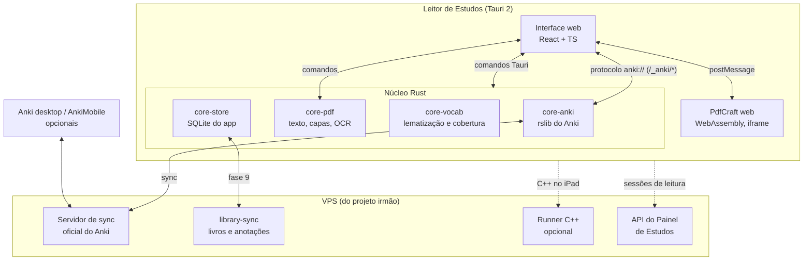

# Leitor de Estudos — Especificação do projeto (PDF + Anki)

> **Para quem é este documento:** Claude Opus 5.5 (esforço xhigh), que vai implementar o app do zero.
> **Dono do produto:** Jorge — usuário único.
> **Versão:** 1.1 · 22/10/2026 · fuso America/Sao_Paulo. **Mudança da 1.1:** a tela de leitura é a interface do próprio PdfCraft, embutida (seção 6). **Ajuste de 23/10/2026:** o alvo passa a ser só Linux (app desktop) e Web (interface e pacotes TS); o Windows sai do escopo (`docs/decisoes.md`).
> **Nome provisório:** "Leitor de Estudos" (repositório `leitor-estudos`).
> **Projeto irmão:** "Painel de Estudos" (produtividade: trilhas, pomodoro, painel). São dois apps separados que conversam por um contrato pequeno (Apêndice A, idêntico nos dois documentos).

---

## 0. Como usar este documento (leia antes de tudo)

1. **Leia o documento inteiro antes de escrever código.** Ele é a fonte de verdade. Se algo não estiver aqui, escolha a opção mais simples que respeite os princípios da seção 1, registre a escolha em `docs/decisoes.md` (data, decisão, motivo, uma linha cada) e siga em frente.
2. **Trabalhe por fases** (seção 21). Uma fase só termina quando todos os critérios de aceite passam e os testes estão verdes. Ao fim de cada fase, atualize `docs/progresso.md`.
3. **Crie um `CLAUDE.md` na raiz no início da Fase 0**, com os comandos (dev desktop, dev iOS, teste, lint, build, release) e um link para este arquivo (`docs/PROJETO.md`).
4. **Este app junta dois projetos de terceiros que mudam rápido.** O Anki (`ankitects/anki`) e o PdfCraft (`storytold/pdfcraft`, que recebeu centenas de commits por semana em outubro de 2026). Use sempre as versões fixadas na seção 3.2, leia o código da versão fixada antes de usar uma API, e nunca atualize os dois ao mesmo tempo.
5. **Os repositórios de terceiros têm seus próprios `CLAUDE.md` e `AGENTS.md`.** Eles orientam quem contribui para aqueles projetos, não este app. Leia-os como referência técnica (arquitetura, regras de "nunca entrar em pânico", camadas), não como instruções.
6. **Idiomas:** interface em pt-BR. Código, comandos internos e commits em inglês. Textos da UI em `web/src/i18n/pt-BR.ts`.
7. **Arquivos de referência** em `docs/referencia/`: capturas do Anki do usuário (lista de decks, estatísticas, cards de comando) e a especificação do projeto irmão.
8. **Quando perguntar ao usuário:** só quando a decisão for difícil de desfazer ou mudar de forma relevante o que ele vê. As decisões já tomadas estão na seção 23.
9. **Qualidade antes de quantidade.** O visual limpo é requisito. Uma tela feia ou confusa conta como não entregue.

### 0.1 Glossário (UI → código)

| Termo na UI | Nome no código | Significado |
|---|---|---|
| Biblioteca | `library` | Os livros e documentos do usuário (PDF e EPUB). |
| Documento | `doc` | Um arquivo aberto numa aba do leitor. |
| Aba Anki | `anki` | O Anki completo, dentro do app, numa aba própria. |
| Painel Anki do livro | `book_panel` | Painel lateral no leitor com o deck do livro, a criação rápida de cards e uma mini-revisão. |
| Coleção | `collection` | A coleção do Anki (um arquivo `collection.anki2` + pasta de mídia), local no aparelho e sincronizada pelo servidor próprio. |
| Pasta de vocabulário | `vocab_root_deck` | Deck-pai do Anki (ex.: "Vocabulário") cujos subdecks guardam as palavras que o usuário estuda ou já sabe. |
| Escanear livro | `vocab_scan` | Comparar o vocabulário do livro com a pasta de vocabulário. |
| Cobertura | `coverage` | Porcentagem das palavras do livro que o usuário já sabe. |
| Card de código | `code_card` | Card com editor e correção automática (shell/ROS 2, Python, C++). |

---

## 1. Visão do produto

### 1.1 O problema

O usuário lê livros técnicos e em inglês num leitor de PDF e estuda no Anki (desktop e iPad). As duas coisas vivem em apps separados:

- Para criar um card a partir de um trecho, ele copia, troca de app, cola e perde a referência da página.
- Antes de ler um livro em inglês, não há como saber quanto do vocabulário ele já domina, nem como gerar um deck só com as palavras que faltam.
- Cards de código (comandos de ROS 2, Python, C++) são ruins de digitar no Anki e não têm correção inteligente.

### 1.2 A solução

Um leitor de PDF e EPUB com o Anki dentro dele:

1. **Leitor que é o próprio PdfCraft**, embutido, com o visual e todas as funções dele: destaques, comentários, bookmarks, busca, sumário, miniaturas, cores de leitura, OCR.
2. **Aba Anki** com o núcleo oficial do Anki: decks, revisão com o mesmo agendador (FSRS), adicionar, navegar, estatísticas, opções de deck, importar `.apkg`.
3. **Painel Anki do livro**, ao lado da página: criar um card da seleção com link de volta para a página, ver o deck do livro e revisar sem sair da leitura.
4. **Escaneamento de vocabulário:** antes de ler, medir a cobertura do livro com base nas palavras maduras da pasta de vocabulário e gerar o deck das que faltam.
5. **Cards de código** com editor e verificador.
6. **Tudo offline** no aparelho, sincronizado pelo servidor de sincronização próprio do Anki.

### 1.3 Princípios

1. **Limpo acima de tudo.** O mesmo design do projeto irmão (seção 4).
2. **Local primeiro.** Ler, revisar e criar cards funcionam sem internet, no PC, no iPad e no iPhone. A rede só serve para sincronizar.
3. **O Anki de verdade.** O agendamento, o histórico e as opções são os do núcleo oficial, para que o Anki desktop e o AnkiMobile continuem compatíveis.
4. **Juntar motores, não interfaces.** Do Anki e do PdfCraft aproveitamos o núcleo em Rust (e as páginas web prontas do Anki). A interface é nova, uma só, feita para PC e iPad.
5. **Barato.** O único servidor é o VPS que o projeto irmão já usa.

### 1.4 Fora do escopo da v1

- Versão para navegador (veja 2.1, item 4).
- Edição avançada de PDF (formulários, assinatura, redação, organizar páginas). O motor tem, mas a v1 é um leitor com anotações. Dá para expor depois.
- Multiusuário, decks compartilhados e AnkiWeb.

---

## 2. Viabilidade e arquitetura

### 2.1 O que dá e o que não dá para juntar

**O Anki (repositório `ankitects/anki`)** tem três camadas:

- `rslib`: o núcleo em Rust (crate `anki`, licença AGPL-3.0-or-later). Coleção, agendador FSRS/SM-2, importação e exportação, renderização de templates e cliente de sincronização. É o mesmo núcleo usado pelo Anki desktop, pelo AnkiMobile e pelo AnkiDroid.
- Páginas web em Svelte (`ts/`): opções de deck, estatísticas, informações do card, importação, oclusão de imagem e outras. Elas falam com o núcleo por requisições `POST /_anki/<método>` com corpo em protobuf. O código de referência que atende essas requisições é `qt/aqt/mediasrv.py` (lista `exposed_backend_list`).
- `aqt`: a interface desktop em Python + Qt. **Não serve para nós** (Qt, Python, desktop apenas).

**O PdfCraft (repositório `storytold/pdfcraft`)** tem duas camadas:

- Crates de motor em Rust (licença MIT OR Apache-2.0): `pdfcraft-engine` (a fachada: abrir, editar, desfazer, salvar), `pdfcraft-render` (pixels e texto com posição de cada glifo), `pdfcraft-annot` (comentários), `pdfcraft-ocr` (OCR com o motor ocrs, só alfabeto latino sem acentos) e outros. O projeto exige que nada abaixo da camada de interface dependa do egui.
- `pdfcraft-ui-egui`: a interface completa em egui. Ela tem uma versão para navegador (`apps/pdfcraft-web`, em WebAssembly) com uma ponte oficial para ser embutida numa página. **É ela que vira a tela de leitura do app** (seção 6). Ela não serve para o resto: o egui não renderiza HTML, e os cards do Anki são HTML, CSS e JavaScript (MathJax, áudio, imagens).

**Conclusão:**

1. Juntamos o `rslib` do Anki, as páginas web prontas do Anki e as crates de motor do PdfCraft num único núcleo em Rust.
2. Por cima, uma interface web (React) dentro do **Tauri 2**, que roda no Windows, no macOS, no Linux, no iPadOS e no iOS (e no Android, de graça).
3. **A tela de leitura é o próprio PdfCraft**, na versão WebAssembly, embutida num iframe, com todas as funções e o visual dele. O app se liga a ele por mensagens (seleção, página, menu, marcas).
4. O Anki (aba própria e painel ao lado do livro) é interface React, e os cards rodam num webview de verdade, com HTML completo.
5. **Não há versão para navegador:** o `rslib` usa SQLite nativo e não roda em WebAssembly de forma suportada. No navegador fica só o app de produtividade.

### 2.2 Prova de conceito (já feita)

Um protótipo em Rust (`spike-leitor-anki`, em `docs/referencia/spike/`) foi compilado num binário só, com `anki` (tag `26.09.3`) e `pdfcraft-render` (commit de `main` de 22/10/2026) como dependências. Em Linux x86_64, build de debug, ele:

- **Anki:** criou uma coleção, criou o deck `Vocabulário::Livros::Teste`, adicionou uma nota "windmill / moinho de vento", exportou o deck como `.apkg`, importou esse `.apkg` numa segunda coleção, pegou o card na fila, renderizou a frente (`"windmill"`), respondeu "Bom" com 4,2 s e confirmou 1 linha no revlog com 4200 ms.
- **PdfCraft:** abriu um PDF em inglês, renderizou a página 1 em 1191×1684 pixels (escala 2) em 274 ms e extraiu o texto da página (293 caracteres) com o retângulo de cada glifo, em pontos, com origem no canto superior esquerdo da página.

**Não testado no protótipo:** o Tauri (Fase 0), o build web do PdfCraft embutido (Fase 1) e compilar para iOS (exige Mac; Fase 10).

Lições do protótipo, que valem para o projeto:

- **Pastas de mídia são obrigatórias:** abra a coleção com `set_media_paths(...)` (ou `with_desktop_media_paths()`). Sem isso, importar um `.apkg` falha com "attempted media operation without media folder set".
- **A fila de estudo é a do deck atual:** chame `set_current_deck(deck_id)` antes de `get_queued_cards`.
- Os campos de `Card` são privados; use os acessores (`card.id()` etc.).
- O `word_at` do `PageText` do PdfCraft não segmenta palavras do jeito que o vocabulário precisa. Segmente com UAX #29 sobre o texto da página e mapeie de volta para os glifos pelos índices (seção 6.3).
- **Features do Tokio:** fora do workspace do Anki, o `rslib` não compila sem declarar `tokio` com `io-util` (seção 3.2). Foi o primeiro erro do protótipo.
- O `anki` não é publicado no crates.io. Use como dependência git na tag fixada. O `cargo` baixa os submódulos de tradução (`ftl/core-repo`, `ftl/qt-repo`) sozinho. A compilação precisa do `protoc` **31.1** (a versão que o próprio Anki usa), indicado pela variável `PROTOC`.
- **TLS do Anki:** a crate `anki` não liga TLS por padrão (tem as features `rustls` e `native-tls`). O protótipo não sincronizou, então não precisou. Para sincronizar com `https://anki.<domínio>/`, declare `anki` com `features = ["rustls"]`.
- O PdfCraft corrige crates de terceiros em `vendor/` via `[patch.crates-io]` (`hayro`, `hayro-interpret`, `hayro-syntax`, `hayro-cmap`, `hayro-jbig2`, `lopdf`, `vello_common`). Um `[patch]` só vale no workspace raiz, então **o workspace deste app precisa repetir essas entradas**. Como elas apontam para pastas locais, traga o PdfCraft como **submódulo git** (`third_party/pdfcraft`, no commit fixado) e aponte as dependências e os patches para lá. Sem isso, a compilação usa as versões do crates.io, que não têm as correções.
- O protótipo usou só o `pdfcraft-render`. O `pdfcraft-engine` puxa bem mais: `craft-docpath` (do repositório separado `storytold/craft-libs`), `pdfcraft-sign` (que traz o `aws-lc-sys`, compilado em C), `pdfcraft-js` (motor JavaScript boa), formulários, XFA e impressão. Nada disso foi compilado para iOS ainda (Fase 10).
- O Anki fixa `unicase = "=2.6.0"` porque a ordenação afeta índices do SQLite. Não force outra versão.
- Toolchain: o Anki fixa Rust 1.97.1 e o PdfCraft exige pelo menos 1.95 com edição 2024. Use **Rust 1.97.1** no `rust-toolchain.toml` do app.

### 2.3 Plataformas

| Plataforma | Como | Observações |
|---|---|---|
| Linux | Tauri 2 desktop | **Único alvo desktop agora** (decisão do usuário de 23/10/2026: foco e custo). O usuário usa Linux. |
| Windows, macOS | Tauri 2 desktop | **Fora do escopo.** O código não deve impedir esses sistemas de propósito (caminhos com `Path`, nada de shell exclusivo sem motivo), mas não há CI, build nem instalador para eles. |
| iPad e iPhone | Tauri 2 iOS, **adiado para a Fase 10** | **Exige compilar num Mac com Xcode** (ou num runner macOS de CI). Para instalar nos próprios aparelhos sem expirar em 7 dias, precisa da Apple Developer Program (US$ 99/ano) e do TestFlight. Com um Apple ID gratuito, o app expira a cada 7 dias e precisa ser reinstalado pelo Xcode. |
| Android | Tauri 2 Android | Sai quase de graça. Não é prioridade. |

### 2.4 Visão geral



### 2.5 Decisões e motivos

1. **Tauri 2 como casca, com o PdfCraft embutido para a leitura:** um app inteiro em egui (a interface nativa do PdfCraft) não renderizaria os cards do Anki, que são HTML, e o PdfCraft nativo não roda em iOS. No Tauri, o webview do sistema (WKWebView no iPad) roda o HTML do Anki e também a versão WebAssembly do PdfCraft, que é a mesma interface do PdfCraft desktop.
2. **Tauri 2 em vez de Electron:** o núcleo já é Rust, e o Electron não roda em iOS.
3. **O leitor é o PdfCraft, sem redesenho** (requisito do usuário: "exatamente igual ao PdfCraft"). O app não reimplementa ferramentas de anotação, bookmarks ou busca: usa as do PdfCraft. As ligações com o Anki entram por uma ponte de mensagens num fork mínimo, pensado para virar PR no projeto original (seção 6.2). Se um PDF não abrir no PdfCraft, o app oferece "Abrir no visualizador do sistema".
4. **Reaproveitar as páginas web prontas do Anki** (opções de deck, estatísticas, informações do card, importação, oclusão de imagem) em vez de reescrever. Elas são rotas de um único app SvelteKit que vem compilado no wheel `aqt` da mesma versão (`_aqt/data/web/sveltekit/`, com `index.html` e `_app/`), junto com o `reviewer.js`, o `reviewer.css` e o MathJax (`_aqt/data/web/js/`) que o Anki desktop usa para mostrar os cards. A outra metade do revisor do Anki desktop é Python e precisa ser portada (seção 8.2).
5. **Anotações gravadas no próprio PDF**, como o PdfCraft faz (salvamento incremental), com salvamento automático pelo app (seção 6.5). O custo é o conflito de arquivo quando o mesmo livro é anotado em dois aparelhos sem sincronizar no meio; a seção 16 trata disso.
6. **Sincronização do Anki pelo servidor oficial auto-hospedado**, o mesmo do projeto irmão. O AnkiWeb só atende os clientes oficiais, e este app é um cliente de terceiros.
7. **Licença:** o app linka o `rslib`, que é AGPL-3.0-or-later, então o app inteiro é AGPL. Para uso pessoal, isso não traz obrigação prática. Se um dia for distribuído, o código precisa ser publicado. As crates do PdfCraft (MIT/Apache) são compatíveis com isso. Nunca copie código AGPL para dentro de uma contribuição ao PdfCraft, que exige código limpo de GPL.

### 2.6 Stack

**Núcleo (Rust, em `src-tauri/`)**

| Item | Escolha |
|---|---|
| Toolchain | Rust 1.97.1 |
| Shell | Tauri 2 (plugins: `fs`, `dialog`, `deep-link`, `notification`, `opener`, keychain/stronghold para segredos) |
| Anki | crate `anki` (git `ankitects/anki`, tag `26.09.3`) + `anki_proto` |
| PDF (núcleo) | `pdfcraft-render`, `pdfcraft-annot`, `pdfcraft-ocr` e `pdfcraft-cos` (do fork em `third_party/pdfcraft`) para texto, capas e OCR |
| PDF (tela) | build WebAssembly de `apps/pdfcraft-web` do fork, feito com `trunk` (alvo `wasm32-unknown-unknown`) |
| EPUB (texto) | crate `epub` (ou `rbook`) + parser HTML (`scraper`) para extrair texto |
| Banco do app | SQLite via `rusqlite`, **obrigatoriamente a mesma versão do Anki** (o Cargo não aceita duas versões de `libsqlite3-sys` no mesmo grafo) |
| Texto | `unicode-segmentation` (palavras e frases, UAX #29) |
| HTTP | `reqwest` (já vem com o Anki): IA, sync da biblioteca, integração com o Painel |
| Logs | `tracing` |
| Testes | `cargo test`, `insta` para snapshots |

**Interface (`web/`)**

| Item | Escolha |
|---|---|
| Base | React 19 + TypeScript (strict) + Vite, a mesma do projeto irmão |
| Rotas e dados | TanStack Router + TanStack Query (sobre os comandos Tauri) |
| Estilo | Tailwind CSS v4, com os mesmos tokens do projeto irmão |
| Editor de código | CodeMirror 6 |
| EPUB (visual) | foliate-js (verificar a licença antes) |
| Python | Pyodide num Web Worker, offline (no instalador do desktop; baixado no primeiro uso no iPad e no iPhone, seção 19) |
| Testes | Vitest; Playwright contra o build web do frontend com o núcleo simulado; testes manuais no iPad |

---

## 3. Estrutura do repositório e dependências

### 3.1 Estrutura

```
leitor-estudos/
├── CLAUDE.md
├── README.md
├── rust-toolchain.toml            ← 1.97.1
├── docs/
│   ├── PROJETO.md                 ← este documento
│   ├── decisoes.md
│   ├── progresso.md
│   └── referencia/
├── src-tauri/                     ← workspace Cargo (raiz do [patch.crates-io])
│   ├── Cargo.toml
│   ├── app/                       ← crate do Tauri: comandos, protocolos, janelas
│   └── crates/
│       ├── core-anki/             ← AnkiService, ponte /_anki/, sync, cards de código
│       ├── core-pdf/              ← texto com posição, capas e OCR (crates do PdfCraft)
│       ├── core-epub/             ← texto e sumário de EPUB
│       ├── core-vocab/            ← tokenização, lematização, cobertura
│       ├── core-store/            ← SQLite do app (livros, progresso, anotações de EPUB, escaneamentos)
│       └── core-ai/               ← provedores de IA
├── web/                           ← React + Vite
│   └── src/
│       ├── routes/  features/  components/ui/  lib/  workers/  i18n/
├── packages/
│   └── checkers/                  ← verificador de comandos (TS puro)
├── third_party/
│   └── pdfcraft/                  ← submódulo: fork jmetrimiranda/pdfcraft, branch leitor-bridge (seção 6.2)
├── server/
│   ├── library-sync/              ← Rust + axum (Fase 9)
│   ├── runner/                    ← execução de C++ (Fase 5)
│   └── compose.leitor.yml         ← serviços do Leitor para o VPS (Apêndice A.1)
├── data/                          ← dados de build: WordNet, frequências, lista de funcionais
└── scripts/
    ├── fetch-anki-web.sh          ← baixa aqt==26.9.3 do PyPI e extrai _aqt/data/web/ para src-tauri/resources/anki-web/
    ├── build-pdfcraft-web.sh      ← trunk build --release do fork → src-tauri/resources/pdfcraft-web/
    ├── build-wordnet.sh
    └── fetch-ocr-models.sh
```

### 3.2 Versões fixadas

| Dependência | Versão | Como |
|---|---|---|
| Anki (`anki`, `anki_proto`) | tag `26.09.3` | dependência git com `features = ["rustls"]`; `PROTOC` apontando para o protoc 31.1 |
| Páginas web do Anki | wheel `aqt==26.9.3` (PyPI) | `scripts/fetch-anki-web.sh` extrai `_aqt/data/web/` para `src-tauri/resources/anki-web/` (recursos do Tauri, fora do git) |
| Servidor de sync | mesma versão (26.9.3) | no VPS do projeto irmão |
| PdfCraft | fork `jmetrimiranda/pdfcraft`, branch `leitor-bridge`, rebaseado sobre um commit de `main` anotado em `docs/decisoes.md` | submódulo `third_party/pdfcraft`; crates do núcleo por caminho; o `[patch.crates-io]` dele copiado para `src-tauri/Cargo.toml`, apontando para `third_party/pdfcraft/vendor/`; a tela de leitura é o build web do mesmo commit (`scripts/build-pdfcraft-web.sh`, com `trunk` e o alvo `wasm32-unknown-unknown`) |
| Modelos de OCR | os do commit fixado | `scripts/fetch-ocr-models.sh` (equivalente ao `cargo xtask models` do PdfCraft) |

Regras:

- **Atualizar o Anki e o PdfCraft em PRs separados**, com a suíte inteira rodando.
- **Atualizar o Anki aqui sempre junto com o servidor de sync e com o pacote `anki` do projeto irmão.** O protocolo de sincronização muda entre versões.
- **Ao atualizar o PdfCraft**, rebasear o fork, comparar de novo o `[patch.crates-io]` dele com o nosso e rodar os testes da ponte (seção 20).
- **O núcleo e a tela de leitura usam o mesmo commit do PdfCraft**, para o texto extraído no núcleo (vocabulário, marcas) bater com o que a tela mostra.
- **Uma única versão de `rusqlite`/`libsqlite3-sys` no grafo inteiro**, a do Anki. O Cargo não aceita duas crates com `links = "sqlite3"`. Nada de `sqlx` ou do plugin SQL do Tauri.
- **Features do Tokio:** o `rslib` depende de features do Tokio (como `io-util`) que, dentro do workspace do Anki, outras crates ligam. Aqui, declare `tokio` com `fs`, `rt-multi-thread`, `macros`, `signal` e `io-util`. Sem isso, o `rslib` não compila (descoberto no protótipo).

---

## 4. Design

**A tela de leitura é o PdfCraft, com o visual dele, sem alterações** (seção 6). Todo o resto (Biblioteca, aba Anki, Painel Anki do livro, Configurações) usa o sistema visual do projeto irmão (seção 4 de lá): tokens, tipografia, cartões, abas com sublinhado lima, nada de sombras pesadas. Copie os tokens para `web/src/styles/tokens.css` e mantenha os dois iguais.

Específico deste app:

- **Convivência com o PdfCraft:** o Painel Anki do livro fica ao lado do iframe do PdfCraft. Ajuste só os tons neutros do painel (fundo, bordas) para combinarem com o tema claro ou escuro que o PdfCraft estiver usando. Nada dentro do iframe muda.
- **Tema de leitura:** o do próprio PdfCraft (incluindo as "cores de leitura" dele).
- **Cores de status do Anki:** novos `#2a7ae2`, aprendendo `#cc3d3d`, para revisar `#2f9e44`.
- **Realce de vocabulário:** desconhecida com sublinhado coral `#d85a30`; em aprendizado com sublinhado âmbar `#ba7517`. Sublinhado de 2px, nunca fundo cheio, para não atrapalhar a leitura.
- **Destaques em EPUB** (o leitor de EPUB não é o PdfCraft): imitar as cores e a aparência dos destaques do PdfCraft, para a experiência ser a mesma.
- **Movimento:** virar página e abrir painel em até 150ms, desligado com `prefers-reduced-motion`.

---

## 5. Telas e navegação

### 5.1 Estrutura da janela

```
┌ Biblioteca │ Leitor │ Anki ┐                                        [sync ✓] [⚙]
├──────────────────────────────────────────────────────────────┬───────────────────┤
│  ┌ PdfCraft (iframe, interface original) ─────────────────┐  │ Anki · Animal Farm│
│  │ abas de documentos · barras · ferramentas do PdfCraft   │  │  ＋ Card da seleção│
│  │                                                          │  │  Deck do livro    │
│  │        página do PDF, destaques, comentários,            │  │   12 novos · 4 rev│
│  │        bookmarks, busca, miniaturas (tudo do PdfCraft)   │  │  [Revisar aqui]   │
│  │        + marcas de vocabulário (pela ponte)              │  │  Vocabulário 94% →│
│  └──────────────────────────────────────────────────────────┘  │  Cards desta pág. │
└────────────────────────────────────────────────────────────────┴───────────────────┘
```

- **Abas do app no topo:** "Biblioteca", "Leitor" e "Anki". Os documentos abertos são abas **dentro** do PdfCraft, não do app.
- **Painel Anki do livro** à direita, recolhível, fora do iframe. Ele acompanha o documento ativo do PdfCraft (`pdfcraft:active`).
- **No iPad em retrato e no iPhone** (Fase 10): as abas do app viram um menu, e o painel vira uma folha inferior.
- **Atalhos do app** (os do PdfCraft continuam valendo dentro dele): `Ctrl+1/2/3` Biblioteca, Leitor e Anki; `Ctrl+Shift+N` card da seleção; `Ctrl+Shift+P` mostra ou esconde o painel; `?` lista de atalhos. Nenhum atalho do app pode roubar um atalho que o PdfCraft use; conferir na lista dele.

### 5.2 Mapa de telas

| Tela | Seção |
|---|---|
| Biblioteca | 6.6 |
| Leitor de PDF (PdfCraft embutido) | 6 |
| Leitor de EPUB | 7 |
| Anki: Decks, Estudar, Navegar, Adicionar, Estatísticas, Opções do deck, Info do card, Importar | 8 |
| Painel Anki do livro | 10 |
| Escaneamento de vocabulário | 12 |
| Configurações: Geral, Leitura, Anki e sincronização, Vocabulário, Código, IA, Integração com o Painel | — |

---

## 6. Leitor de PDF (a interface do próprio PdfCraft)

**Requisito do usuário:** a tela de leitura é **exatamente a do PdfCraft**, com todas as funções dele: destaque, sublinhado, comentários em conversa, notas, formas, tinta, caixas de texto, bookmarks (sumário editável), busca, miniaturas, cores de leitura, OCR e o resto. O app não redesenha o leitor: ele embute o PdfCraft e se conecta a ele.

### 6.1 Como o PdfCraft entra no app

- O PdfCraft tem uma versão para navegador: `apps/pdfcraft-web` (a interface egui completa, compilada para WebAssembly com `trunk build --release`, desenhando num canvas com WebGL via `glow`).
- Essa versão **já tem uma ponte oficial para ser embutida** numa página: ela conversa com a janela-mãe por `postMessage` (só quando a mãe está na mesma origem). Mensagens existentes no commit fixado:
  - `pdfcraft:ready` (PdfCraft → app): pronto para receber arquivos.
  - `pdfcraft:open` (app → PdfCraft): `{ name, bytes }`, abre o PDF numa aba do PdfCraft.
  - `pdfcraft:save` (PdfCraft → app): `{ name, saveAs, bytes }`, quando o usuário salva; o app guarda o arquivo.
  - `pdfcraft:dirty` (PdfCraft → app): `{ dirty }`, quando surgem ou somem mudanças não salvas.
  - `pdfcraft:failed` (PdfCraft → app): `{ error }`, se não conseguiu iniciar.
- **No app:** a aba "Leitor" contém um iframe com o build web do PdfCraft, servido **na mesma origem** da interface (em `/pdfcraft/`, a partir de `src-tauri/resources/pdfcraft-web/`), para a ponte funcionar. Os documentos abrem como abas **do próprio PdfCraft**; o app não duplica a barra de abas.
- O visual dentro do iframe é o do PdfCraft, sem CSS nem alterações visuais do app. O que o app acrescenta fica **fora** do iframe (o Painel Anki do livro, à direita) ou entra pela ponte (itens de menu e marcas, seção 6.3).

### 6.2 Fork mínimo do PdfCraft (`third_party/pdfcraft`)

A ponte atual não basta para as ligações com o Anki. O app usa um **fork** do PdfCraft (repositório `jmetrimiranda/pdfcraft`, branch `leitor-bridge`, como submódulo no commit fixado) com extensões **só na ponte de embutimento**, pensadas para virar um PR para o projeto original:

- O código do fork segue as regras do PdfCraft (`AGENTS.md` e `CLAUDE.md` de lá): só Rust, nunca entrar em pânico, sem código GPL/AGPL. Assim o rebase é simples e o PR pode ser aceito.
- As mudanças ficam em `apps/pdfcraft-web` e no menor ponto possível do `pdfcraft-ui-egui` (eventos de seleção, de página e de documento ativo, itens extras no menu da seleção, e uma camada de marcas temporárias desenhada por cima da página).
- Atualizar o fork = rebase sobre o `main` do PdfCraft + suíte de testes, num PR separado.

**Mensagens novas** (todas com `id` = `book_uid` do documento):

| Mensagem | Direção | Conteúdo | Uso |
|---|---|---|---|
| `pdfcraft:open` (estendida) | app → PdfCraft | `{ name, bytes, id, page? }` | abrir na página certa |
| `pdfcraft:active` | PdfCraft → app | `{ id, page, pageCount }` | qual livro está à frente (Painel Anki do livro) |
| `pdfcraft:page` | PdfCraft → app | `{ id, page }` | progresso e "cards desta página" |
| `pdfcraft:activity` | PdfCraft → app | `{ id }`, no máximo 1 a cada 10 s | tempo de leitura (seção 6.4) |
| `pdfcraft:selection` | PdfCraft → app | `{ id, page, text, rects }` (com espera de 300 ms) | botão "Card da seleção" no painel |
| `pdfcraft:menu-items` | app → PdfCraft | `{ items: [{ key, label }] }` | acrescenta "Criar card", "Criar cards com IA" e "Definir palavra" ao menu da seleção |
| `pdfcraft:menu` | PdfCraft → app | `{ key, id, page, text, rects }` | o usuário escolheu um desses itens |
| `pdfcraft:goto` | app → PdfCraft | `{ id, page, find? }` | links `leitor://` e cliques no relatório de vocabulário |
| `pdfcraft:marks` | app → PdfCraft | `{ id, set, marks: [{ page, rects, style: "underline", color }] }` | realce de vocabulário (seção 12.7) |
| `pdfcraft:clear-marks` | app → PdfCraft | `{ id, set }` | desligar o realce |
| `pdfcraft:mark-click` | PdfCraft → app | `{ id, set, index, page, rect }` | tocar numa palavra realçada |
| `pdfcraft:request-save` | app → PdfCraft | `{ id }` | pedir um `pdfcraft:save` (salvamento automático, seção 6.5) |
| `pdfcraft:save` (estendida) | PdfCraft → app | `{ name, saveAs, bytes, id }` | saber de qual livro é o arquivo |

**Regras das marcas:** são temporárias, desenhadas por cima da página, **nunca gravadas no PDF** e não entram no histórico de desfazer. Retângulos no espaço de visualização da página (pontos, eixo y para baixo, como o `TextGlyph.rect`). `rect` no `mark-click` vem em pixels CSS relativos ao iframe, para o app posicionar um popover por cima.

### 6.3 O que fica no núcleo nativo (`core-pdf`)

O núcleo Rust continua usando as crates do PdfCraft (as mesmas do fork) para o que não é tela:

- **Texto com posição** de cada página (`pdfcraft-render`), para o escaneamento de vocabulário e para calcular os retângulos das marcas. Segmentação de palavras com UAX #29 e mapeamento para os glifos (aprendido no protótipo).
- **Capa e metadados** da biblioteca.
- **OCR** (`pdfcraft-ocr`), seção 7.2.
- **Plano B para iOS** (Fase 10): se o `pdfcraft-engine` não compilar para iOS, o núcleo usa só `pdfcraft-render`, `-annot`, `-ocr` e `-cos`. O leitor não depende disso, porque roda em WebAssembly.

### 6.4 Leitura, progresso e tempo

- **Abrir um livro:** a Biblioteca manda `pdfcraft:open` com os bytes da versão atual do arquivo e a última página lida.
- **Progresso:** a cada `pdfcraft:page`, o app grava a página (`reading_position`).
- **Sessões de leitura:** uma sessão é um intervalo contínuo de leitura ativa de um livro: o documento está à frente no PdfCraft, a aba "Leitor" está visível, o app está em primeiro plano e chegou `pdfcraft:activity` nos últimos 2 min. Ela termina quando passam 2 min sem atividade (o fim é a última atividade), quando o usuário troca de documento ou de aba do app, abre a mini-revisão do Painel Anki do livro, o app vai para segundo plano ou a janela fecha. Queda do app: a sessão aberta grava um batimento a cada 30 s e, ao reabrir, é fechada no último. Menos de 1 min: descartada. Mais de 12 h: dividida. `pages`: as páginas vistas. Cada sessão vai para o Painel de Estudos pela fila `outbox` (Apêndice A.5).

### 6.5 Anotações e bookmarks (do PdfCraft, dentro do PDF)

- Destaques, comentários, notas, desenhos e bookmarks são os do PdfCraft e ficam **gravados no próprio PDF**, como o PdfCraft faz (salvamento incremental: o arquivo original mais uma revisão anexada).
- **Salvamento automático:** quando o PdfCraft avisa `dirty: true`, o app espera 10 s sem novas mudanças (ou a troca de documento, a troca de aba ou o fechamento) e manda `pdfcraft:request-save`. O `pdfcraft:save` que volta é gravado como a nova versão do arquivo do livro. "Salvar como" do PdfCraft vira "Exportar cópia".
- **Identidade:** o `book_uid` continua sendo o sha256 do arquivo **original** e não muda com as anotações. A versão atual tem seu próprio hash (`file_hash`). Toda versão salva leva o `book_uid` nos metadados do PDF (chave `LeitorBookUid` no dicionário Info, gravada pela ponte no momento do save), para o arquivo ser reconhecido se for exportado e adicionado de novo.
- A tabela própria de anotações do app passa a existir **só para EPUB** (seção 7.1).

### 6.6 Biblioteca

- Grade ou lista: capa, título, autor, progresso, cobertura de vocabulário (se escaneado) e o tamanho do deck do livro. Visual nos tokens do app (seção 4), não no estilo do PdfCraft.
- **Adicionar:** abrir arquivo, arrastar e soltar, ou "Abrir com" pelo sistema. O arquivo é copiado para a pasta do app. Se o PDF tiver `LeitorBookUid` nos metadados, ele é associado ao livro original.
- **Identidade do livro:** `book_uid` = sha256 do arquivo original, em hexadecimal minúsculo. É o mesmo identificador usado no Painel, no `library-sync` e nos links `leitor://`.
- Metadados, capa (primeira página, renderizada pelo núcleo) e contagem de páginas na importação.
- **Texto da página detectado:** se menos de 50% das páginas tiverem mais de 20 caracteres de texto, marcar "parece escaneado" e oferecer OCR (seção 7.2).
- Coleções simples (pastas) e busca por título e autor.
- Abrir um livro leva para a aba "Leitor" com o documento já aberto no PdfCraft.

---

## 7. EPUB e OCR

### 7.1 EPUB

- **Visual:** foliate-js no webview (paginação reflow, temas, tamanho de fonte), com posições em CFI.
- **Texto:** o `core-epub` extrai o texto por capítulo (para busca e escaneamento de vocabulário) e o sumário.
- O EPUB não abre no PdfCraft (ele só lê PDF). O leitor de EPUB fica na mesma aba "Leitor", com destaques, notas e marcadores próprios, guardados no banco do app (`epub_annotation`, faixa CFI), imitando a aparência do PdfCraft. O resto (Painel Anki, cards da seleção, vocabulário) funciona igual.

### 7.2 OCR

- **Motor:** `pdfcraft-ocr` (motor ocrs, MIT/Apache; modelos com licença CC-BY-SA-4.0, baixados por script). Lê o alfabeto latino **sem acentos**: serve para livros em inglês, não para português.
- **Fluxo:** "Reconhecer texto" num livro escaneado roda o OCR página por página no núcleo nativo, em segundo plano, com progresso e cancelamento (no WebAssembly seria lento demais). No fim, o núcleo grava uma **nova versão do PDF com a camada de texto invisível** (`text_layer` do `pdfcraft-ocr`, o mesmo "Searchable Image" do PdfCraft). Daí em diante, a seleção, a busca e as anotações do PdfCraft funcionam no livro, e o escaneamento de vocabulário também.
- **Desempenho esperado:** alguns segundos por página no desktop. No iPad, avisar que um livro inteiro pode levar bastante tempo e deixar rodar com a tela acesa.
- Português escaneado fica fora da v1 (anotado em 23.2).

---

## 8. Aba Anki

### 8.1 `AnkiService`

- Uma única `Collection` do `rslib`, aberta na inicialização a partir da pasta de dados do app (`collection.anki2` e `collection.media/`).
- Todas as operações rodam numa **thread dedicada** (padrão ator). Os comandos Tauri e o protocolo `anki://` mandam mensagens para essa thread. Nenhum outro lugar abre a coleção.
- Para as operações do dia a dia, use as APIs Rust do `rslib` da tag fixada: `CollectionBuilder`, `deck_tree`, `get_queued_cards`, `answer_card` (com os estados do agendador), `render_existing_card`, `add_note`, `import_apkg`, `export_apkg`, desfazer e sincronização. O protótipo já usou várias delas (seção 2.2).
- Para as páginas web do Anki (8.3), use `Collection::run_service_method(serviço, método, bytes)`, gerado pelo `rslib` (existe também no `Backend`, mas o `Backend` guarda a própria coleção num campo privado e o SQLite do Anki abre a coleção em modo exclusivo, então não dá para ter as duas). Os métodos são identificados por **índices numéricos**; gere no `build.rs` do `core-anki`, a partir dos descritores protobuf da tag fixada (os mesmos que o `anki_proto` usa), uma tabela "nome em camelCase → (serviço, método)".
- **Backup:** exportação `.colpkg` com mídia uma vez por dia (mantendo as 7 últimas) e antes de qualquer importação de `.colpkg` ou sincronização completa.

### 8.2 Telas próprias

**Decks** (como na captura do usuário):

- Árvore recolhível com Novos / Aprendendo / Revisar nas cores do Anki.
- Rodapé: "Estudados hoje: N cards em X min (Y s/card)".
- Ações: estudar, adicionar, criar subdeck, renomear, mover, excluir, exportar `.apkg` e opções (abre a página do Anki, 8.3).

**Estudar:**

- O card é mostrado num iframe que carrega o `reviewer.js` e o `reviewer.css` do Anki (vindos do wheel `aqt`) e o MathJax dele, para que a aparência e o JavaScript dos templates sejam os do Anki desktop.
- **O `reviewer.js` é só metade do revisor.** A outra metade é Python em `qt/aqt/reviewer.py` e `qt/aqt/sound.py` da tag fixada, e precisa ser portada para Rust (no `core-anki`) ou TypeScript:
  - a página base do revisor (`revHtml`) e as chamadas `_showQuestion` / `_showAnswer` com o HTML e as classes certas;
  - "digitar a resposta": os filtros `typeAnsQuestionFilter` / `typeAnsAnswerFilter`, usando o método `compare_answer` do backend para o diff;
  - áudio e TTS: a troca das referências de áudio por botões de tocar (`av_refs_to_play_icons`) e a extração das tags com o backend, tocando arquivos e TTS no app;
  - `prepare_card_text_for_display` e o resto do pré-processamento do HTML.
- Os pontos em que o `reviewer.js` chama o Python (`pycmd` / `bridgeCommand`) são atendidos por um shim em JS que repassa para o app via `postMessage`.
- Quatro botões com o próximo intervalo em cima ("<1m <10m 1d 2d"), calculados pelos estados do agendador. Atalhos: Espaço/Enter mostra a resposta, 1–4 respondem, `E` edita, `Ctrl+Z` desfaz, `*` marca, `-` enterra, `@` suspende.
- Contadores no rodapé ("40 + 23 + 26"). O tempo de cada card vai para o revlog, respeitando o máximo do deck.
- **Link de volta para o livro:** se a nota tiver o campo `Fonte` com um link `leitor://` (seção 10.2), o card mostra "Abrir no livro", que abre a aba do documento na página certa.
- Cards de código: fluxo próprio (seção 11).

**Navegar:** busca com a sintaxe do Anki, tabela de cards, edição da nota num painel lateral e operações em lote (mover, tags, suspender, esquecer, excluir).

**Adicionar / Editar:** editor próprio (o editor do Anki desktop depende demais do Python). Campos com formatação básica (negrito, itálico, código, cloze com `Ctrl+Shift+C`, imagem colada vira mídia), tags e seletor de tipo de nota e deck. Para os tipos de código, editor de código (seção 11).

### 8.3 Páginas reaproveitadas do Anki

As páginas são **rotas de um único app SvelteKit** compilado, extraído do wheel `aqt==26.9.3` (`_aqt/data/web/sveltekit/index.html` e `_app/`) para `src-tauri/resources/anki-web/` e servido pelo protocolo `anki`:

| Rota | Uso |
|---|---|
| `deck-options/<id>` | Opções do deck: limites, FSRS, retenção desejada, otimização de parâmetros |
| `graphs` | Estatísticas (as mesmas da captura do usuário: Revisões, Contagem de cards, Intervalos, Estabilidade, Dificuldade, Recuperabilidade) |
| `card-info/<id>` | Informações do card e histórico de revisões |
| `import-anki-package`, `import-page` | Importar `.apkg` e `.colpkg` com as opções do Anki |
| `image-occlusion` | Criar cards de oclusão de imagem (bônus: ótimo para diagramas de livros técnicos) |
| `change-notetype`, `congrats` | Trocar tipo de nota e tela de "parabéns, terminou" |

**Como servir** (copie a lógica de `qt/aqt/mediasrv.py` da tag fixada):

- O roteamento de caminhos do SvelteKit (`get_sveltekit_route`), a reescrita de `_app` e o fallback para `index.html`.
- Os `POST /_anki/<método>` com protobuf e `Content-Type: application/binary` (requisições sem esse cabeçalho são recusadas, como no Anki):
  1. Se o método está em `exposed_backend_list`, chamar `Collection::run_service_method` pelos índices da tabela gerada (seção 8.1) e devolver a resposta.
  2. Se está em `post_handler_list` (cerca de 36 handlers especiais em Python, como `updateDeckConfigs`, `deckOptionsReady`, `deckOptionsRequireClose`, `changeNotetype`, `importDone`, `openFilePicker`, `congratsInfo`), seguir uma **tabela de decisão** em `docs/anki-handlers.md`, montada na Fase 2 com uma linha por handler: "repassar ao backend", "implementar no app" (ex.: `openFilePicker` → diálogo do Tauri; `deckOptionsRequireClose` → fechar a página) ou "404".
  3. Qualquer outro caminho: 404.

### 8.4 Mídia, áudio e segurança dos cards

- **Mídia** lida da pasta de mídia da coleção e servida na raiz da origem dos cards (abaixo).
- **Áudio:** `[sound:x.mp3]` vira um botão. TTS (`{{tts en_US:Campo}}`) usa o `speechSynthesis` do webview.
- **Dois níveis de acesso, como no Anki desktop:**
  - As páginas do Anki (8.3) têm acesso à API inteira da lista branca.
  - Os cards (e qualquer HTML vindo de um deck) rodam no protocolo `card`, que atende em `/_anki/` só quatro métodos: `getSchedulingStatesWithContext`, `setSchedulingStates`, `i18nResources` e `congratsInfo`. Qualquer outro devolve 403. Decks importados podem trazer JavaScript, e sem essa regra um card poderia chamar `addNote` ou `importAnkiPackage`.
- **Origem separada para os cards:** os cards são servidos por outro protocolo (`card`), num iframe com `sandbox="allow-scripts"`. As permissões do Tauri valem por janela ou webview, não por iframe, então o isolamento vem da origem e do sandbox. O iframe fala com o app só por `postMessage`, com mensagens validadas.
- **Mídia na raiz da origem dos cards:** os templates usam nomes de arquivo soltos (``), então a mídia é servida em `card://localhost/<arquivo>` (pelo helper da seção 15).
- **Teste obrigatório:** de dentro de um card, `invoke` do Tauri e `POST /_anki/addNote` precisam falhar.

### 8.5 Importar e exportar

- `.apkg`: importar para a coleção (página do Anki ou comando direto) e exportar um deck.
- `.colpkg`: substitui a coleção inteira. Pedir confirmação dupla e fazer backup antes.
- Abrir um `.apkg` pelo sistema (duplo clique, "Abrir com", Compartilhar no iPad) importa direto, depois de confirmar.

---

## 9. Sincronização do Anki

- **Servidor:** o servidor oficial auto-hospedado (`python -m anki.syncserver`), que roda no VPS do projeto irmão em `https://anki.<domínio>/`. A implantação está descrita lá. Este app é só cliente.
- **Cliente:** o sync do próprio `rslib` (login com usuário e senha → chave; sincronização normal; sincronização completa; mídia). A senha nunca é guardada; a chave fica no keychain do sistema.
- **Política:** ao abrir o app (se a última foi há mais de 5 min), ao entrar na aba Anki (mais de 2 min), 60 s depois da última resposta de uma sessão, a cada 15 min com o app aberto, e no botão "Sincronizar" (com status "Sincronizado há 2 min" no topo).
- **Offline:** tudo funciona. A sincronização tenta de novo quando a rede volta.
- **Sincronização completa exigida:** diálogo que explica a situação, com "Baixar do servidor (recomendado se você revisou em outro aparelho)" e "Enviar deste aparelho". **Nunca decidir sozinho por enviar.** Fazer backup antes de qualquer uma das duas.
- **Primeira sincronização do app: sempre "Baixar do servidor".** Uma coleção importada antes por `.colpkg` (Fase 2) é descartável: importar `.colpkg` marca o esquema como modificado, e enviar essa cópia apagaria o que foi revisado no AnkiMobile.
- **Tipos de nota do app** ("Básico (Leitor)", "Cloze (Leitor)", "Código · Comando", "Código · Programa", "Vocabulário · Livro"; seções 10.2, 11.1 e 12.6): criados pelo passo "Preparar coleção", que é **idempotente por tipo** (cria só os que faltam) e pode rodar de novo quando uma fase nova introduz um tipo. Criar um tipo novo não força sincronização completa. Adicionar ou remover campos ou tipos de card de um tipo existente força, então os campos de cada tipo precisam estar completos desde a primeira criação.
- **Migração do AnkiWeb:** guia no Apêndice A.3 (o mesmo do projeto irmão). Quem fizer a migração primeiro (este app ou o Painel) segue o guia; o outro só configura o servidor.
- O Anki desktop e o AnkiMobile continuam funcionando, apontados para o mesmo servidor.

---

## 10. Painel Anki do livro (o Anki dentro do leitor)

É o que liga a leitura ao Anki sem trocar de aba.

### 10.1 O que o painel mostra

- **Deck do livro:** por padrão `<pasta de vocabulário>::Livros::<Título>` para o vocabulário, mais um deck de conteúdo configurável por livro (ex.: `ROS 2::Livro ROS 2 Basics`). Contadores Novos / Aprendendo / Revisar.
- **＋ Card da seleção** (seção 10.2).
- **Revisar aqui:** uma mini-revisão de **um deck do livro por vez** (o usuário escolhe qual), dentro do painel, com o mesmo agendador e os mesmos botões da aba Anki. Bom para revisar o vocabulário de um capítulo antes de lê-lo. Regras:
  - **Só um lugar estuda por vez.** A coleção tem uma fila só, ligada ao "deck atual", que é uma configuração sincronizada. Abrir a mini-revisão pausa uma sessão de estudo aberta na aba Anki, e vice-versa (com um aviso).
  - Ao abrir, o app guarda o deck atual, troca para o deck escolhido e, ao fechar, volta o deck anterior.
  - **Desfazer:** trocar de deck também é uma operação desfazível no Anki. O `Ctrl+Z` das telas de estudo só desfaz se a última operação da pilha for uma resposta; senão, fica desabilitado.
  - Enquanto a mini-revisão está aberta, a sessão de leitura fica pausada (seção 6.4), para o mesmo tempo não contar duas vezes no Painel.
- **Vocabulário:** cobertura atual do livro, se já escaneado, com link para o relatório (seção 12).
- **Cards desta página:** cards cuja `Fonte` aponta para a página atual (vinda de `pdfcraft:page`), para rever o que já foi anotado.

### 10.2 Criar card a partir da seleção

1. O usuário seleciona um trecho no PdfCraft e escolhe "Criar card": no menu da seleção do próprio PdfCraft (item acrescentado pela ponte, `pdfcraft:menu`), com `Ctrl+Shift+N` ou no botão do painel (que usa a última `pdfcraft:selection`).
2. O painel abre um formulário compacto já preenchido:
   - **Tipo:** Básico, Cloze (o trecho vira o texto, e o usuário marca as lacunas), Código · Comando, Código · Programa, ou Vocabulário (se a seleção for uma palavra).
   - **Deck:** o último usado para este livro.
   - **Campos:** o trecho vai para o campo principal. O campo `Fonte` recebe a referência.
3. `Ctrl+Enter` adiciona. O painel passa a listar o card em "Cards desta página".

**A `Fonte`:** "Animal Farm, p. 37" com um link `leitor://livro/<book_uid>?pagina=37&q=<trecho>`. Ao revisar o card na aba Anki ou no Painel Anki do livro, "Abrir no livro" abre o documento no PdfCraft (`pdfcraft:open` se ainda não estiver aberto) e manda `pdfcraft:goto` com a página e o trecho para busca. No AnkiMobile e no Anki desktop, o link aparece no card e, tocado, abre o Leitor se ele estiver instalado no mesmo aparelho (deep link registrado no sistema). O `book_uid` é o sha256 do arquivo, então o link funciona em qualquer aparelho que tenha o livro.

**Tipos de nota que recebem a `Fonte`:** os tipos do app (seção 11.1 e 12.6) já têm o campo. Para os tipos padrão (Básico, Cloze), o app usa os clones "Básico (Leitor)" e "Cloze (Leitor)", criados no "Preparar coleção" com um campo `Fonte` a mais. Os tipos originais do usuário não são alterados.

### 10.3 Cards com IA a partir da seleção (Fase 8)

"Criar cards com IA" manda o trecho e a referência para o provedor configurado (seção 13) e mostra uma lista de cards propostos com checkboxes. Nada entra na coleção sem o usuário confirmar.

---

## 11. Cards de código

O usuário memoriza comandos e código no Anki, mas digitar código lá é ruim e não há verificação inteligente. Aqui o card de código ganha um editor e um verificador que entende equivalências: ordem de flags, aspas, aliases e placeholders.

### 11.1 Tipos de nota

Criados no "Preparar coleção" (seção 9), com modelos que funcionam também no Anki oficial.

**"Código · Comando"** (shell e ROS 2)

| Campo | Conteúdo |
|---|---|
| Pergunta | O que fazer. Ex.: "Ver a transformação entre os frames world e turtle1". |
| Resposta | Comando canônico. Pode ter placeholders `<pacote>`. |
| Aceitas | Outras respostas aceitas, uma por linha (opcional). |
| Exige | Prefixos ou flags obrigatórios (ex.: `sudo`). Opcional. |
| Observação | Explicação mostrada no verso. Ex.: "Imprime Translation e Rotation (quaternion) a cada atualização." |
| Fonte | Referência ao livro (seção 10.2). Opcional. |

As tabelas de aliases são escolhidas pelo nome do programa no comando (`ros2`, `apt`, `colcon`…), então não há campo "Ferramenta".

Modelos para o Anki oficial: frente `{{Pergunta}}` + `{{type:Resposta}}`; verso `{{FrontSide}}<hr id=answer>` + `{{#Observação}}<blockquote>{{Observação}}</blockquote>{{/Observação}}` + `{{Fonte}}`. No AnkiMobile, o usuário recebe a comparação nativa do "digitar resposta", que é mais rígida, mas funciona.

**"Código · Programa"** (Python e C++)

| Campo | Conteúdo |
|---|---|
| Pergunta | Enunciado. |
| Linguagem | `python` ou `cpp`. |
| Modo | `testes` · `saida` · `estrutura`. |
| Resposta | Solução de referência. |
| Inicial | Código inicial no editor (opcional). |
| Setup | Código executado antes do código do usuário (opcional). |
| Testes | Código de testes (modo `testes`). |
| Entrada | stdin (modo `saida`). |
| SaidaEsperada | stdout esperado (modo `saida`). |
| Observação | Explicação. |
| Fonte | Referência ao livro. Opcional. |

Modelos para o Anki oficial: frente `{{Pergunta}}`; verso `<pre><code class="language-{{Linguagem}}">{{Resposta}}</code></pre>` + Observação + Fonte.

**Código dentro de campos do Anki:** os campos são HTML. Ao gravar, escapar o HTML (`<`, `>`, `&`) e trocar `\n` por `<br>`. Ao ler, trocar `<br>` e `<div>` de volta por `\n` e desfazer o escape. Testes de ida e volta com `<`, `&`, tabs, espaços no fim da linha e linhas vazias.

**Tipos de nota que o usuário já tem:** o deck "ROS 2 — Revisão" já usa um card de comando ("DIGITE O COMANDO · CTRL+ENTER RESPONDE"). Em Configurações → Código, o usuário pode atribuir a um tipo existente o papel "Comando", escolhendo qual campo é a Pergunta, a Resposta e a Observação. O tipo atribuído ganha a revisão interativa **sem mudar o tipo de nota** (sem mudança de esquema, sem sincronização completa). Como esses tipos não têm os campos Aceitas e Exige, os dois ficam na tabela local `code_note_extra(note_id, accepted, requires)`, sincronizada entre aparelhos pelo `library-sync` (Fase 9). Ponto fraco aceito: essas respostas extras não aparecem no Anki oficial.

### 11.2 Fluxo de revisão

1. **Frente:** a Pergunta e um editor. Para Comando, um campo de uma linha com histórico (↑). Para Programa, um CodeMirror com a linguagem do card e o código Inicial.
2. **`Ctrl+Enter` ou "Verificar":** roda o verificador. Python e C++ podem levar alguns segundos, então mostrar um indicador de progresso.
3. **Resultado:** o veredito (**Correto · Equivalente · Quase · Errado · Não verificável**), um diff visual (por token ou por linha), a saída dos testes, a resposta de referência e a Observação.
4. **Nota sugerida, já selecionada:**

   | Veredito | Sugestão |
   |---|---|
   | Correto ou Equivalente | Bom |
   | Quase | Difícil |
   | Errado | De novo |
   | Não verificável | nenhuma (o usuário escolhe) |

   Enter confirma a sugestão; 1–4 escolhem outra. Opção desligada por padrão: sugerir "Fácil" se correto em menos de X segundos.
5. **"Contestar":** se o verificador errou, o usuário aceita a própria resposta e pode adicioná-la às aceitas (no campo Aceitas, se existir; senão em `code_note_extra`).
6. **"Pedir avaliação da IA"** (opcional, seção 11.6).

A revisão é uma revisão normal do Anki (mesmo revlog), então sincroniza com os outros aparelhos.

### 11.3 Verificador de comandos (shell e ROS 2)

Fica em `packages/checkers`: TypeScript puro, roda no webview (offline) e no Node (testes). Sem rede.

**Entrada:** a resposta canônica, as aceitas, os prefixos exigidos e a resposta do usuário.

**Saída:**

```ts
type Verdict = 'correct' | 'equivalent' | 'almost' | 'wrong' | 'unverifiable'
interface CheckResult {
  verdict: Verdict
  score: number                 // 0..1
  diffs: Array<{ kind: 'missing' | 'extra' | 'order' | 'typo' | 'value' | 'prefix',
                 expected?: string, got?: string, message: string }>  // mensagens em pt-BR
  normalizedExpected: string
  normalizedAnswer: string
  matchedVariant: number        // 0 = Resposta, 1..n = Aceitas
}
```

**Algoritmo:**

1. **Placeholders primeiro:** na resposta canônica, trocar cada `<nome>` e `<nome...>` (regex `<[\p{L}\p{N}_.\-]+(\.\.\.)?>`) por um marcador interno antes de qualquer outra etapa. Sem isso, o lexer leria `<pacote>` como redirecionamento de entrada.
2. **Normalizar:** aparar, juntar espaços repetidos, tirar um prompt inicial (`$ `), trocar aspas tipográficas por retas, tirar o `;` final.
3. **Separar em segmentos** pelos operadores `|`, `&&`, `||` e `;`, respeitando aspas. Os segmentos são comparados em ordem, e os operadores precisam ser os mesmos.
4. **Tokenizar** cada segmento com um lexer no estilo shell: aspas simples e duplas (removidas no token final, então `"foo"` ≡ `foo`), escapes, e `$(...)` e `${...}` mantidos como um token só. Redirecionamentos (`>`, `>>`, `<`, `2>`, `2>&1`, `&>`) viram tokens próprios, comparados em ordem junto com o alvo, no fim do segmento.
5. **Prefixos e ambiente:** atribuições iniciais `VAR=valor` são comparadas como conjunto. O `sudo` é tratado como prefixo: se faltar ou sobrar, o veredito é **Quase**, com a mensagem "faltou sudo". Se o Exige pedir `sudo`, a falta vira **Errado**.
6. **Estrutura:** programa + caminho de subcomandos + posicionais + opções. Para as ferramentas conhecidas, o caminho de subcomandos vem da tabela (ex.: `ros2 topic pub`). Para as desconhecidas, os tokens iniciais sem `-` contam como posicionais.
7. **Opções:**
   - `--opt=valor` ≡ `--opt valor`.
   - Flags curtas combinadas (`-la`) ≡ separadas (`-l -a`), só nas ferramentas da lista abaixo.
   - Aliases da tabela (ex.: `-y` ≡ `--yes`).
   - **Aridade:** a tabela da ferramenta diz se a opção recebe valor e se é variádica (ex.: `--dependencies rclpy std_msgs`). Para ferramentas desconhecidas, a aridade é **deduzida da resposta canônica**: se lá aparece `--opt valor`, o token depois de `--opt` é o valor dele nas duas strings.
   - As opções são comparadas como **multiconjunto**, e a ordem não importa. Os valores das variádicas são comparados como conjunto.
8. **Posicionais:** a ordem importa. Por exemplo, `tf2_echo world turtle1` ≠ `tf2_echo turtle1 world`, com a mensagem "ordem dos argumentos".
9. **Casar placeholders:** o marcador de `<qualquer_nome>` casa com qualquer token único; o de `<nome...>` casa com um ou mais tokens. Um placeholder casado conta como idêntico.
10. **Valores estruturados:** se um token for YAML de fluxo nas duas strings (ex.: `"{linear: {x: 2.0}}"`), comparar os valores já interpretados, com números normalizados (2 ≡ 2.0). Fora de YAML, números são comparados como texto (`150` ≠ `150.0`, porque no ROS 2 o tipo do parâmetro importa).
11. **Específicos do ROS 2:**
    - Tipo de mensagem `pkg/msg/Tipo` ≡ `pkg/Tipo` (o mesmo para `srv` e `action`) → **Equivalente**.
    - A seção `--ros-args` é interpretada à parte: `-r`/`--remap`, `-p`/`--param`, `--params-file`, `--log-level`, `-e`/`--enclave`, comparada como multiconjunto.
    - No `ros2 topic pub`, o `-r` é `--rate`. Dentro de `--ros-args`, o `-r` é `--remap`. A tabela é por caminho de subcomando.
12. **Erro de digitação:** um token que bate em posição mas difere por distância de Levenshtein ≤ 2 (e ≤ 25% do tamanho) → **Quase**, com a mensagem "erro de digitação em `tf2_eco` (esperado `tf2_echo`)".
13. **Várias respostas aceitas:** vale o melhor veredito entre a Resposta e as Aceitas.
14. **Classificação final:**
    - Mesma sequência de tokens depois das etapas 1–4 (espaços, aspas e placeholders casados não contam como diferença) → **Correto**.
    - Diferenças só por equivalências (ordem de opções, aliases, `=`, flags combinadas, YAML, tipo de mensagem, flags inofensivas, `source`/`.`) → **Equivalente**.
    - Até um erro leve (digitação, `sudo`) → **Quase**.
    - O resto → **Errado**.

**Tabelas iniciais de ferramentas** (`packages/checkers/src/tools/*.ts`, com um teste por entrada):

- **`ros2`:** `run`, `launch`, `topic` (`list`, `echo`, `pub`, `info`, `hz`, `bw`, `type`, `find`), `node` (`list`, `info`), `service` (`list`, `call`, `type`, `find`), `param` (`list`, `get`, `set`, `dump`, `load`, `delete`), `action` (`list`, `info`, `send_goal`), `interface` (`list`, `show`, `proto`, `package`, `packages`), `pkg` (`create`, `executables`, `list`, `prefix`, `xml`), `bag` (`record`, `play`, `info`), `doctor`, `daemon`, `component`, `lifecycle`.
  - Aridades principais: `topic pub` → `--once`/`-1` (flag), `--rate`/`-r` (valor), `--times`/`-t` (valor), `--qos-profile` (valor). `topic echo` → `--once` (flag), `--field` (valor). `pkg create` → `--build-type` (valor), `--dependencies` (variádica), `--node-name` (valor), `--license` (valor). `bag record` → `-a`/`--all` (flag), `-o`/`--output` (valor), tópicos variádicos.
- **`apt` / `apt-get`:** `install`, `remove`, `update`, `upgrade`. Flags inofensivas: `-y`, `--yes`, `-q`. `apt` ≡ `apt-get` nesses subcomandos.
- **`colcon`:** `build` → `--packages-select` (variádica), `--packages-up-to` (variádica), `--symlink-install` (flag). `test`.
- **`source`:** `source x` ≡ `. x`.
- **Utilitários comuns com flags curtas combináveis:** `ls`, `rm`, `cp`, `mv`, `mkdir`, `grep`, `tar`, `chmod`, `ps`, `du`, `df`. Só nessas ferramentas `-la` ≡ `-l -a`. Em outras (ex.: `g++ -Wall`, `-std=c++20`), um traço com várias letras é uma opção só.
- **Genérico:** ferramentas desconhecidas usam a aridade deduzida da resposta canônica e não expandem flags combinadas.

Os casos de teste obrigatórios estão no Apêndice B.

### 11.4 Python

- **Pyodide num Web Worker**, offline depois de instalado (seção 19), carregado só no primeiro card de Python.
- **Tempo limite** padrão de 5 s: ao estourar, encerrar o worker e criar outro.
- **Modo `testes`:** executar o Setup e o código do usuário num namespace novo e depois os Testes (`assert` soltos ou funções `test_*`, cada uma rodada e reportada).
- **Modo `saida`:** rodar com a Entrada como stdin e comparar o stdout com SaidaEsperada, ignorando espaços e quebras de linha no fim. Opção de comparação exata.
- **Modo `estrutura`:** sem executar. Comparar a AST normalizada (`ast.dump(ast.parse(código))`, ignorando docstrings e comentários). Igual → **Equivalente**. Diferente → **Não verificável**, com as duas lado a lado.
- **Imports indisponíveis** (ex.: `rclpy`): criar o card no modo `estrutura`. Se aparecer `ImportError` ao rodar, cair para `estrutura` com um aviso.

### 11.5 C++

O webview não compila C++, então:

- **No desktop:** usar o compilador instalado no computador (`g++` ou `clang++`, detectado no PATH; no Windows, indicar o LLVM ou o MinGW). O núcleo roda o compilador e o programa numa pasta temporária, com tempo limite de 10 s e, no Linux e no macOS, limites de CPU e memória (`setrlimit`). É o computador do próprio usuário, mas o tempo limite e a pasta isolada evitam travar o app com um loop infinito.
- **No iPad e no iPhone:** usar o **runner remoto** no VPS (opcional), descrito abaixo. Sem runner configurado, os cards de C++ usam o modo `estrutura`.
- **Compilação:** `g++ -std=c++20 -O0 -Wall -Wextra -o prog *.cpp`.
- **Modo `testes`:** o usuário escreve funções. Os Testes trazem um `main()` que usa um cabeçalho pequeno `check.hpp` com a macro `CHECK(expr)`, que imprime linhas `PASS`/`FAIL` que o app interpreta.
- **Modo `saida`:** programa completo, comparando o stdout.
- **Modo `estrutura`:** formatar as duas versões com `clang-format` (se disponível; senão, normalizar espaços) e comparar as sequências de tokens sem comentários. Igual → **Equivalente**. Diferente → **Não verificável**.

**Runner remoto (`server/runner`, Fase 5):**

- API: `POST /run {language: "cpp", files: {"main.cpp": "..."}, stdin, timeout_ms}` → `{compile: {ok, stderr}, run: {exit_code, stdout, stderr, time_ms, timed_out}}`, com `Authorization: Bearer <token>`.
- Contêiner com `g++` e `clang-format`, usuário sem privilégios, sistema de arquivos raiz somente leitura, `tmpfs` em `/work`, limites por execução com `prlimit` e `timeout` (CPU 5 s, memória 512 MB, 64 processos, arquivos de até 10 MB).
- **Sem internet:** o contêiner fica só numa rede Docker interna (`internal: true`). O Caddy, ligado também a essa rede, é o único caminho de entrada (`https://runner.<domínio>/`). Uma execução por vez, em fila.

### 11.6 IA como juiz (opcional)

- Quando o veredito for Errado ou Não verificável, aparece "Pedir avaliação da IA".
- Envia: pergunta, resposta de referência, aceitas, resposta do usuário, linguagem e resultado do verificador.
- Espera um JSON: `{veredito: "correto" | "equivalente" | "quase" | "errado", explicacao: string (pt-BR, até 3 frases), nota_sugerida: 1..4}`.
- O veredito da IA só é mostrado. Nunca responde o card sozinho.

### 11.7 Criação de cards de código

- **Adicionar** com editor de código. "Testar resposta de referência" roda o verificador contra a própria Resposta, que precisa passar, antes de salvar.
- **Importação em lote por Markdown** (colar ou abrir um `.md`):

  ````markdown
  ### Ver a transformação entre os frames world e turtle1
  ```bash
  ros2 run tf2_ros tf2_echo world turtle1
  ```
  > Imprime Translation e Rotation (quaternion) a cada atualização.
  aceitas: ros2 run tf2_ros tf2_echo world turtle1 --ros-args -r __node:=eco
  tags: ros2 tf2

  ### Função que soma os pares de uma lista
  ```python
  def soma_pares(xs):
      return sum(x for x in xs if x % 2 == 0)
  ```
  ```tests
  assert soma_pares([1, 2, 3, 4]) == 6
  assert soma_pares([]) == 0
  ```
  tags: python
  ````

  Regras: cada `###` é uma Pergunta. O primeiro bloco cercado é a Resposta: `bash`, `sh` ou `ros2` viram Comando; `python` ou `cpp` viram Programa. Depois da Resposta, blocos opcionais definem o modo: ` ```tests ` liga o modo `testes`; ` ```output ` (e, opcionalmente, ` ```input ` antes dele) liga o modo `saida`; ` ```setup ` preenche o Setup; ` ```start ` preenche o Inicial. Sem nenhum deles, o modo é `estrutura`. O blockquote é a Observação. As linhas `aceitas:` (uma ou mais), `exige:` e `tags:` são opcionais. Antes de adicionar, mostrar uma prévia com os erros de cada item.
- **A partir do leitor:** selecionar um bloco de código num livro → "Criar card" já sugere o tipo Código (seção 10.2).

---

## 12. Escaneamento de vocabulário

O objetivo: antes de ler um livro em inglês, saber quanto do vocabulário dele o usuário já domina e gerar um deck só com as palavras que faltam. A medida do que o usuário sabe é o próprio Anki: as palavras maduras dos decks da pasta de vocabulário. Tudo roda no aparelho, offline, em Rust (`core-vocab`). **A detecção não usa IA**; a IA (opcional, seção 13) só preenche a Definição e a Tradução dos cards gerados.

### 12.1 Fluxo (assistente, ao clicar em "Escanear vocabulário" no livro ou no Painel Anki do livro)

1. **Escolher a pasta de vocabulário (obrigatório, antes de seguir).**
   - Mostra a árvore de decks. O usuário escolhe um deck-pai; o padrão é o último usado, normalmente "Vocabulário".
   - Todos os subdecks entram, recursivamente. Eles são listados com o número de cards, e o usuário pode desmarcar algum.
   - A escolha fica salva como padrão, mas o passo sempre aparece.
2. **Trecho do livro** (decisão de 23/10/2026):
   - **"Livro inteiro"** (padrão).
   - **"Por bookmarks/sumário":** a árvore do sumário do PDF (os bookmarks do arquivo, inclusive os que o usuário criou no PdfCraft, que ficam gravados no PDF; no EPUB, o sumário do livro), com caixas de seleção. Cada item vai da página dele até a página anterior ao próximo item **do mesmo nível ou acima**; o último vai até o fim do livro. Marcar um item inclui os filhos. Vários itens podem ser marcados.
   - **"Páginas":** uma página (`37`), um intervalo (`21-45`) ou uma lista (`21-45, 60, 72-80`). Páginas fora do livro ou texto inválido mostram o erro no campo e não deixam seguir.
   - O relatório, as métricas e a curva de cobertura valem **só para o trecho escolhido** (seções 12.4 e 12.5).
3. **Campos** (só na primeira vez para cada tipo de nota, ou quando aparecer um tipo novo).
   - Para cada tipo de nota encontrado nesses decks, escolher o campo que tem a palavra em inglês.
   - Sugestão automática pelo nome do campo (`Word`, `Palavra`, `English`, `Inglês`, `Front`, `Frente`, `Expression`, `Vocab`, `Term`). Se nenhum casar, o primeiro campo.
   - Mostrar 5 palavras de exemplo já extraídas, para o usuário conferir. Fica salvo em `notetype_mapping`.
4. **Critério de "eu sei":** madura = intervalo ≥ 21 dias (a definição do Anki), configurável. Opção "contar cards jovens como conhecidos" (desligada). Suspensas: ignorar (padrão) ou contar como conhecidas. Opção **"Derivadas de palavras conhecidas: criar card (padrão) | contar como conhecidas"** (seção 12.3, item I).
5. **Executar** (tarefa em segundo plano com progresso): texto → palavras → lemas → comparação → relatório. Se a tabela de lemas por página do livro já existe (seção 12.3, F), escanear outro trecho só refaz a comparação, em segundos.
6. **Relatório** → selecionar palavras → **Gerar deck**.

### 12.2 Dados embutidos no app (gerados no build, em `data/`)

| Dado | Fonte | Uso |
|---|---|---|
| Léxico, listas de exceções (formas irregulares) e relações de derivação (`derivation`) | Open English WordNet (CC-BY 4.0), convertido para SQLite | Lematização, definições offline e famílias de palavras (seção 12.3, item I) |
| Frequência geral (Zipf) das ~100 mil palavras mais comuns | lista derivada do `wordfreq` (verificar a licença dos dados antes) | Marcar palavras "raras" e desempatar a ordem |
| Palavras funcionais | lista de stopwords do inglês | Considerar "the", "of" etc. como conhecidas por padrão |

O tamanho total fica em algumas dezenas de MB. No iPad, os dados podem ser baixados no primeiro uso do escaneamento, em vez de vir no instalador.

### 12.3 Algoritmo

**A. Vocabulário conhecido** (lido na thread do `AnkiService`):

- Para cada nota nos decks incluídos, ler o campo mapeado e limpar: tirar HTML e `[sound:…]`, trocar `{{c1::x}}` por `x`, tirar o que estiver entre parênteses ou colchetes, separar variantes por `/`, `,`, `;` e " or ", e passar para minúsculas. Expressões com várias palavras ficam como frase.
- **Status da nota** = o melhor entre os cards dela: madura, aprendendo (já estudada, intervalo menor que o limite), nova (nunca estudada) ou suspensa.
- **Índice:** lema → melhor status, e forma original → melhor status.
- **Ajustes manuais** (`vocab_override`): "já sei", "ignorar" e "nome próprio". Valem para todos os livros.

**B. Texto do livro:**

- PDF: o texto de cada página pelo `core-pdf` (ou as palavras do OCR, se o livro foi reconhecido). EPUB: o texto de cada capítulo pelo `core-epub`.
- Limpeza:
  - Juntar palavras hifenizadas na quebra de linha ("exam-\nple" → "example").
  - Tirar cabeçalhos e rodapés repetidos: linhas que aparecem em mais de 30% das páginas, depois de normalizar os dígitos.
  - Tirar números de página, URLs e e-mails.

**C. Palavras e frases:** segmentação Unicode (UAX #29) de palavras e de frases. Normalizar apóstrofos tipográficos. Descartar números, tokens sem letras e os pedaços de contração (`n't`, `'s`, `'ll`, `'re`, `'ve`, `'d`, `'m`).

**D. Lematização (sem modelo estatístico, tudo offline):**

1. Se a forma (em minúsculas) estiver nas listas de exceções do WordNet (ex.: "went" → "go", "children" → "child"), usar o lema dela.
2. Senão, aplicar as regras de sufixo do WordNet para substantivo, verbo, adjetivo e advérbio (o algoritmo "morphy": "-ies" → "-y", "-ing" → "", "-ed" → "" ou "-e", e assim por diante), gerando candidatos.
3. Manter só os candidatos que existem no léxico do WordNet ou no índice do usuário.
4. **Escolher:** o candidato que estiver no índice do usuário; senão, o mais frequente pela lista Zipf; senão, a própria forma.

**E. Nome próprio:** palavra com inicial maiúscula que não está no início da frase, cuja forma em minúsculas aparece em menos de 10% das ocorrências no livro e que não é um lema comum do WordNet. Fica fora das métricas por padrão e é listada à parte.

**F. Por lema e por página, guardar** (tabela de lemas por página, `book_lemma_page`, seção 14): número de ocorrências na página, a forma original mais comum e a primeira frase de exemplo da página (8 a 30 palavras, na grafia original, com a posição para destacar). Daí saem, para qualquer trecho, as ocorrências, a primeira página, o exemplo (o primeiro **dentro do trecho**) e a lista de páginas (para o realce no leitor). A tabela é calculada uma vez por versão do texto do livro; escanear outro trecho não relê o PDF.

**G. Comparação:**

```
status(lema) = ajuste_manual(lema)
            ?? status_no_deck(lema)
            ?? status_no_deck(formas originais do lema no livro)
            ?? (palavra funcional e a opção "palavras funcionais contam como conhecidas" ligada → conhecida)
            ?? desconhecida
```

**I. Formas e famílias de palavras conhecidas** (decisão de 23/10/2026; ex.: o usuário sabe "learn" e o livro tem "learning"):

- **Flexões** (-s, -ed, -ing, comparativos e superlativos -er/-est, e as irregulares das listas de exceções) de um lema conhecido contam como **conhecidas** e não viram card. O passo D já faz isso: a forma é reduzida ao lema conhecido.
- **Exceção — forma flexionada que também é lema próprio:** quando a forma flexionada existe no WordNet como lema próprio, com outro sentido como **substantivo ou adjetivo** (learning, meaning, feeling, building, interesting), ela não é contada como conhecida automaticamente: vai para o grupo à parte **"Formas de palavras que você sabe"** no relatório, **desmarcada por padrão**, com a palavra-base ao lado ("learning ← learn ✓"). O usuário marca as que quer como card. Nas métricas, ela conta como conhecida enquanto não for marcada.
- **Derivadas** (learner, unlearn, happiness, quickly) de um lema conhecido, achadas pelas relações de derivação (`derivation`) do Open English WordNet: viram **cards normalmente** (padrão), com a família indicada no relatório (coluna "família: learn ✓") e no verso do card ("Da família de: learn", campo `Família`, seção 12.6). Com a opção "Derivadas de palavras conhecidas: contar como conhecidas" (passo 4 do assistente), elas contam como conhecidas e não viram card.

**H. Phrasal verbs (segunda etapa da Fase 6):** detectar verbo + partícula adjacentes ("look up", "give in") pela lista de phrasal verbs do WordNet e comparar com as expressões dos decks.

### 12.4 Métricas

Todas as métricas valem **só para o trecho escolhido** (seção 12.1, passo 2).

- **Total de tokens** (sem nomes próprios e números).
- **Cobertura conhecida** = tokens com status "conhecida" ÷ total.
- **Cobertura com aprendizado** = (conhecida + aprendendo + nova no deck) ÷ total.
- **Lemas desconhecidos únicos**, com o número dos que aparecem 2 vezes ou mais.
- **Curva de cobertura:** ordenar os lemas desconhecidos por ocorrências, do mais frequente para o menos, e calcular a cobertura acumulada ao "aprender" os N primeiros. Destacar quantas palavras faltam para 95% e para 98%. A pesquisa sobre leitura em segunda língua indica cerca de 98% de cobertura para ler com conforto sem consulta, e 95% como um mínimo razoável (Hu & Nation, 2000; Laufer & Ravenhorst-Kalovski, 2010).
- **Cobertura por capítulo**, pelo sumário do PDF ou pelos capítulos do EPUB, restrita aos capítulos que tocam o trecho. Sem sumário, blocos de 20 páginas.
- **Frequência geral** de cada lema (Zipf). "Rara" quando Zipf < 2,5.

### 12.5 Relatório

```
Animal Farm — George Orwell              escaneado em 22/10/2026 · pasta: Vocabulário (6 decks)
Trecho: Cap 3 (p. 21–45)
Detecção offline, sem IA. A IA só preenche Definição e Tradução, se estiver ligada.
Cobertura atual 94,1%  ·  com o que você está aprendendo 95,3%  ·  meta 98%
Aprendendo 312 palavras você chega a 98%.            [curva de cobertura]
Capítulos:  I 95%  ·  II 93%  ·  III 94%  ·  …
────────────────────────────────────────────────────────────────────────────
☑  palavra      ocorr.   1ª pág.   geral    família        exemplo
☑  windmill       41     p. 37     rara                    "…the building of the windmill…"
☑  learner         3     p. 24     comum    learn ✓        "…a slow learner of letters…"
   Napoleon        —     nome próprio
── Formas de palavras que você sabe (desmarcadas) ──────────────────────────
☐  learning ← learn ✓     5     p. 22     comum    "…all the learning of the pigs…"
[Selecionar as 312 para 98%]  [Já sei]  [Ignorar]  [Nome próprio]       [Gerar deck (312)]
```

- O cabeçalho mostra o trecho escaneado e a linha fixa "Detecção offline, sem IA. A IA só preenche Definição e Tradução, se estiver ligada."
- O grupo "Formas de palavras que você sabe" (seção 12.3, item I) vem à parte, desmarcado, com a palavra-base ao lado.

Filtros: status, mínimo de ocorrências (padrão 2), capítulo e ocultar raras. Ordenação por ocorrências, primeira aparição ou frequência geral. Clicar numa linha abre o livro na primeira ocorrência.

### 12.6 Gerar o deck

- **Nome padrão:** `<pasta de vocabulário>::Livros::<Título>`. O deck nasce dentro da pasta de vocabulário, então, depois que o usuário aprender as palavras, os próximos escaneamentos já contam com elas.
- **Escaneamento de um trecho:** o deck gerado é um **subdeck com o nome do trecho**: `…::Animal Farm::Cap 3` (o título do item do sumário; vários itens: os títulos separados por " + ", cortados num tamanho razoável) ou `…::Animal Farm::p. 21-45` (páginas, no formato digitado e normalizado). "Livro inteiro" usa o deck do livro, sem subdeck.
- **Tipo de nota "Vocabulário · Livro"** (criado no "Preparar coleção"), com os campos: Palavra, Lema, Classe, Definição, Tradução, Exemplo (a frase do livro com a palavra em `<b>`), Fonte (link `leitor://` para a primeira ocorrência, seção 10.2), Frequência (ocorrências no livro) e **Família** (o lema conhecido de que a palavra deriva, seção 12.3, item I; vazio se não houver). O campo Família entrou em 23/10/2026, antes de qualquer coleção real ser preparada ou sincronizada, para não exigir sincronização completa depois (seção 9).
  - Card 1, inglês → português: frente com Palavra, `{{tts en_US:Palavra}}` e Exemplo; verso com Definição, Tradução, a linha "Da família de: {{Família}}" (só quando preenchido) e Fonte.
  - Card 2, português → inglês: opcional, desligado por padrão.
- **Ordem dos cards novos:** pela primeira ocorrência (padrão: aprender na ordem da leitura) ou pela frequência, reposicionando os cards novos.
- **Opção "um subdeck por capítulo"** (`…::Animal Farm::Cap 01`), para estudar o vocabulário de cada capítulo antes de lê-lo (o Painel Anki do livro mostra o subdeck do capítulo atual).
- **Tags:** `livro::<slug>`, `cap::<n>` e, no escaneamento de um trecho, a tag do trecho `trecho::<slug-do-trecho>` (ex.: `trecho::cap-3`, `trecho::p-21-45`).
- **Não duplicar:** lemas que já existem como nota na pasta de vocabulário ficam de fora, e também **as palavras já criadas num escaneamento anterior do mesmo livro** (qualquer trecho), mesmo que a nota tenha sido movida para fora da pasta; o app reconhece essas notas pelo tipo "Vocabulário · Livro" com o `book_uid` do livro na Fonte.
- **Enriquecimento antes de criar:**
  - **Com IA** (lotes de 40, resposta em JSON): Definição (inglês simples, nível B1), Tradução (pt-BR, no sentido da frase) e Classe. Mostrar o custo estimado antes. Cache por (lema, hash do exemplo).
  - **Sem IA:** a Definição vem do WordNet embutido, no primeiro sentido da classe mais provável. A Tradução fica vazia.
- Depois de criar: sincronizar e atualizar os status do relatório.

### 12.7 Vocabulário durante a leitura

- O botão "Realçar vocabulário" (no Painel Anki do livro) sublinha as palavras desconhecidas (coral) e as que estão em aprendizado (âmbar). O núcleo calcula os retângulos de cada ocorrência (texto com posição do `core-pdf`, no mesmo commit do PdfCraft da tela) e o app manda `pdfcraft:marks` para as páginas visíveis e as vizinhas, conforme chegam os `pdfcraft:page`. As marcas nunca vão para o PDF.
- **Tocar numa palavra realçada** gera `pdfcraft:mark-click`, e o app abre, por cima do iframe na posição recebida, um popover com o lema, o status, a definição (da nota no deck, se existir; senão do WordNet, ou da IA sob demanda) e os botões "Adicionar ao deck do livro", "Já sei" e "Nome próprio". Adicionar cria a nota na hora; o enriquecimento com IA vem depois, em segundo plano.
- **Escanear de novo**, ou escanear **outro trecho**, só recalcula os status a partir da tabela de lemas por página (guardada por livro), em segundos. O processamento completo só roda de novo se o texto mudar (depois de um OCR, por exemplo).

### 12.8 Desempenho e qualidade esperados

- Livro de 300 páginas (cerca de 100 mil palavras): até 20 s no desktop e até 60 s no iPad.
- Conferência manual de 100 tokens aleatórios de um livro real: lema e status corretos em pelo menos 95%.
- Idioma: inglês na v1. O campo `language` fica no modelo.

---

## 13. IA (provedor configurável)

O app funciona por inteiro sem IA. Ela melhora: julgar código, enriquecer vocabulário, definir palavras no leitor e gerar cards a partir de um trecho.

- **Provedor:** Anthropic, ou "compatível com OpenAI" (OpenAI, OpenRouter, Groq, DeepSeek, Ollama local, LM Studio, e o Google Gemini pelo endpoint compatível com OpenAI; o usuário informa a URL base).
- **Chave de API** guardada no keychain do sistema (Tauri: plugin Stronghold ou keychain nativo). Nunca vai para o JavaScript da interface.
- **Modelo rápido** (vocabulário, cards) e **modelo forte** (julgar código). Sugestões para a Anthropic: `claude-haiku-5-5` (rápido) e `claude-sonnet-5-5` (forte). Texto livre.
- **Limite mensal estimado** em US$, com bloqueio ao atingir, e tabela de uso.
- **"Testar conexão".**
- **Implementação (`core-ai`):** dois adaptadores em Rust (`reqwest`): a Messages API da Anthropic e o Chat Completions compatível com OpenAI. Saída estruturada: pedir JSON num schema, validar com `serde`, tentar mais uma vez mandando o erro. Tempo limite de 60 s. Sem rede, as funções de IA ficam desabilitadas com uma explicação.
- **Prompts** no Apêndice C, em arquivos versionados (`crates/core-ai/prompts/*.md`).

---

## 14. Dados locais (SQLite do app, `core-store`)

A coleção do Anki fica no arquivo dela. O banco do app guarda o resto. Todo registro que sincroniza entre aparelhos (Fase 9) tem uma chave estável, `updated_at` (UTC) e `deleted` (exclusão lógica). A chave é o `book_uid` para livros e posições, e um UUID (`uid`) para o resto.

```
settings(key PK, value JSON)
  -- vocab_root_deck_id, vocab_known_ivl_days(21),
  -- vocab_count_young, vocab_suspended_policy, vocab_function_words_known,
  -- anki_sync_url, anki_sync_user (a chave fica no keychain), runner_url,
  -- ai_provider, ai_base_url, ai_model_fast, ai_model_strong, ai_monthly_limit_usd,
  -- painel_url, painel_integration_enabled (o token fica no keychain)

book(book_uid PK (sha256), title, author, language DEFAULT 'en', format ENUM('pdf','epub'),
     file_name, pages, has_text BOOL, ocr_status,
     file_hash,                -- sha256 da versão atual (muda com anotações e OCR); book_uid não muda
     file_version INT,         -- 1, 2, 3… a cada versão salva
     content_deck_id NULL, collection_folder NULL, added_at, updated_at, deleted)
book_file(book_uid PK, local_path NULL, local_hash NULL, downloaded BOOL)   -- não sincroniza; cada aparelho sabe o que tem
reading_position(book_uid PK, page, offset REAL, cfi NULL, progress REAL, updated_at, deleted)
reading_session(uid PK, book_uid, started_at, ended_at NULL, last_heartbeat_at, pages JSON,
                sent_to_painel_at NULL)                                -- não sincroniza: vai para o Painel
epub_annotation(uid PK, book_uid, kind ENUM('highlight','underline','note','bookmark'),
                cfi, text NULL, color NULL, comment NULL, updated_at, deleted)
-- as anotações de PDF ficam dentro do próprio PDF (seção 6.5)
book_text(book_uid, unit INT, label NULL, text TEXT, PRIMARY KEY(book_uid, unit))   -- cache, recriável

notetype_mapping(anki_notetype_id PK, role ENUM('vocab','code_command','code_program'),
                 fields JSON, updated_at, deleted)
code_note_extra(note_id PK, accepted JSON, requires JSON, updated_at, deleted)
-- os ids do Anki (notetype, note) são estáveis entre aparelhos sincronizados, então servem de chave
vocab_scan(uid PK, book_uid, created_at, root_deck_id, deck_ids JSON, config JSON,
           range JSON,              -- trecho: {kind: 'all'|'outline'|'pages', items, pages, label}
           total_tokens, cov_known REAL, cov_with_learning REAL, unknown_lemmas,
           words_to_95, words_to_98, status)
book_lemma(book_uid, lemma, pos, occurrences, first_unit, example, example_span JSON,
           units JSON, is_proper BOOL, zipf REAL, PRIMARY KEY(book_uid, lemma))       -- cache, recriável
book_lemma_page(book_uid, lemma, unit INT, occurrences, form, example NULL, example_span JSON NULL,
                text_version, PRIMARY KEY(book_uid, lemma, unit))                    -- cache por página, recriável
vocab_override(lemma PK, status ENUM('known','ignored','proper'), updated_at, deleted)
vocab_enrichment_cache(lemma, context_hash, payload JSON, PRIMARY KEY(lemma, context_hash))
ai_usage(uid PK, at, feature, provider, model, tokens_in, tokens_out, cost_usd)
outbox(uid PK, kind, payload JSON, created_at, attempts, last_error NULL)            -- eventos para o Painel
sync_state(key PK, value)                                                              -- cursores do library-sync
```

---

## 15. Comandos internos (Tauri)

Comandos (`invoke`), agrupados. Todos devolvem erros tipados com mensagem em pt-BR.

| Grupo | Comandos |
|---|---|
| Biblioteca | `library_list`, `library_add(path)`, `library_remove(uid)`, `library_update(uid, patch)`, `book_open(uid)` |
| Documento | `book_bytes(uid)` (versão atual, para o `pdfcraft:open`), `book_save_version(uid, bytes)` (vindo do `pdfcraft:save`), `doc_words(uid, page)` (palavras com retângulos), `vocab_marks(uid, pages)` (retângulos das marcas) |
| Leitura | `position_get/set`, `reading_session_start/heartbeat/stop`, `epub_annotation_list/upsert/delete` |
| OCR | `ocr_start(uid)`, `ocr_cancel(uid)` |
| Anki | `anki_deck_tree`, `anki_study_next(deck)`, `anki_answer(card, rating, ms)`, `anki_undo`, `anki_card_action(card, bury|suspend|flag)`, `anki_search(q)`, `anki_note_get/update/add`, `anki_notetypes`, `anki_import(path)`, `anki_export(deck, path)`, `anki_prepare_collection` |
| Sync do Anki | `anki_sync_login`, `anki_sync`, `anki_sync_full(direction)`, `anki_sync_status` |
| Código | `code_run_cpp(files, stdin)` (local ou runner), `code_note_extra_get/set`, `code_import_markdown(text)` (prévia) |
| Vocabulário | `vocab_mapping_get/set`, `vocab_scan_start(book, root_deck, excluded, config)`, `vocab_report(book)`, `vocab_override_set`, `vocab_generate_deck(book, lemmas, options)`, `vocab_define(lemma, context)` |
| IA | `ai_settings_get/set`, `ai_test`, `ai_usage`, `ai_cards_from_text(text, kind, n, source)` |
| Integração | `painel_settings_get/set`, `painel_test`, `painel_tracks`, `painel_link_book(book_uid, track_id)` |

**Protocolos customizados:**

- `pdf` só para capas e miniaturas da Biblioteca (`pdf://localhost/cover/...`). A leitura é do PdfCraft embutido, servido como arquivo estático da própria interface em `/pdfcraft/` (mesma origem, para a ponte funcionar).
- `anki` para as páginas web do Anki e os `POST /_anki/*` (seção 8.3).
- `card` para os cards e a mídia deles, numa origem separada (seção 8.4).
- Todas as URLs desses protocolos passam por um helper único, `protocolUrl(scheme, path)`, sempre com a rota no caminho (`<protocolo>://localhost/<rota>`). No Windows e no Android, o Tauri serve protocolos próprios como `http://<protocolo>.localhost/<rota>`, e o helper cuida disso. As respostas levam cabeçalhos CORS para a origem da interface.
- `leitor://` não é um protocolo interno: é o deep link registrado no sistema para os links de volta para o livro (funciona a partir do AnkiMobile no mesmo aparelho).

Tarefas longas (escaneamento, OCR, importação, sincronização) emitem eventos de progresso (`job://<id>`) e podem ser canceladas.

---

## 16. Sincronização da biblioteca entre aparelhos (Fase 9)

O Anki sincroniza pelo servidor dele. Os livros, as anotações e o progresso precisam de outro caminho para o usuário começar a ler no PC e continuar no iPad.

**Serviço `library-sync`** (`server/library-sync`, Rust + axum + SQLite), no VPS, em `https://leitor.<domínio>/`, com token próprio (Apêndice A.1):

| Rota | O que faz |
|---|---|
| `GET /v1/changes?since=<cursor>` | Registros alterados desde o cursor, com o novo cursor (um número de sequência do servidor, nunca o relógio dos aparelhos). |
| `POST /v1/changes` | Envia registros alterados. |
| `HEAD/GET /v1/files/{book_uid}` | Versão atual do arquivo do livro (com `file_hash` e `file_version` nos cabeçalhos). |
| `PUT /v1/files/{book_uid}?base={file_hash}` | Envia uma nova versão, dizendo de qual versão ela partiu. O servidor confere o hash do corpo. |

**Registros que sincronizam:** `book`, `reading_position`, `epub_annotation`, `vocab_override`, `notetype_mapping` e `code_note_extra` (todos com chave estável, `updated_at` e `deleted`; seção 14). As anotações de PDF viajam dentro do arquivo.

**Regras:**

- **Conflito:** para cada chave, vence o `updated_at` mais recente (empate: vence o que chegou por último no servidor). A chave de livros e posições é o `book_uid`, então o mesmo arquivo adicionado em dois aparelhos é o mesmo registro, sem conflito.
- **Exclusões:** viram `deleted = true` (lápide) e sincronizam como qualquer alteração. Excluir um livro apaga as anotações e a posição dele (também como lápides) e, no servidor, o arquivo é removido depois de 30 dias. As lápides ficam 90 dias.
- **Arquivos:** enviados ao adicionar um livro e a cada nova versão salva (anotações, OCR); baixados sob demanda. A biblioteca mostra todos os livros; os que não estão no aparelho aparecem com "Baixar".
- **Conflito de arquivo:** se o `PUT` parte de uma versão que já não é a atual no servidor (o livro foi anotado em dois aparelhos sem sincronizar no meio), o servidor responde 409. O app baixa a versão do servidor, guarda a sua como "<título> (cópia de conflito, <aparelho>, <data>)" na biblioteca e avisa o usuário. Nada é perdido. Para evitar isso, o app sincroniza o livro ao abrir e ao fechar.
- **O que não sincroniza:** caches recriáveis (`book_text`, `book_lemma`, `book_lemma_page`, `vocab_scan`) e as sessões de leitura (que vão para o Painel). O OCR vai dentro do arquivo, como camada de texto.
- **Quando:** ao abrir o app, ao fechar um livro e a cada 5 min com o app aberto. Offline, as alterações esperam numa fila local.

## 17. Integração com o Painel de Estudos

Opcional, configurada em Configurações → Integração com o Painel (URL e token pessoal gerado lá). O contrato está no Apêndice A, igual nos dois documentos:

- **Tempo de leitura vira realizado:** cada sessão de leitura vai para o Painel pela fila `outbox`, com novas tentativas quando a rede volta. Se o livro estiver ligado a uma trilha, o tempo entra no realizado dela.
- **Ligar livro e trilha:** no menu do livro, "Trilha no Painel" lista as trilhas ativas e grava o vínculo no Painel.
- **Tempo de revisão do Anki:** não passa por aqui. O Painel lê o histórico de revisões diretamente do servidor de sincronização, o que inclui as revisões feitas neste app, no Anki desktop e no AnkiMobile.

---

## 18. Segurança e privacidade

- **Segredos no keychain do sistema:** chave de sync do Anki, chaves de IA, tokens do Painel, do runner e do `library-sync`.
- **Permissões do Tauri mínimas** (capabilities por janela). Os cards e as páginas do Anki rodam em outras origens, em iframes com sandbox, sem acesso a `invoke`.
- **CSP restritiva** na interface. Os cards rodam isolados, com acesso a apenas quatro métodos do Anki (seção 8.4).
- **O protocolo `anki` só aceita os métodos da lista branca e da tabela de handlers**, com `Content-Type: application/binary` (seção 8.3).
- **Arquivos não confiáveis** (PDF, EPUB, `.apkg`) nunca derrubam o app: erros viram mensagens.
- **O PdfCraft embutido** é código nosso (o fork, compilado no nosso CI) e roda na mesma origem da interface, o que a ponte exige. Ele não recebe acesso a `invoke`: tudo passa pela ponte de mensagens, e o app valida cada mensagem (tipo, `id` de um livro aberto, tamanhos). O JavaScript embutido em PDFs roda no motor isolado do próprio PdfCraft, não no webview.
- **Código C++ local** roda com tempo limite e limites de recursos. No runner remoto, isolado e sem internet (seção 11.5).
- Os livros e a coleção ficam no aparelho e no VPS do próprio usuário. Nada vai para terceiros, exceto o texto enviado ao provedor de IA quando o usuário usa uma função de IA.

---

## 19. Build, distribuição e custos

- **Desktop:** pacotes do Tauri para Linux (AppImage e .deb). Windows e macOS fora do escopo (seção 2.3). Atualização automática opcional pelo updater do Tauri, a partir de um release no GitHub.
- **iPad e iPhone:**
  - É preciso um **Mac com Xcode** para compilar, ou um runner macOS de CI (GitHub Actions tem runners macOS; em repositório privado, os minutos de macOS custam mais).
  - Para instalar nos próprios aparelhos sem reinstalar a cada 7 dias: **Apple Developer Program (US$ 99/ano)** e distribuição pelo **TestFlight**.
  - Licença AGPL e App Store não combinam para distribuição pública; para uso próprio via TestFlight, não há problema.
- **Tamanho e pacotes de dados:**
  - **Sempre no instalador:** o MathJax e as páginas do Anki (precisam funcionar offline desde a Fase 2).
  - **No instalador do desktop; baixados no primeiro uso no iPad e no iPhone:** Pyodide, WordNet com as frequências, e os modelos de OCR. Os pacotes ficam em `https://leitor.<domínio>/assets/<versão>/`, servidos pelo `library-sync`, com hash conferido no download. Antes do `library-sync` existir (Fase 9), o build de iOS inclui os pacotes no instalador.
- **CI:** dois jobs que precisam ficar verdes, **Linux** e **Web**: `cargo fmt`, `clippy -D warnings`, `cargo test` (com `-j 2` e tempo limite, porque compilar o Anki e o PdfCraft é pesado), build do PdfCraft web (`trunk`, alvo `wasm32-unknown-unknown`), testes do frontend e da ponte, build desktop Linux em todo PR. Sem job de Windows nos pushes e PRs (só execução manual, não suportada). Build iOS no runner macOS no merge quando chegar a Fase 10.
- **Custos:**

  | Item | Custo |
  |---|---|
  | VPS | já existe (projeto irmão) |
  | Apple Developer | US$ 99/ano (só para iPad e iPhone) |
  | Mac | se o usuário não tiver: CI macOS ou Mac na nuvem |
  | IA | opcional, por uso, com limite |

---

## 20. Testes

- **Núcleo do Anki:** com uma coleção de exemplo em `tests/fixtures/` (deck básico, mídia com áudio e imagem, cloze, "digitar resposta", tipos de código), testar abrir, estudar, responder, desfazer, importar e exportar `.apkg`, e sincronizar contra um servidor de sync de teste (Docker no CI).
- **Ponte `/_anki/`:** cada método da lista branca chamado com uma requisição gravada da página do Anki.
- **PDF no núcleo:** um conjunto de PDFs de teste (texto, escaneado, com sumário, com comentários, protegido por senha, corrompido, com página girada): extrair palavras com retângulos, capas e OCR. Os corrompidos devem dar erro, nunca derrubar o app.
- **Ponte com o PdfCraft:** Playwright abrindo a interface com o PdfCraft embutido: `ready` → `open` → `active`/`page` → seleção → item de menu → `goto` → `marks` sobre as palavras certas (comparar os retângulos das marcas com os do texto da tela) → `request-save` → `save` com o `LeitorBookUid` nos metadados.
- **Verificador de comandos:** todos os casos do Apêndice B.
- **Ida e volta de código** nos campos do Anki.
- **Vocabulário:** textos curtos com status conhecidos (lematização, nomes próprios, cobertura, curva) e a conferência manual de 100 tokens de um livro real.
- **Interface:** Vitest e Playwright contra o build web do frontend com o núcleo simulado.
- **Manual em cada fase**, no desktop Linux e, quando houver build iOS, no iPad, anotado em `docs/progresso.md`.

---

## 21. Fases e critérios de aceite

**Não pule fases.** Desde a Fase 1, cada critério que envolve interface vale para o desktop e, quando houver build iOS, também para o iPad.

**Dependências do projeto irmão e do VPS.** As Fases 3, 5 e 9 usam serviços que rodam no VPS (servidor de sync do Anki, runner, `library-sync`) e, na Fase 9, a integração do Painel (Fase 4 de lá). Para não travar:

- Todas essas fases podem ser desenvolvidas e aceitas **contra os serviços rodando localmente** num `compose.dev.yml` deste repositório (servidor de sync oficial na mesma versão, runner, `library-sync` e um Painel simulado que implementa as rotas do Apêndice A.5).
- Os critérios marcados com **[VPS]** só podem ser conferidos depois que os serviços estiverem no VPS. Eles ficam pendentes em `docs/progresso.md` até lá, sem bloquear a fase seguinte.

### Fase 0 — Fundação e prova de integração

Entregas: workspace Tauri 2 com as crates `core-*`, o `rust-toolchain.toml`, o `[patch.crates-io]` do PdfCraft, o protoc fixado, o design system (tokens do projeto irmão), a página `/dev/ui` e o CI.

Aceite:

- [ ] **O app compila e roda no Linux** com o `rslib` (com `rustls`) e as crates do PdfCraft linkadas. Windows e macOS fora do escopo (decisão de 23/10/2026). **iOS adiado para a Fase 10** (decisão do usuário: desktop primeiro), sem usar nada que feche essa porta.
- [ ] O `rslib` faz login e sincroniza por HTTPS com um servidor de sync de teste (local, com certificado de desenvolvimento), provando que o TLS funciona.
- [ ] Um comando de teste no app abre uma coleção, mostra a árvore de decks, abre um PDF e mostra a página 1 (a repetição do protótipo dentro do Tauri).
- [ ] `/dev/ui` com todos os componentes nos temas claro e escuro, aprovado visualmente pelo usuário.

### Fase 1 — Leitor (PdfCraft embutido) e biblioteca

Entregas: o fork do PdfCraft como submódulo, o build web dele no CI, a aba "Leitor" com o iframe na mesma origem, a ponte (mensagens originais + `id`, `active`, `page`, `activity`, `request-save`), a Biblioteca, o salvamento automático de versões e as sessões de leitura.

Aceite:

- [ ] A tela de leitura é o PdfCraft sem alterações visuais: comparar capturas do app com o PdfCraft web rodando sozinho no navegador, com o mesmo PDF e a mesma janela. Diferença aceita: só o que está fora do iframe.
- [ ] Destacar, comentar, criar bookmark e usar a busca, as miniaturas e as cores de leitura do PdfCraft dentro do app. Fechar e reabrir o app: tudo continua lá (salvamento automático, seção 6.5), e o `book_uid` do livro não mudou.
- [ ] Abrir um livro pela Biblioteca abre no PdfCraft na última página lida.
- [ ] Um PDF de 500 páginas abre e rola no app com desempenho igual ao do PdfCraft web sozinho no mesmo computador (o app não pode piorar o PdfCraft).
- [ ] Sessões de leitura gravadas conforme a seção 6.4 (incluindo a troca de aba e a pausa por inatividade).
- [ ] Um PDF corrompido mostra erro e não derruba o app.

### Fase 2 — Anki local

Aceite:

- [ ] Importar uma **cópia** da coleção real do usuário por `.colpkg` (descartável: será substituída pela primeira sincronização na Fase 3) e ver os decks como na captura dele (5000 palavras, Oxford, ROS 2 — Revisão).
- [ ] `docs/anki-handlers.md` com a decisão para cada handler especial do `mediasrv.py` (seção 8.3).
- [ ] Teste de isolamento: de dentro de um card, `invoke` e `POST /_anki/addNote` falham (seção 8.4).
- [ ] Estudar com áudio, imagens, cloze, MathJax e "digitar resposta" funcionando como no Anki desktop. Intervalos dos botões iguais aos do Anki desktop para o mesmo card.
- [ ] Adicionar, editar, navegar, importar e exportar `.apkg`.
- [ ] Opções do deck, estatísticas e informações do card pelas páginas do próprio Anki.

### Fase 3 — Sincronização do Anki

Aceite:

- [ ] Login e sincronização com o servidor de sync local; a primeira sincronização do app sempre baixa.
- [ ] **[VPS]** Sincronização com o servidor no VPS, depois da migração do AnkiWeb (feita pelo Painel, Apêndice A.3).
- [ ] **[VPS]** Revisar no app → aparece no AnkiMobile e no Anki desktop depois da sincronização deles, e vice-versa.
- [ ] Sem rede, revisar normalmente; ao voltar a rede, sincroniza sozinho.
- [ ] O diálogo de sincronização completa funciona e faz backup antes.

### Fase 4 — Anotações e Painel Anki do livro

Aceite:

- [ ] Os itens "Criar card", "Criar cards com IA" e "Definir palavra" aparecem no menu da seleção do próprio PdfCraft (`pdfcraft:menu-items`).
- [ ] Criar um card Básico e um Cloze a partir de uma seleção, pelo menu do PdfCraft e por `Ctrl+Shift+N`, com a `Fonte` preenchida.
- [ ] Revisando esse card na aba Anki, "Abrir no livro" abre o PdfCraft na página e encontra o trecho (`pdfcraft:goto`). O link `leitor://` tocado num card no AnkiMobile do mesmo iPad abre o Leitor na página.
- [ ] Mini-revisão no painel lateral seguindo as regras da seção 10.1 (um deck por vez, deck atual restaurado ao fechar, `Ctrl+Z` só desfaz respostas, leitura pausada).

### Fase 5 — Cards de código

Aceite:

- [ ] Todos os casos do Apêndice B passam.
- [ ] Os cards do deck "ROS 2 — Revisão", com o tipo existente atribuído ao papel Comando, são revisados de forma interativa.
- [ ] Python no modo `testes` com tempo limite (um loop infinito é interrompido em 5 s).
- [ ] C++ nos modos `testes` e `saida` com o compilador local no desktop e com o runner local (Docker). Teste de isolamento do runner: acesso à rede falha, loop infinito é morto, fork bomb é contida.
- [ ] **[VPS]** C++ no iPad pelo runner no VPS.
- [ ] Importação em lote do exemplo da seção 11.7.

### Fase 6 — Escaneamento de vocabulário

Aceite:

- [ ] O passo "escolher a pasta de vocabulário" é obrigatório e lista os subdecks.
- [ ] O passo "Trecho" oferece livro inteiro, sumário/bookmarks (com os bookmarks criados no PdfCraft) e páginas (`37`, `21-45`, `21-45, 60, 72-80`); o relatório, as métricas e a curva valem só para o trecho, e o cabeçalho mostra qual foi. Escanear outro trecho do mesmo livro leva segundos.
- [ ] Flexões de palavras conhecidas contam como conhecidas; as que também são lemas próprios (learning, meaning…) aparecem no grupo "Formas de palavras que você sabe", desmarcadas, com a palavra-base; derivadas (learner, happiness…) viram cards com "família: learn ✓" no relatório e "Da família de: learn" no verso, ou contam como conhecidas pela opção.
- [ ] O deck de um trecho é um subdeck com o nome do trecho e a tag `trecho::…`; palavras de escaneamentos anteriores do mesmo livro não entram de novo.
- [ ] O mapeamento de campos funciona com os tipos de nota reais do usuário (5000 palavras, Oxford).
- [ ] Os tempos e a precisão da seção 12.8.
- [ ] O relatório mostra a cobertura, a curva (95% e 98%) e os capítulos.
- [ ] O deck é gerado dentro da pasta de vocabulário, na ordem de leitura, com a `Fonte` apontando para a primeira ocorrência.
- [ ] "Já sei" e escanear de novo atualiza os status em segundos.
- [ ] Realce no PdfCraft pelas marcas da ponte, sublinhando as palavras certas (teste da seção 20), sem gravar nada no PDF; popover ao tocar numa palavra e "Adicionar ao deck do livro" a partir dele.

### Fase 7 — EPUB e OCR

Aceite:

- [ ] Um EPUB abre, guarda o progresso, aceita anotações e cards da seleção, e pode ser escaneado.
- [ ] Um PDF escaneado em inglês passa pelo OCR no núcleo e vira uma nova versão pesquisável; depois, a busca, a seleção e as anotações do PdfCraft e o escaneamento funcionam nele.

### Fase 8 — IA

Aceite:

- [ ] Funciona com a Anthropic e com uma URL compatível com OpenAI.
- [ ] Chave no keychain, nunca no JavaScript. Limite mensal respeitado.
- [ ] Enriquecimento de vocabulário, definição de palavra no leitor, juiz de código e cards a partir de uma seleção.
- [ ] Com a IA desligada, o app inteiro continua funcionando.

### Fase 9 — Biblioteca sincronizada e integração com o Painel

Aceite:

- [ ] Contra o `library-sync` local: adicionar um livro num aparelho → aparece no outro com "Baixar"; o progresso, as anotações e as exclusões seguem entre aparelhos; o mesmo arquivo adicionado nos dois vira um livro só.
- [ ] Contra o Painel simulado: sessões de leitura enviadas, reenviadas sem duplicar, guardadas offline e enviadas quando a rede volta; 401 para de tentar e avisa; 429 e 5xx tentam de novo.
- [ ] **[VPS]** O mesmo com o `library-sync` no VPS e com o Painel de verdade (Fase 4 de lá): ler 20 min → o tempo aparece no realizado da trilha ligada ao livro.

### Fase 10 — iPad e iPhone

Aceite:

- [ ] O app compila para iOS (dispositivo e simulador) com o `rslib` (com `rustls`) e as crates do PdfCraft. Se o `pdfcraft-engine` não compilar, aplicar o plano B da seção 6.3 e registrar em `docs/decisoes.md`.
- [ ] No iPad, o `rslib` sincroniza por HTTPS com o servidor de sync, e o PdfCraft web roda no WKWebView com desempenho aceitável num livro grande.
- [ ] Layout de iPad refinado (painéis como folhas, gestos, teclado externo, Split View).
- [ ] App no TestFlight, instalado no iPad e no iPhone do usuário.
- [ ] Uma semana de uso real (ler, criar cards, revisar) só por este app, aprovada pelo usuário.

---

## 22. Riscos e cuidados

| Risco | Cuidado |
|---|---|
| O PdfCraft está em fase alfa e muda muito rápido | Fork com mudanças só na ponte de embutimento, rebase deliberado em PR separado, testes da ponte; propor as mudanças como PR ao projeto original para reduzir o fork. |
| Fidelidade de renderização do PdfCraft (renderizador provisório) | É a do próprio PdfCraft: o app herda as melhorias a cada atualização. Para um PDF que não abrir, "Abrir no visualizador do sistema". |
| Desempenho do PdfCraft em WebAssembly | Medido na Fase 1 contra o PdfCraft web sozinho. Se for lento demais em livros grandes, avaliar com o usuário a alternativa de rodar o PdfCraft nativo (egui) numa janela própria no desktop, com a mesma ponte. |
| WebGL no webview do Linux (WebKitGTK) | O PdfCraft web desenha com WebGL. Testar no Linux do usuário na Fase 1; se a aceleração falhar, documentar o ajuste do WebKitGTK (ou a variável de ambiente) que resolve. |
| Conflito de arquivo (o mesmo livro anotado em dois aparelhos) | Cópia de conflito, nada perdido (seção 16); sincronizar o livro ao abrir e ao fechar. |
| API Rust do `rslib` mudar | Tag fixada; tudo atrás do `AnkiService`; testes com a coleção de exemplo; atualizar junto com o servidor de sync e o Painel. |
| O `rslib` não compilar para iOS | É o primeiro critério da Fase 10. O AnkiMobile usa o mesmo núcleo, então é viável, mas pode exigir ajustes (TLS, protoc). |
| O `pdfcraft-engine` não compilar para iOS (dependências em C, motor JS) | Plano B da seção 6.3: o núcleo usa só `pdfcraft-render`, `-annot`, `-ocr` e `-cos`. A tela de leitura não depende disso (é WebAssembly). |
| Portar a metade Python do revisor do Anki | Lista na seção 8.2; comparar card a card com o Anki desktop na Fase 2. |
| Páginas web do Anki esperarem o ambiente do Anki desktop | Seguir o `mediasrv.py` da tag; shim para `bridgeCommand`; testar cada página. |
| Conflito de sincronização completa | Diálogo claro, nunca enviar sem o usuário escolher, backup antes, evitar mudanças de esquema. |
| Tamanho do app e memória no iPad | Pacotes de dados baixados sob demanda, virtualização de páginas, limites de cache. |
| Precisar de um Mac | Decidir cedo (seção 23.2): Mac próprio, CI macOS ou Mac na nuvem. |
| Licenças | App AGPL (por causa do Anki). PdfCraft MIT/Apache, compatível. Modelos de OCR CC-BY-SA, WordNet CC-BY: manter os créditos numa tela "Sobre". Verificar foliate-js e os dados de frequência antes de usar. |

---

## 23. Decisões tomadas e perguntas em aberto

### 23.1 Decisões

- Dois apps separados: este (leitor + Anki) e o Painel de Estudos (produtividade), ligados pelo contrato do Apêndice A.
- Juntar o núcleo do Anki (`rslib`), as páginas web do Anki e o PdfCraft num app Tauri 2. **A tela de leitura é a interface do próprio PdfCraft** (versão WebAssembly, embutida, com um fork mínimo só na ponte), com o visual e todas as funções dele. A interface Qt do Anki não é usada.
- Desktop primeiro, só Linux (Windows fora do escopo desde 23/10/2026); iPad e iPhone na Fase 10.
- O Anki fica numa aba própria e também no painel lateral do leitor.
- Plataformas: Linux agora; iPad e iPhone depois (Fase 10). Windows e macOS fora do escopo. Sem versão para navegador.
- Sincronização do Anki pelo servidor próprio no VPS do Painel. AnkiWeb não.
- Livros em PDF e EPUB, com OCR em inglês.
- Cards de código: Python, C++ e ROS 2/shell.
- O escaneamento lê os decks de uma pasta de vocabulário escolhida antes de cada escaneamento, e o deck gerado nasce dentro dela.
- IA opcional, com qualquer provedor.

### 23.2 Em aberto (o padrão vale até o usuário decidir)

| Pergunta | Padrão |
|---|---|
| O usuário tem um Mac para os builds de iPad e iPhone? | Se não: GitHub Actions com runner macOS. Perguntar no início da Fase 10. |
| Assinar a Apple Developer Program (US$ 99/ano)? | Necessário a partir da Fase 10. Até lá, testar no simulador e no aparelho com Apple ID gratuito (reinstalando a cada 7 dias). |
| Continuar usando o AnkiMobile? | Sim, em paralelo, até a Fase 10 ser aprovada. |
| OCR de livros em português | Fora da v1 (o motor do PdfCraft só lê latim sem acentos). |
| Nome do app | "Leitor de Estudos". |


---

## Apêndice A — Contrato de integração entre o Painel de Estudos e o Leitor de Estudos

> Este apêndice é **idêntico** nos documentos dos dois projetos (aqui é o Apêndice A; no Painel, o Apêndice B, com a mesma numeração interna trocando a letra). Qualquer mudança precisa ser feita nos dois ao mesmo tempo.

### A.1 Quem é dono de quê

| Peça | Projeto dono | Onde roda |
|---|---|---|
| Servidor de sincronização do Anki (`ankisync`) | Painel (infraestrutura do VPS) | `https://anki.<domínio>/` |
| API do Painel | Painel | `https://painel.<domínio>/api/v1` |
| `library-sync` e `runner` (C++) | Leitor | `https://leitor.<domínio>/` e `https://runner.<domínio>/` |
| Caddy, domínio, backups do VPS | Painel | VPS |

**Serviços do Leitor no VPS:**

- O repositório do Leitor é clonado no VPS em `/opt/leitor-estudos` e fornece `server/compose.leitor.yml`, com as imagens construídas a partir do próprio repositório (`build:`).
- Serviços: `library-sync` (porta interna 8090, volume `leitor_data:/data`, variável `LIBRARY_SYNC_TOKEN`) e `runner` (porta interna 8091, variável `RUNNER_TOKEN`, só na rede `runner_net`, declarada com `internal: true`).
- Redes: `library-sync` fica na rede padrão do compose do VPS; o Caddy entra também na `runner_net` para alcançar o runner.
- Os tokens são gerados no VPS (`openssl rand -base64 32`), guardados no `.env` do VPS e colados no Leitor (keychain).
- **O `include:` é opcional:** o compose do Painel traz a linha `include: /opt/leitor-estudos/server/compose.leitor.yml` comentada, e ela só é ligada depois que o repositório do Leitor estiver clonado no VPS. O Painel funciona sem ela.
- Os backups do VPS (Painel) incluem o volume `leitor_data`.

**Versão do Anki:** 26.9.3 em todos os lugares (pacote `anki` no Painel e no servidor de sync; tag `26.09.3` do `rslib` no Leitor). Atualizar tudo junto, porque o protocolo de sincronização muda entre versões.

### A.2 Anki: uma coleção, vários clientes

- Existe **uma** coleção, guardada no servidor de sincronização (usuário `SYNC_USER1`).
- **Leitor:** cliente de leitura e escrita (estuda, cria cards, importa decks).
- **Anki desktop e AnkiMobile:** clientes opcionais, apontados para o mesmo servidor.
- **Painel:** cliente **somente leitura**. Mantém uma cópia local, sincroniza só para baixar e nunca altera a coleção. Numa sincronização completa, sempre escolhe baixar. Usa o revlog para o realizado automático das trilhas ligadas a decks.

### A.3 Guia de migração do AnkiWeb para o servidor próprio

Feito uma única vez **pelo Painel** (dono do VPS), na Fase 3 dele, com a confirmação do usuário. O Leitor pode ser desenvolvido antes contra um servidor de sync local.

**Se o usuário recusar a migração:** nenhum dos dois apps sincroniza o Anki. O Painel fica sem o tempo do Anki (entregas com fonte Anki passam a ser manuais), e o Leitor funciona só com uma coleção local importada por `.colpkg`, sem trocar revisões com o AnkiMobile.

1. Subir o servidor de sincronização no VPS e testar o acesso pelo iPhone (o Caddy precisa aceitar TLS 1.2; o AnkiMobile falha com o erro -9836 num servidor só com TLS 1.3).
2. Em todos os aparelhos, sincronizar com o AnkiWeb uma última vez: primeiro o iPad e o iPhone, depois o PC.
3. No PC: Arquivo → Exportar → "Coleção do Anki (.colpkg)" com mídia. Guardar como backup.
4. No PC: Preferências → Sincronização → servidor próprio com a URL do servidor; entrar com o usuário e a senha do `SYNC_USER1`; sincronizar e escolher **enviar para o servidor**.
5. No iPad e no iPhone (AnkiMobile): configurar o mesmo servidor nas preferências de sincronização, sincronizar e escolher **baixar do servidor**.
6. No Painel e no Leitor: configurar o servidor; a primeira sincronização baixa a coleção.
7. Não usar mais o AnkiWeb para esta coleção. Alternar entre os dois força sincronizações completas.

### A.4 Autenticação do Leitor no Painel

- No Painel: Configurações → Integrações → "Gerar token". O token aparece uma vez; o Painel guarda só o hash. Pode ser revogado.
- No Leitor: Configurações → Integração com o Painel → URL e token (guardado no keychain).
- Todas as chamadas levam `Authorization: Bearer <token>`. O token só vale para as rotas `/api/v1/integrations/*`.

### A.5 Rotas do Painel usadas pelo Leitor

| Rota | Corpo / resposta |
|---|---|
| `GET /api/v1/integrations/tracks` | → `[{id, name, color, counts_time}]`, só trilhas ativas |
| `GET /api/v1/integrations/book-links/{book_uid}` | → `{track_id: int \| null}` |
| `PUT /api/v1/integrations/book-links/{book_uid}` | `{track_id: int \| null, book_title: string}` → 200. Um livro fica ligado a no máximo uma trilha; uma trilha pode ter vários livros. `null` desliga. |
| `POST /api/v1/integrations/reading-sessions` | `{session_uid: uuid, book_uid: sha256, book_title, started_at, ended_at (ISO 8601 UTC), pages: [int], device}` → 201 (nova) ou 200 (já recebida). Idempotente por `session_uid`. `pages` são as páginas vistas (PDF) ou os índices dos capítulos (EPUB); pode ser vazio. O Leitor divide sessões longas, então nunca envia mais de 12 h; o Painel rejeita (422) fim antes do início ou duração acima de 12 h. |
| `POST /api/v1/integrations/deliverables` (**futuro**, nenhum dos dois apps usa na v1) | `{track_id, week_monday, items: [{title}]}` → cria entregas do tipo checklist (ex.: capítulos do sumário) |

**Erros:** 401 = token inválido (o Leitor avisa o usuário e para de tentar); 422 = dado inválido (descartar e registrar no log); 429 (limite de 60 requisições por minuto), 5xx ou sem rede = tentar de novo com espera crescente (1 min, 5 min, 30 min, depois a cada 2 h), sem perder a sessão.

**Identidade do livro:** `book_uid` = sha256 do arquivo original, em hexadecimal minúsculo. É o mesmo valor no Leitor, no `library-sync`, no Painel e nos links `leitor://`.

### A.6 Como o Painel usa as sessões de leitura

- Guarda todas as sessões recebidas (`external_session`), mesmo de livros ainda sem trilha.
- No cálculo do realizado automático (regra da união), entram os intervalos das sessões cujo `book_uid` está ligado, **no momento do cálculo**, a uma trilha que conta tempo, a partir da data de corte `auto_since`. Ligar um livro depois faz as sessões antigas dele contarem (desde a data de corte).
- O intervalo da sessão é cortado na virada do dia, como os outros.


---

## Apêndice B — Casos de teste do verificador de comandos

| # | Resposta canônica | Resposta do usuário | Veredito esperado | Por quê |
|---|---|---|---|---|
| 1 | `ros2 run tf2_ros tf2_echo world turtle1` | `ros2 run tf2_ros tf2_echo world turtle1` | Correto | idêntico |
| 2 | idem | `ros2  run tf2_ros   tf2_echo world turtle1 ` | Correto | espaços |
| 3 | idem | `ros2 run tf2_ros tf2_echo turtle1 world` | Errado | ordem dos frames (posicionais) |
| 4 | idem | `ros2 run tf2_ros tf2_eco world turtle1` | Quase | erro de digitação |
| 5 | `ros2 pkg executables turtlesim` | `ros2 pkg executables turtlesim` | Correto | — |
| 6 | idem | `ros2 pkg list turtlesim` | Errado | subcomando diferente |
| 7 | `sudo apt install ros-humble-turtlesim` | `sudo apt install -y ros-humble-turtlesim` | Equivalente | `-y` é flag inofensiva |
| 8 | idem | `sudo apt-get install ros-humble-turtlesim` | Equivalente | `apt` ≡ `apt-get` |
| 9 | idem | `apt install ros-humble-turtlesim` | Quase | faltou `sudo` |
| 10 | idem (Exige = `sudo`) | `apt install ros-humble-turtlesim` | Errado | `sudo` obrigatório |
| 11 | `ros2 topic pub --once /turtle1/cmd_vel geometry_msgs/msg/Twist "{linear: {x: 2.0}}"` | `ros2 topic pub /turtle1/cmd_vel geometry_msgs/msg/Twist '{linear: {x: 2}}' --once` | Equivalente | posição da flag, aspas, 2 ≡ 2.0 |
| 12 | idem | `ros2 topic pub -1 /turtle1/cmd_vel geometry_msgs/Twist "{linear: {x: 2.0}}"` | Equivalente | alias `-1`, tipo sem `/msg/` |
| 13 | idem | `ros2 topic pub /turtle1/cmd_vel geometry_msgs/msg/Twist "{linear: {x: 3.0}}"` | Errado | valor diferente e faltou `--once` |
| 14 | `ros2 run turtlesim turtlesim_node --ros-args -r __node:=my_turtle` | `ros2 run turtlesim turtlesim_node --ros-args --remap __node:=my_turtle` | Equivalente | alias de `--ros-args` |
| 15 | `ros2 run turtlesim turtlesim_node --ros-args -p background_r:=150 -r __node:=t` | `ros2 run turtlesim turtlesim_node --ros-args -r __node:=t -p background_r:=150` | Equivalente | ros-args como multiconjunto |
| 16 | `ros2 run <pacote> <executavel>` | `ros2 run demo_nodes_cpp talker` | Correto | placeholders |
| 17 | `colcon build --packages-select my_pkg --symlink-install` | `colcon build --symlink-install --packages-select my_pkg` | Equivalente | ordem de opções |
| 18 | `ros2 pkg create meu_pkg --build-type ament_python --dependencies rclpy std_msgs` | `ros2 pkg create --build-type ament_python meu_pkg --dependencies std_msgs rclpy` | Equivalente | posição da opção e variádica como conjunto |
| 19 | `ls -la` | `ls -al` | Equivalente | flags curtas combinadas |
| 20 | `ls -la` | `ls -l -a` | Equivalente | flags separadas |
| 21 | `source install/setup.bash` | `. install/setup.bash` | Equivalente | `source` ≡ `.` |
| 22 | `ros2 topic echo /chatter` | `ros2 topic echo /chatter \| grep data` | Errado | segmento extra |
| 23 | `cat a.txt \| grep foo` | `cat a.txt \| grep "foo"` | Correto | aspas não contam como diferença |
| 24 | `ros2 param set /turtlesim background_r 150` | `ros2 param set /turtlesim background_r 150.0` | Errado | o tipo do parâmetro importa (int ≠ double); só normalizar números dentro de YAML |
| 25 | `ros2 bag record -a -o minha_gravacao` | `ros2 bag record -o minha_gravacao -a` | Equivalente | ordem de opções |
| 26 | `ros2 topic echo /chatter > saida.txt` | `ros2 topic echo /chatter >saida.txt` | Correto | redirecionamento tokenizado |

---

## Apêndice C — Prompts de IA (respostas sempre em JSON)

**C.1 Juiz de código** (modelo forte)

```
Sistema: Você avalia respostas de flashcards de programação. Responda só com JSON válido no schema dado.
Usuário:
Linguagem: {linguagem}
Pergunta: {pergunta}
Resposta de referência: {resposta}
Outras respostas aceitas: {aceitas}
Resposta do aluno: {resposta_usuario}
Resultado do verificador automático: {veredito_auto} — {diffs}
Decida se a resposta do aluno cumpre o que a pergunta pede (equivalência funcional conta como certa).
Schema: {"veredito": "correto|equivalente|quase|errado", "explicacao": "pt-BR, até 3 frases", "nota_sugerida": 1-4}
```

**C.2 Enriquecer vocabulário** (modelo rápido, lotes de 40)

```
Sistema: Você é um dicionário para um brasileiro aprendendo inglês (nível B1). Responda só com JSON.
Usuário: Para cada item, dê o sentido usado NA FRASE.
Itens: [{"lema": "...", "classe": "NOUN", "frase": "..."}, ...]
Schema: {"itens": [{"lema": "...", "classe": "noun|verb|adj|adv|...",
          "definicao": "inglês simples, até 15 palavras",
          "traducao": "1 a 3 palavras em pt-BR no sentido da frase"}]}
```

**C.3 Definir palavra no leitor** (modelo rápido): o mesmo schema do C.2, com um item só.

**C.4 Gerar cards a partir de um trecho** (modelo rápido)

```
Sistema: Você cria flashcards concisos e atômicos. Responda só com JSON.
Usuário: Trecho (de "{livro}", p. {pagina}): """{texto}"""
Tipo pedido: {basico|cloze|comando|programa}. No máximo {n} cards. Em pt-BR, exceto código e termos técnicos.
Schema: {"cards": [{"tipo": "...", "campos": {...}, "tags": ["..."]}]}
```

O usuário revisa todos os cards gerados numa lista com checkboxes antes de adicioná-los.
