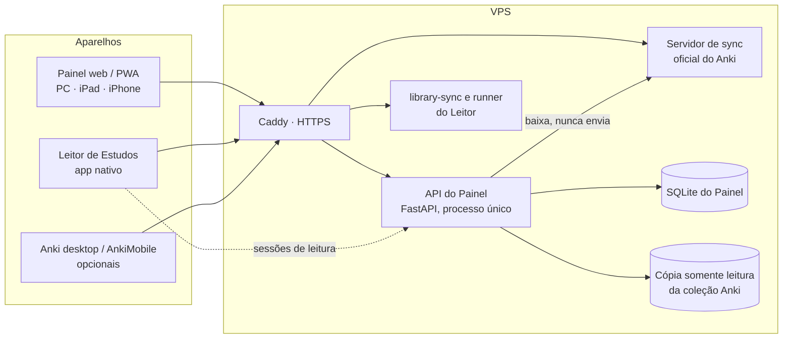

# Painel de Estudos — Especificação do projeto

> **Para quem é este documento:** Claude Opus 5.5 (esforço xhigh), que vai implementar o app do zero.
> **Dono do produto:** Jorge — usuário único.
> **Versão:** 1.1 · 22/10/2026 · fuso America/Sao_Paulo.
> **Nome provisório:** "Painel de Estudos" (repositório `painel-estudos`). O nome pode mudar sem impacto técnico.
> **Projeto irmão:** "Leitor de Estudos" (leitor de PDF/EPUB com o Anki dentro, app nativo). São dois apps separados que conversam por um contrato pequeno (Apêndice B, idêntico nos dois documentos).

---

## 0. Como usar este documento (leia antes de tudo)

1. **Leia o documento inteiro antes de escrever código.** Ele é a fonte de verdade. Se algo não estiver aqui, escolha a opção mais simples que respeite os princípios da seção 1, registre a escolha em `docs/decisoes.md` (data, decisão, motivo, uma linha cada) e siga em frente.
2. **Trabalhe por fases** (seção 17). Uma fase só termina quando todos os critérios de aceite passam e os testes estão verdes. Ao fim de cada fase, atualize `docs/progresso.md`: o que foi entregue, o que ficou de fora e como testar à mão.
3. **Crie um `CLAUDE.md` na raiz no início da Fase 0**, com os comandos (dev, teste, lint, build, deploy), as convenções e um link para este arquivo (`docs/PROJETO.md`).
4. **Não confie na memória para APIs que mudam rápido**, em especial o pacote `anki` (pylib). Antes de usar, leia o código-fonte ou a documentação da versão fixada no projeto.
5. **Idiomas:** interface em pt-BR. Código, tabelas, rotas e mensagens de commit em inglês. Centralize os textos da UI em `apps/web/src/i18n/pt-BR.ts`.
6. **Arquivos de referência:** o usuário vai colocar em `docs/referencia/` o painel atual em Apps Script (`Code.gs`, `Index.html`, `Semanal.html`), a planilha `fBaseProdutividade.xlsx` e as capturas de tela. As fórmulas do painel estão reproduzidas no Apêndice A. Se houver divergência, vale o código original, exceto nas mudanças marcadas como **[mudança]**.
7. **Quando perguntar ao usuário:** só quando a decisão for difícil de desfazer ou mudar de forma relevante o que ele vê. As decisões já tomadas estão na seção 19.
8. **Qualidade antes de quantidade.** O visual limpo é requisito, não acabamento. Uma tela feia ou confusa conta como não entregue.

### 0.1 Glossário (UI → código)

| Termo na UI | Nome no código | Significado |
|---|---|---|
| Trilha | `track` | Qualquer coisa que o usuário quer levar adiante com planejamento diário e semanal: um curso, um livro, "aprender a andar de bicicleta", corrida, trabalho. |
| Bloco | `block` | Unidade de planejamento: um pomodoro de foco. Padrão de 50 min, configurável. Internamente tudo é guardado em **minutos**. |
| Carga diária | `day_track.planned_min` | Quanto de cada trilha está planejado para cada dia. |
| Realizado | `day_track.done_*` | Quanto foi feito no dia. Vem de fontes automáticas (pomodoro, revisões do Anki, leitura no Leitor) e pode ser corrigido à mão. |
| Entrega da semana | `deliverable` | O que precisa sair até o fim da semana: "Cap 22.3", "Terminar artigo", "Corrida 5 dias", "Ler 40 páginas". |
| Hábito | `habit` | Check-in diário de sim/não ou número: "Acordou cedo", "Tomou água". |
| Sessão de foco | `focus_session` | Um pomodoro (foco ou pausa) com início e fim. |
| Fechar o dia | `close_day` | Ritual de fim de dia que confirma os números (substitui o "Enviar"). |
| Leitor | — | O app irmão "Leitor de Estudos" (PDF + Anki). |
| Sessão de leitura | `external_session` | Tempo de leitura enviado pelo Leitor. |

---

## 1. Visão do produto

### 1.1 O problema

Hoje o usuário usa quatro ferramentas que não conversam entre si:

- **Planilha Google** com duas abas: horas programadas e realizadas por dia, e entregas da semana com 0/1. Um **painel em Apps Script** desenha heatmaps no estilo do Review Heatmap do Anki.
- **Pomofocus**, para o timer e a lista de tarefas do dia.
- **Anki**, no desktop e no iPad.
- **Um leitor de PDF.**

O mesmo dado é digitado várias vezes, e o tempo gasto no Anki e na leitura não aparece no planejamento.

### 1.2 A solução: dois apps

O problema vira dois apps, cada um bom no seu trabalho:

- **Painel de Estudos (este documento):** planejamento e produtividade, para qualquer coisa que o usuário queira levar adiante. Roda no navegador (PC, iPad, iPhone).
- **Leitor de Estudos (documento próprio):** leitor de PDF e EPUB com o Anki completo dentro, cards de código e escaneamento de vocabulário. App nativo (desktop e iPad/iPhone), offline.

Este app tem quatro áreas:

1. **Planejar** a semana por trilhas: carga diária, entregas da semana e hábitos.
2. **Hoje**: pomodoro com a lista do dia, registro do realizado e checklist das entregas da semana.
3. **Painel**: os mesmos heatmaps de hoje (horas por dia e cumprimento semanal), mais hábitos.
4. **Registros**: tabelas com tudo que foi inserido.

**O núcleo é genérico.** Uma trilha pode ser "Curso FastAPI", "Aprender a andar de bicicleta", "Corrida", "Trabalho" ou "Livro: Animal Farm". Nenhuma regra do núcleo depende de Anki ou de livros. Os dois entram por vínculos opcionais:

- **Trilha ↔ decks do Anki:** o tempo de revisão, feito em qualquer aparelho (Leitor, AnkiMobile, Anki desktop), entra como realizado. Os dias com revisão contam para entregas de frequência ("Anki 5 dias"). O Painel só **lê** o histórico do Anki (seção 9).
- **Trilha ↔ livros do Leitor:** o tempo de leitura que o Leitor envia entra como realizado (seção 10).

### 1.3 Princípios

1. **Limpo acima de tudo.** A referência visual é o painel atual em Apps Script: fundo branco, bordas finas, verde-lima, nada de sombras pesadas, nada de enfeite.
2. **O dado entra uma vez.** O que dá para medir sozinho (pomodoro, revisões, leitura) vem pré-preenchido. O usuário só confirma ou corrige.
3. **Só leitura no Anki.** O Painel nunca altera a coleção do Anki. Quem estuda e cria cards é o Leitor (ou o Anki oficial).
4. **Barato.** Um VPS pequeno, um usuário, SQLite.
5. **Web primeiro e responsivo** (PC, iPad, iPhone), instalável como PWA.

### 1.4 Fora do escopo

- Revisar cards, ler livros, cards de código e vocabulário: ficam no Leitor de Estudos.
- A aba "Financeiro" da planilha.
- Multiusuário e colaboração.
- Uso offline do app web.

---

## 2. Plataformas e arquitetura

### 2.1 Como cada aparelho é atendido

| | PC | iPad | iPhone |
|---|---|---|---|
| Painel (este app) | Navegador | Safari → "Adicionar à Tela de Início" (PWA) | Igual ao iPad |
| Anki e livros | Leitor de Estudos (desktop) | Leitor de Estudos (iPad) | Leitor de Estudos (iPhone) |

### 2.2 Visão geral



### 2.3 Decisões de arquitetura e motivos

1. **Dois apps, não um.** O usuário prefere separar a produtividade (web, leve, qualquer aparelho) do leitor com Anki (nativo, offline, pesado). A ligação entre eles é pequena e explícita (Apêndice B): o Painel lê o histórico do Anki pelo servidor de sincronização e recebe as sessões de leitura do Leitor.
2. **SPA React + PWA, sem Next.js.** O app não precisa de SEO nem de renderização no servidor.
3. **Backend em Python (FastAPI).** O pacote oficial `anki` (pylib, que embrulha o núcleo em Rust) é o jeito mais simples e seguro de baixar a coleção do servidor de sincronização e ler o histórico de revisões.
4. **Um único processo da API** (`uvicorn --workers 1`). A cópia da coleção do Anki é um SQLite que só pode ser aberto por um processo. Todo acesso passa pelo `AnkiReader` (seção 9.1).
5. **SQLite em modo WAL** para os dados do app: um usuário, backup simples, custo zero.
6. **Sincronização do Anki por servidor próprio, não pelo AnkiWeb.** O AnkiWeb só atende os clientes oficiais. O desenvolvedor do Anki afirma que "the service is only provided for the main Anki clients". O servidor oficial auto-hospedado (`python -m anki.syncserver`) é suportado pelo Anki desktop, pelo AnkiDroid e pelo AnkiMobile, e também atende o Leitor.

### 2.4 Stack

**Frontend (`apps/web`)**

| Item | Escolha |
|---|---|
| Base | React 19 + TypeScript (strict) + Vite |
| Rotas e dados | TanStack Router (file-based) + TanStack Query |
| Estado local | Zustand (só para estado de UI, como o timer) |
| Estilo | Tailwind CSS v4 + componentes próprios sobre primitivos Radix (estilo shadcn/ui), seguindo os tokens da seção 4. Os mesmos tokens são usados pelo Leitor. |
| Ícones | Lucide (contorno, 16–18 px) |
| Arrastar e soltar | dnd-kit |
| Datas | date-fns + date-fns-tz (sempre America/Sao_Paulo) |
| Tabelas | TanStack Table + TanStack Virtual |
| PWA | vite-plugin-pwa (Workbox) |
| Cliente da API | tipos gerados do OpenAPI (`openapi-typescript` + `openapi-fetch`) |
| Testes | Vitest + Testing Library; Playwright com os projetos Chromium **e WebKit** (aproxima o Safari do iPad) |

**Backend (`apps/api`)**

| Item | Escolha |
|---|---|
| Base | Python 3.12+, FastAPI, Pydantic v2, gerenciado com `uv` |
| Banco | SQLite (WAL) + SQLAlchemy 2 + Alembic |
| Anki | `anki==26.9.3` (versão atual no PyPI em 22/10/2026). Fixar e atualizar junto com o servidor de sync e o Leitor. |
| Planilhas | `openpyxl` (importação e exportação XLSX) |
| Segurança | `argon2-cffi`, `cryptography` (Fernet) |
| Push (Fase 5) | `pywebpush` |
| Logs | `structlog` (JSON) |
| Testes | `pytest`, `pytest-asyncio` |

**Infra:** Docker Compose, Caddy (TLS automático), restic para backups, GitHub Actions para CI.

---

## 3. Estrutura do repositório

```
painel-estudos/
├── CLAUDE.md
├── README.md
├── docs/
│   ├── PROJETO.md              ← este documento
│   ├── decisoes.md
│   ├── progresso.md
│   └── referencia/             ← Apps Script, planilha, capturas de tela
├── apps/
│   ├── web/
│   │   └── src/
│   │       ├── routes/         ← uma rota por tela (seção 4.4)
│   │       ├── features/       ← hoje/ semana/ trilhas/ painel/ registros/ config/
│   │       ├── components/ui/  ← design system
│   │       ├── lib/            ← cliente da API, datas, formatação pt-BR
│   │       └── i18n/pt-BR.ts
│   └── api/
│       └── app/
│           ├── main.py
│           ├── core/           ← config, auth, db, segurança, jobs, tempo
│           ├── modules/        ← tracks/ planning/ today/ focus/ dashboard/
│           │                     anki_reader/ integrations/ imports/
│           └── tests/          ← inclui fixtures/ com a planilha e uma coleção Anki de teste
├── packages/
│   └── api-types/              ← tipos gerados do OpenAPI
└── infra/
    ├── compose.yml             ← include opcional de server/compose.leitor.yml do Leitor (Apêndice B.1)
    ├── compose.dev.yml
    ├── Caddyfile
    └── backup/
```

Os pacotes JS usam workspaces do pnpm. O Python usa `uv`. Os tipos da API são regenerados com um comando (`pnpm gen:api`) e o CI falha se estiverem desatualizados.

---

## 4. Design

O que o usuário mais valoriza é o visual limpo do painel atual. Esta seção transforma esse visual em regras.

### 4.1 Tokens

Os valores do tema claro vêm do `Index.html` atual e devem ser mantidos **exatamente**.

| Token | Claro | Escuro (proposta) | Uso |
|---|---|---|---|
| `--bg` | `#ffffff` | `#141414` | fundo da página |
| `--text` | `#222222` | `#e8e8e8` | texto principal |
| `--muted` | `#767676` | `#9a9a9a` | rótulos, legendas, texto secundário |
| `--border` | `#e1e1e1` | `#2c2c2c` | bordas de cartões e campos |
| `--card` | `#ffffff` | `#1b1b1b` | fundo de cartão |
| `--empty` | `#ececec` | `#262626` | célula de heatmap sem dado |
| `--lime` | `#77a83c` | `#8fbf4f` | cor de marca, botão primário, aba ativa |
| `--lime-dark` | `#4a7f22` | `#a9d36a` | texto de destaque, hover do primário |
| `--today` | `#3f6d1e` | `#9ccc65` | contorno de "hoje" e da semana atual |
| `--link` | `#2a7ae2` | `#6ea8ff` | links |
| `--error` | `#cc3d3d` | `#ff6b6b` | erros |

**Escala do heatmap** (igual nos dois temas, para não mudar a leitura):

- Verdes: `#dae289`, `#a8c95f`, `#77a83c`, `#4a7f22`
- Planejado sem execução: `#f2b8b0`
- Futuro previsto: `#cfcfcf` no claro, `#4a4a4a` no escuro
- Sem dado: `--empty`

**Cores do pomodoro** (só como acento no cartão do timer; no "modo imersivo" elas viram o fundo da página, como no Pomofocus):

- Foco `#ba4949`
- Pausa curta `#38858a`
- Pausa longa `#397097`

### 4.2 Tipografia, espaço e forma

- **Fonte:** `-apple-system, BlinkMacSystemFont, 'Segoe UI', Roboto, 'Noto Sans', Arial, sans-serif` (a mesma de hoje). Código: `ui-monospace, SFMono-Regular, Menlo, Consolas, monospace`.
- **Tamanhos:** base 14px/1.5. Título de página 18px peso 600. Título de cartão 15px peso 600, centralizado nos heatmaps. Rótulos 12px em `--muted`. Rótulos do heatmap 11px. O timer usa números grandes (96px no desktop, 72px no celular) com `font-variant-numeric: tabular-nums`.
- **Pesos:** só 400 e 600.
- **Cartão:** borda 1px `--border`, raio 10px, padding 14–16px, sem sombra.
- **Campos e botões:** raio 6px, borda 1px. Botão neutro com fundo `#f7f7f7`. Botão primário com fundo `--lime`, borda `--lime-dark` e texto branco.
- **Abas:** sublinhado de 2px `--lime` na ativa, texto `--lime-dark` peso 600, como no painel atual.
- **Sombras:** só em popovers e tooltips (`0 4px 12px rgba(0,0,0,.12)`).
- **Movimento:** transições de 150ms no máximo, desligadas com `prefers-reduced-motion`.
- **Layout:** conteúdo com largura máxima de 1200px (o Painel pode ocupar a largura toda). Margem lateral de 16px no celular e 24px no desktop. Alvos de toque com pelo menos 44px em telas de toque. Nada de rolagem horizontal da página; só dentro dos heatmaps.
- **Estados:** toda lista tem estado vazio com uma frase e uma ação ("Nenhuma trilha ainda. Criar trilha"). Carregamentos usam esqueleto, nunca spinner de página inteira. Erros de rede aparecem num aviso discreto no topo, com "tentar de novo".

### 4.3 Navegação

- **Desktop:** barra lateral estreita, recolhível: Hoje · Semana · Trilhas · Painel · Registros · Configurações.
- **iPad:** a mesma barra, recolhida por padrão no retrato.
- **iPhone:** barra inferior com Hoje · Semana · Painel · Registros · Mais (Mais abre Trilhas e Configurações).
- **Atalhos globais:** `g h` Hoje, `g s` Semana, `g p` Painel, `g r` Registros, `?` lista de atalhos.
- **Página `/dev/ui`** (só em desenvolvimento) mostrando todos os componentes nos dois temas. Ela serve de referência visual e de teste.

### 4.4 Mapa de telas

| Rota | Tela | Seção |
|---|---|---|
| `/hoje` | Hoje: foco e check-in (tela inicial) | 6 |
| `/semana/:segunda?` | Planejamento da semana | 5.3 |
| `/trilhas`, `/trilhas/:id` | Lista e detalhe de trilhas | 5.1 |
| `/painel` | Heatmaps (abas) | 8 |
| `/registros` | Tabelas de tudo que foi inserido | 7 |
| `/config/*` | Geral, Pomodoro, Hábitos, Anki, Integrações, Importar, Conta | 9.3, 10.1 |

---

## 5. Trilhas, hábitos e planejamento

### 5.1 Trilha

| Campo | Detalhe |
|---|---|
| Nome | Obrigatório. Único entre as trilhas ativas. |
| Cor | Uma de 8 cores suaves pré-definidas. Usada no ponto ao lado do nome. |
| Área | Texto livre opcional com sugestões ("Inglês", "Trabalho", "Mestrado"). Serve para agrupar e filtrar. |
| Descrição | Markdown opcional. |
| Modelo semanal | Blocos padrão por dia da semana (ex.: seg–sex 4 blocos). Pré-preenche o planejamento. |
| Conta tempo? | Ligado por padrão. Se desligado, a trilha só tem entregas e não aparece no heatmap de horas. |
| Decks do Anki | Opcional. Lista de decks; os subdecks entram. Cada subárvore de deck pertence a no máximo uma trilha (seção 6.4). |
| Livros do Leitor | Opcional. Vários livros por trilha; cada livro em no máximo uma trilha (seção 10.3). |
| Status | Ativa · Pausada (não entra quando os modelos são aplicados) · Arquivada (some das listas; o histórico continua). |

Regras:

- Renomear não quebra o histórico, porque tudo referencia o `id`.
- **Mesclar trilhas** (necessário depois da importação, que traz variações como "Nav 2" e "Nav2"): move todos os registros, entregas e vínculos para a trilha de destino e arquiva a de origem. Quando as duas têm `day_track` no mesmo dia, as linhas viram uma só: somam-se `planned_min` e `done_manual_min` (vazio + x = x), as notas são concatenadas e o `done_auto_min` é recalculado. A idempotência da importação não depende dessas linhas (tabela `import_row`, seção 13).
- O detalhe da trilha mostra o mini-heatmap dela, as entregas por semana e os vínculos.

### 5.2 Hábitos

- Tipos: **sim/não** ou **número** com meta diária (ex.: copos d'água, meta 8).
- Dias ativos (ex.: seg–sex). Fora deles, o hábito não aparece no Hoje e não conta no Painel.
- Hábitos iniciais, vindos da planilha: "Programar café", "Presencial", "Tomou água", "Acordou cedo", "Leu antes de dormir". Todos sim/não.
- No Hoje, os hábitos aparecem numa linha de chips: um toque marca sim, dois toques marcam não, e um toque longo limpa. Os hábitos numéricos usam um stepper.

### 5.3 Tela Semana (substitui a digitação na planilha)

A semana vai de **segunda a domingo**, com numeração ISO 8601.

Layout no desktop:

```
Semana 43 · 19–25 out 2026              ‹  Hoje  ›     [Copiar semana anterior] [Aplicar modelos]
────────────────────────────────────────────────────────────────────────────────────────
Trilha                 Seg   Ter   Qua   Qui   Sex   Sáb   Dom    Total
● ROS 2                 2     2     2     2     2     ·     ·     10 bl · 8h20
   Entregas: ☐ tf2: tutorial 3   ☐ URDF Humble   ＋ entrega
● Gramática Inglês      4     4     4     4     4     ·     ·     20 bl · 16h40
   Entregas: ☐ Cap: I have done   ☐ Cap: Have you ever…?   ＋ entrega
● Corrida               ½     ½     ½     ½     ½     ·     ·     2,5 bl · 2h05
   Entregas: ◔ 5 dias (frequência · fonte: esta trilha)
＋ Adicionar trilha à semana
────────────────────────────────────────────────────────────────────────────────────────
Total do dia           5h25  5h25  5h25  5h25  5h25   —     —     27h05
Hábitos da semana: Acordou cedo (seg–dom) · Tomou água (seg–dom) · Presencial (seg–sex)
```

Interações:

- **Célula:** clicar abre um stepper (− / ＋ de meio bloco). Também dá para digitar um número. As setas navegam entre as células. Mostrar blocos quando o valor for múltiplo de meio bloco; senão, mostrar h:mm.
- **Linha:** arrastar reordena. O menu da linha tem "Remover da semana" (apaga a carga e as entregas da trilha naquela semana, com confirmação) e "Abrir trilha". Uma trilha pode estar na semana sem carga nenhuma, só com entregas (tabela `week_track`).
- **Entregas:** a linha expande para listar as entregas. Enter adiciona. Cada entrega tem um seletor de tipo (seção 5.4).
- **Copiar semana anterior:** abre um diálogo com as opções [x] carga diária, [x] entregas não concluídas (como novas) e [ ] todas as entregas.
- **Aplicar modelos:** preenche as células vazias com o modelo semanal de cada trilha ativa, sem sobrescrever o que já foi preenchido.
- **Totais:** a soma do dia fica destacada se passar da "capacidade diária" configurável (padrão 10h).
- **Salvamento:** automático, com 500ms de espera, e um indicador discreto "Salvo".
- **Dias passados** da semana continuam editáveis.

Layout no celular: uma lista de trilhas, cada uma com uma fileira de 7 pontos (um por dia, mais cheio quanto mais blocos). Um toque abre uma folha inferior com 7 steppers e as entregas.

**Materialização:** a carga é gravada por dia em `day_track`. Mudar o modelo de uma trilha depois **não** altera semanas já planejadas.

### 5.4 Entregas da semana

Cada entrega tem um progresso `feito` de 0 a 1, que alimenta o Painel semanal.

| Tipo | Exemplo | Como o usuário registra | `feito` |
|---|---|---|---|
| Checklist | "Cap 22.3", "Terminar artigo" | Marca ☑ | 1 se concluída, senão 0 |
| Quantidade | "Ler 40 páginas", "20 exercícios" | Stepper de progresso no Hoje | `min(1, progresso / meta)` |
| Frequência | "Corrida 5 dias", "Acordar cedo 6 dias", "Anki 5 dias" | Nada: é calculado | `min(1, dias_que_contam / meta)` |

Fontes de uma entrega de frequência (o critério de "o dia conta"):

- **Hábito:** o valor do hábito no dia ≥ meta do hábito (para sim/não, = 1).
- **Trilha:** o realizado da trilha no dia ≥ M minutos (padrão: > 0), ou a opção "cumpriu o planejado" (realizado ≥ programado).
- **Decks do Anki:** pelo menos K revisões no dia (padrão 1) nos decks escolhidos.
- **Manual:** o usuário toca nos dias da semana.

Regras:

- **Data da entrega no Painel** = data-alvo, se houver; senão, a segunda-feira da semana. Uma entrega é "futura" quando essa data é depois de hoje e `feito` = 0.
- **Pendências:** o botão "Levar pendentes para a próxima semana" cria cópias na semana seguinte (`carried_from_id`). A original continua como não concluída, para não reescrever o histórico.
- A descrição aceita Markdown. Não há subtarefas; para dividir, crie mais entregas.

### 5.5 Metas do mês e do ano (Fase 6)

A planilha tem as abas "Metas Mensais" (266 linhas, em uso em 2026) e "Metas do ano". Elas viram uma camada leve: título, trilha opcional, período (mês ou ano), realizada de 0 a 1 e nota. Há uma tela simples, um cartão no topo da Semana com as metas do mês e a importação. A prioridade é baixa.

---

## 6. Hoje (foco e check-in)

Esta é a tela inicial. Ela junta o Pomofocus e o lançamento diário da planilha.

### 6.1 Layout

No desktop, o timer fica à esquerda e o dia à direita. No iPad em retrato e no iPhone, tudo fica empilhado, com o timer no topo.

```
 Foco · Pausa curta · Pausa longa
            50:00
          [ INICIAR ]
   #3 · ROS 2 › tf2: tutorial 3

Hoje · qui, 22 out                          ‹ ›     6h40 de 9h10 planejadas
┌─────────────────────────────────────────────────────────────────────────┐
│ ● ROS 2                                     2/2 blocos      ▸ focar    │
│   Realizado [1h40]  auto: 1h40 de foco                                  │
│   Entregas da semana: ☑ tf2: tutorial 3   ☐ URDF Humble                 │
│   Micro-tarefas: ☐ revisar launch file   ＋                              │
├─────────────────────────────────────────────────────────────────────────┤
│ ● Anki 5k                                   ½/1 bloco      ▸ focar     │
│   Realizado [25 min]  auto: 25 min de revisões (de qualquer aparelho)            │
│   Entregas: Frequência ●●●○○ 3/5 dias                                  │
└─────────────────────────────────────────────────────────────────────────┘
Hábitos:  [✓ Acordou cedo] [✓ Tomou água] [✗ Programar café] [ Presencial ]
                                                           [ Fechar o dia ]
```

### 6.2 Lista do dia

- Mostra os `day_track` do dia com programado > 0, ou realizado > 0, ou `origin = 'added'` (trilha adicionada ao dia, mesmo com programado 0).
- "＋ Adicionar trilha ao dia" inclui uma trilha não planejada, com programado 0 ou um valor definido ali.
- "2/2 blocos" = realizado efetivo ÷ duração do bloco, sobre programado ÷ duração do bloco, arredondado para meio bloco.
- **Realizado:** o campo mostra o valor efetivo (seção 6.4). Editar grava um valor manual que substitui o automático. O detalhe "auto: …" mostra a origem, e o link "voltar ao automático" apaga o valor manual. Pode passar do programado.
- **Entregas da semana:** todas as entregas da semana daquela trilha, não só as de hoje, como o usuário pediu. Checklist com ☑, quantidade com stepper, frequência com 7 pontos (seg–dom) mostrando os dias que contaram.
- **Micro-tarefas:** checklist livre do dia por trilha, como as notas do Pomofocus ("Alterações formulário", "Atualizar BI"). Não entram nas métricas. As não feitas podem ir "para amanhã".
- **Registrar tempo:** botão para lançar tempo feito longe do computador ("Bicicleta, 40 min, das 7h às 7h40").
- **Navegação de datas (‹ ›):** dá para preencher ontem ou planejar amanhã.

### 6.3 Timer

| Configuração | Padrão |
|---|---|
| Foco | 50 min (é também a duração do bloco) |
| Pausa curta | 10 min |
| Pausa longa | 20 min |
| Pausa longa a cada | 4 focos |
| Iniciar pausas automaticamente | desligado |
| Iniciar foco automaticamente | desligado |
| Som ao terminar | ligado (3 opções de som, volume) |
| Manter tela acesa (Wake Lock) | desligado |
| Modo imersivo | desligado |

Comportamento:

- **O servidor é a fonte da verdade.** A sessão ativa fica gravada com `started_at`, duração planejada, os intervalos de pausa, modo e trilha. O cliente calcula o tempo restante com base no relógio do servidor (corrigindo a diferença de relógio no carregamento). Assim, o timer sobrevive a recarregar a página e aparece igual no PC e no iPad.
- **Nunca contar o tempo com `setInterval` acumulando.** O tempo restante é sempre `fim_previsto − agora`, e o intervalo serve só para redesenhar.
- **Ações:** iniciar, pausar, retomar, pular e parar. Ao parar um foco antes do fim, perguntar "Registrar 23 min em ROS 2?".
- **Foco concluído:** entra no realizado automático da trilha. O contador "#3" é o número de focos de hoje.
- **Escolher o que focar:** "▸ focar" numa trilha associa o timer a ela. Opcionalmente, dá para escolher uma entrega, que aparece embaixo do timer.
- **Fim da sessão:** som, notificação do navegador (Notification API), título da aba com o tempo restante ("42:10 · ROS 2") e troca automática de modo se configurada.
- **iPhone e iPad em segundo plano (Fase 5):** o iOS suspende o JavaScript, então o servidor agenda um Web Push para o horário de término. Isso funciona no app instalado na Tela de Início (iOS 16.4+).
- **Atalhos:** Espaço inicia ou pausa, `S` pula, `Esc` fecha diálogos.

### 6.4 Realizado efetivo e a regra da união

Para cada (dia, trilha):

```
realizado_auto = duração da UNIÃO dos intervalos de:
   (a) sessões de foco concluídas ou registradas dessa trilha no dia,
       MENOS os trechos em pausa (cada pausa é guardada como intervalo)
   (b) revisões nos decks vinculados: cada linha do revlog vira o intervalo
       [id_ms − time_ms, id_ms]. Os intervalos entre um card e outro NÃO contam
       (é o mesmo critério do "tempo estudado" do Anki).
   (c) sessões de leitura enviadas pelo Leitor para livros ligados à trilha (seção 10, Apêndice B.6)
   (d) tempo registrado à mão com início e fim ("Registrar tempo")
 + (e) tempo registrado à mão só com a duração (sem horário): somado por fora da união
realizado_efetivo = done_final_min ?? done_manual_min ?? realizado_auto
```

A união evita contar duas vezes quando o pomodoro está rodando enquanto o usuário revisa ou lê. Os intervalos que cruzam a virada do dia são cortados nela.

**Revisões do Anki atribuídas a decks** (vale para (b), para o `anki_day_cache` e para as entregas de frequência):

- O revlog não tem coluna de deck. O deck de uma revisão é `coalesce(nullif(cards.odid, 0), cards.did)` no momento do cálculo (o `odid` cobre os decks filtrados).
- Revisões de cards já excluídos são ignoradas. Linhas manuais ou de reagendamento (tipos 4 e 5, ou `ease = 0`) não são revisões e ficam de fora.
- **O histórico não é reescrito:** o `anki_day_cache` só é recalculado para os dias a partir da revisão mais antiga que chegou na sincronização. Dias anteriores ficam congelados, então mover cards de deck depois não muda o passado.
- **Cada subárvore de deck pertence a no máximo uma trilha.** A interface impede ligar o mesmo deck, ou um deck e um subdeck dele, a duas trilhas, para o "Geral" do Painel não contar em dobro.

**Data de corte:** o realizado automático só é calculado a partir de `auto_since` (uma configuração, gravada na primeira execução do app e atualizada ao fim de uma importação da planilha). Dias anteriores usam só o que foi importado ou digitado. Assim, ligar a trilha "Anki 5k" ao deck não sobrescreve o histórico importado com anos de revlog.

**Quem encerra o pomodoro:** o servidor. Uma tarefa em segundo plano na API verifica a cada 15 s as sessões cujo fim previsto já passou e as encerra (status `done`, `counted_min`), mesmo sem nenhum aparelho aberto. É essa mesma tarefa que dispara o Web Push (Fase 5).

**Linhas criadas automaticamente:** quando há realizado automático para uma trilha num dia sem `day_track`, a linha é criada (upsert) com `origin='auto'` e `planned_min = 0`.

**Virada do dia:** configurável, padrão 00:00. Exemplo: 03:00 para quem estuda de madrugada. Todo agrupamento por dia usa America/Sao_Paulo mais esse deslocamento.

### 6.5 Fechar o dia

- Abre um resumo: planejado × realizado por trilha, hábitos sem resposta e uma nota do dia.
- Ao confirmar: os hábitos sem resposta viram 0 (opção: deixar vazio), os valores efetivos são congelados em `done_final_min` e o dia fica marcado como fechado (ícone de cadeado).
- **Dia fechado é somente leitura**, no Hoje e nos Registros. Para editar, o usuário reabre. Reabrir apaga os `done_final_min` do dia (os valores voltam a ser ao vivo). Fechar de novo congela outra vez.
- **Não fechar não quebra nada:** o Painel usa os valores efetivos ao vivo.

---

## 7. Registros (as tabelas)

O usuário pediu "uma tabela para exibir tudo que foi inserido". Esta tela substitui a visão de planilha.

- **Abas:** Diário (data, trilha, programado, realizado, origem, fechado) · Entregas (semana, trilha, entrega, tipo, progresso, feito) · Hábitos (matriz data × hábitos) · Sessões de foco · Leitura (sessões vindas do Leitor).
- **Filtros:** período e trilhas. Ordenação por coluna.
- **Edição na própria tabela**, com as mesmas validações do resto do app. Linhas de dias fechados ficam travadas (reabrir o dia primeiro). Exclusão em lote com confirmação.
- **Exportar CSV e XLSX** com os nomes de coluna da planilha antiga, para dar ida e volta:
  - Diário: `Data`, `Atividade`, `Programado [H]`, `Realizado [H]` e uma coluna por hábito.
  - Semanal: `Data`, `Semana`, `Atividade`, `Tarefa`, `Terminou?`.
- Tabela virtualizada: o histórico já tem mais de 2.500 linhas.

---

## 8. Painel

É um port fiel do painel em Apps Script: mesmo visual, mesmas fórmulas (Apêndice A).

**Abas:** Horas por dia · Cumprimento semanal · Hábitos.

**Controles** (como hoje):

- De, Até e o seletor "N de M trilhas", com busca e "marcar todas" / "desmarcar todas" (que agem só sobre os itens visíveis na busca).
- **Salvar:** grava De, Até e as trilhas desmarcadas por aba, no servidor.
- O "Atualizar agora" e a recarga a cada 5 min deixam de ser necessários, porque os dados são ao vivo (a consulta recarrega quando a janela ganha foco).
- Filtro opcional por área.

**Cartões:** uma legenda por aba, logo abaixo dos controles (como no original). Depois, "Geral · N trilhas" no topo quando mais de uma estiver selecionada, e um cartão por trilha, cada um com o heatmap e a linha de estatísticas.

**Mudanças deliberadas em relação ao original:**

1. **[mudança]** A grade do heatmap diário começa na segunda. As linhas vão de Seg a Dom, com os rótulos Seg, Qua e Sex nas linhas de índice 0, 2 e 4 (1ª, 3ª e 5ª linhas). Não copiar o vetor de rótulos do original, que é para uma grade começando no domingo.
2. **[mudança]** A numeração de semanas é ISO 8601 (segunda a domingo).
3. **[mudança]** Hoje e a semana atual ficam "em andamento": se ainda não foram cumpridos, não zeram a "sequência atual". Depois de cumpridos, contam normalmente. Todas as outras estatísticas seguem o original.
4. **[mudança]** Em telas de toque, o tooltip abre com um toque.
5. **[mudança]** Período padrão, se nada foi salvo: os últimos 12 meses no desktop e as últimas 26 semanas no celular.
6. O heatmap rola na horizontal dentro do cartão e abre já rolado até o fim (o mais recente).

**Modo de compatibilidade (só para testes):** o motor de métricas recebe `today` (a data de hoje, sempre como parâmetro, nunca lida do relógio lá dentro), `week_start` (segunda ou domingo) e `today_in_progress` (verdadeiro ou falso). Com domingo e falso, ele precisa reproduzir os números do original (Apêndice A.4).

**Onde as métricas são calculadas:** no backend (`modules/dashboard/metrics.py`), com testes de referência. O endpoint devolve os mapas por dia, as cores e as estatísticas já formatadas. O frontend só desenha. Isso mantém uma única implementação, testada contra a planilha.

**Aba Hábitos:** um heatmap por hábito, com a mesma grade. A cor usa a mesma escala do A.2 com `razao = valor / meta` (assim, um hábito numérico com 5 de 8 copos fica num verde intermediário; um sim/não só tem 0 ou 1). Sem registro → `--empty`. Dias inativos → transparente. Estatísticas: % de dias cumpridos (valor ≥ meta), maior sequência e sequência atual, com as mesmas regras do A.1.

**Desempenho:** até cerca de 30 cartões × 70 semanas × 7 dias = 15 mil células. Desenhar cada cartão como um único SVG (ou uma grade CSS memoizada) e tratar o tooltip por delegação de eventos, como no original.

---

## 9. Integração com o Anki (somente leitura)

O Painel não estuda nem cria cards. Ele só precisa saber **quanto tempo o usuário revisou em cada deck, em cada dia**, para alimentar o realizado automático das trilhas ligadas a decks (seção 6.4) e as entregas de frequência com fonte "decks do Anki" (seção 5.4).

### 9.1 `AnkiReader`

- Dependência fixada: `anki==26.9.3`. O servidor de sync usa **a mesma versão**, porque o protocolo muda entre versões.
- O `AnkiReader` é dono de uma única `Collection`, uma **cópia local** em `/data/anki/collection.anki2` (com a pasta de mídia ao lado, mesmo que a mídia não seja usada), aberta na inicialização.
- Todas as operações rodam numa **thread dedicada** (executor de uma thread só). Os endpoints chamam `await anki.run(fn)`. Nenhum outro lugar abre a coleção.
- **Somente leitura:** o código nunca chama operações que alteram a coleção (responder cards, adicionar notas, mudar decks ou opções). Um teste garante isso: depois de qualquer fluxo do Painel, a coleção local não pode ter mudanças pendentes de envio.
- O que o Painel usa:
  - **Lista de decks** (nome completo e id), para o usuário ligar decks a trilhas. Use só nomes e ids (a lista de nomes de decks da pylib). **Não use a árvore de decks com contagens** (`deck_tree` com data), que desenterra cards e, portanto, grava na coleção.
  - **Revlog**, para o `anki_day_cache` (seção 6.4, "Revisões do Anki atribuídas a decks").
- Antes de implementar, leia `pylib/anki/collection.py` e `pylib/anki/sync.py` da versão fixada para o login, a sincronização normal e a completa.
- **Testes:** uma coleção de exemplo em `tests/fixtures/` com alguns decks, revisões em dias diferentes, um deck filtrado e um card excluído.

### 9.2 Servidor de sincronização (infra do VPS)

O servidor é usado pelo Painel, pelo Leitor e pelos apps oficiais do Anki. Este projeto é o **dono da infraestrutura** dele (Apêndice B.1).

**Topologia:**

- O contêiner `ankisync` roda o servidor oficial (`python -m anki.syncserver`, mesma versão do `anki`) com `SYNC_USER1=jorge:<senha>`, `SYNC_BASE=/data/ankisync` e `SYNC_PORT=8080`.
- Ele fica atrás do Caddy em `https://anki.<domínio>/`. O servidor fala HTTP puro, então nunca deve ficar exposto sem o proxy HTTPS.
- **O Caddy precisa aceitar TLS 1.2.** O iOS falha com servidores que só aceitam TLS 1.3 (erro -9836 no AnkiMobile). Também é preciso aumentar o `read_buffer` para 512k, senão o download de mídia dá problema.
- Se o servidor for publicado num subcaminho, a URL configurada no Anki precisa terminar com `/`.
- **Migração do AnkiWeb:** guia no Apêndice B.3. Pedir a confirmação do usuário antes de começar, mostrando o guia.

**O Painel como cliente:**

- Em Configurações → Anki: URL (`http://ankisync:8080/` pela rede interna do Docker), usuário e senha. A senha é usada só no login; a chave devolvida fica criptografada no banco.
- **Política:** sincronizar (só baixar) a cada 15 min, ao abrir o Hoje se a última sincronização tiver mais de 5 min, e no botão "Sincronizar agora" em Configurações → Anki.
- **Sincronização completa exigida:** escolher sempre **baixar do servidor**, sem perguntar. O Painel nunca envia.
- **Depois de cada sincronização:** atualizar o `anki_day_cache` (revisões e minutos por dia e deck), seguindo as regras de atribuição da seção 6.4.

### 9.3 Telas

- **Configurações → Anki:** servidor, usuário, status ("Sincronizado há 3 min · 12.430 revisões"), "Sincronizar agora" e o link para o guia de migração.
- **Trilha → Decks do Anki:** seletor em árvore com os decks da cópia local, respeitando a regra "cada subárvore de deck pertence a no máximo uma trilha" (seção 6.4).
- **Hoje:** na trilha ligada, "auto: 25 min de revisões" com o detalhe por deck no tooltip.

---

## 10. Integração com o Leitor de Estudos

O Leitor envia o tempo de leitura e pode ligar livros a trilhas. O contrato completo está no Apêndice B. Aqui, só o que o Painel implementa.

### 10.1 Tokens de integração

- **Configurações → Integrações → "Gerar token":** cria um token aleatório (32 bytes, base64url), mostrado **uma vez**, com um nome ("Leitor no iPad"). O banco guarda só o hash (SHA-256).
- Lista de tokens com nome, criação e último uso, e o botão "Revogar".
- O token só autentica as rotas `/api/v1/integrations/*`.

### 10.2 Rotas (Apêndice B.5)

- `GET /api/v1/integrations/tracks`
- `GET` e `PUT /api/v1/integrations/book-links/{book_uid}`
- `POST /api/v1/integrations/reading-sessions` (idempotente por `session_uid`)
- `POST /api/v1/integrations/deliverables` (futuro; não implementar na v1)

### 10.3 Uso dos dados

- **Sessões de leitura** ficam em `external_session` e entram no realizado automático pela regra da união (seção 6.4, fonte (c)), conforme o Apêndice B.6.
- **Livros na trilha:** no detalhe da trilha, a seção "Livros do Leitor" lista os livros ligados (título e `book_uid`) e permite ligar outro livro entre os já vistos pelo Painel (`known_book`: livros que mandaram sessões ou foram ligados pelo Leitor) ou desligar.
- **Registros:** uma aba "Leitura" lista as sessões recebidas (data, livro, trilha, duração).
- **Hoje:** na trilha ligada, "auto: 40 min de leitura (Animal Farm)".

---

## 11. Modelo de dados (SQLite do app)

Convenções: o tempo é sempre em **minutos inteiros**. Datas são `DATE` (dia local, já com a virada do dia aplicada). Instantes são `TIMESTAMP` em UTC. Os ids são inteiros. A coleção do Anki fica no arquivo dela (cópia somente leitura).

```
settings(key TEXT PK, value JSON)
  -- timezone, day_rollover_hour, block_minutes(50), short_break(10), long_break(20),
  -- long_break_every(4), auto_start_*, daily_capacity_min(600), theme,
  -- anki_sync_url, anki_sync_user, anki_sync_key_enc,
  -- auto_since (data de corte do realizado automático, seção 6.4)

user(id, username, password_hash, totp_secret_enc NULL, created_at)
session(id TEXT PK, user_id, created_at, expires_at, user_agent)
integration_token(id, name, token_hash UNIQUE, created_at, last_used_at NULL, revoked_at NULL)

track(id, name, color, area NULL, description NULL, counts_time BOOL, status,
      weekly_template JSON  -- {"mon": 200, "tue": 200, ...} em minutos
      anki_deck_ids JSON, sort_order, created_at, archived_at NULL)
track_book(book_uid PK, track_id, book_title, linked_at)      -- um livro → no máximo uma trilha
known_book(book_uid PK, title, first_seen_at)                  -- livros vistos pelo Painel (sessões ou vínculos)

day(date PK, closed BOOL, closed_at NULL, note NULL)

day_track(id, date, track_id, planned_min INT, sort_order,
          done_manual_min NULL, done_auto_min INT (cache), done_final_min NULL,
          origin ENUM('plan','added','auto','import'), note NULL,
          UNIQUE(date, track_id))

micro_task(id, date, track_id, text, done BOOL, sort_order)

manual_time(id, date, track_id, start_at NULL, end_at NULL, minutes, note)

week(monday DATE PK, note NULL, planned_at NULL)
week_track(week_monday, track_id, sort_order, PRIMARY KEY(week_monday, track_id))  -- trilha na semana, mesmo sem carga

deliverable(id, week_monday, track_id, title, description NULL,
            kind ENUM('checklist','quantity','frequency'),
            target REAL NULL, unit NULL, progress REAL DEFAULT 0,
            source ENUM('manual','habit','track','anki') NULL, source_ref JSON NULL,
            day_rule JSON NULL,       -- {"min_minutes":1} | {"meet_plan":true} | {"min_reviews":1}
            manual_days JSON NULL,    -- datas marcadas à mão (frequência manual)
            due_date NULL, done_at NULL, sort_order, carried_from_id NULL)

habit(id, name, kind ENUM('bool','number'), daily_target REAL DEFAULT 1, unit NULL,
      active_days INT (bitmask seg..dom), sort_order, active BOOL, color)
habit_log(date, habit_id, value REAL, PRIMARY KEY(date, habit_id))

focus_session(id, track_id NULL, deliverable_id NULL,
              mode ENUM('focus','short_break','long_break'),
              started_at, ended_at NULL, planned_sec,
              pauses JSON,            -- [[início, fim], ...] em UTC; a pausa aberta tem fim nulo
              status ENUM('running','paused','done','stopped'), counted_min NULL, device NULL)

external_session(session_uid PK, source ENUM('leitor'), book_uid, book_title,
                 started_at, ended_at, pages JSON, device, received_at)

anki_day_cache(date, deck_id, reviews INT, minutes INT, intervals JSON,
               PRIMARY KEY(date, deck_id))

meta_goal(id, period ENUM('month','year'), year, month NULL, track_id NULL,
          title, done REAL DEFAULT 0, note NULL)                         -- Fase 6

view_config(view PK, value JSON)          -- painel_diario, painel_semanal, painel_habitos
job(id, kind, status, progress REAL, payload JSON, result JSON, error NULL,
    created_at, started_at NULL, finished_at NULL)
push_subscription(id, endpoint, keys JSON, created_at)                  -- Fase 5
import_run(id, file_name, sha256, created_at, report JSON)
import_row(import_key PK, import_run_id, entity, entity_id)  -- idempotência da importação; sobrevive a mesclas
```

**Valores derivados** (calculados, nunca digitados):

- `feito` de uma entrega: seção 5.4.
- `done_auto_min`: seção 6.4. É recalculado quando uma sessão de foco termina, depois de uma sincronização do Anki, quando chega uma sessão de leitura e **quando os vínculos de uma trilha mudam** (decks ou livros ligados ou desligados), para todos os dias a partir de `auto_since`.
- Realizado efetivo = `done_final_min ?? done_manual_min ?? done_auto_min`.
- Minutos pausados de uma sessão de foco = soma dos intervalos em `pauses`.

---

## 12. API (REST, `/api/v1`)

Todas as rotas exigem sessão, exceto o login e as rotas de integração (que exigem token, seção 10.1). Os erros seguem o padrão `{error: {code, message}}`, com a mensagem em pt-BR.

| Grupo | Rotas |
|---|---|
| Auth | `POST /auth/login`, `POST /auth/logout`, `GET /auth/me` |
| Config | `GET/PUT /settings` |
| Trilhas | `GET/POST /tracks`, `GET/PATCH/DELETE /tracks/{id}`, `POST /tracks/{id}/merge {into_id}`, `GET/PUT /tracks/{id}/books`, `GET /books/known` (livros vistos, para o seletor) |
| Hábitos | `GET/POST /habits`, `PATCH/DELETE /habits/{id}`, `PUT /habit-logs/{date}` |
| Semana | `GET /weeks/{monday}` (grade completa), `PUT /weeks/{monday}/tracks` (lista ordenada das trilhas da semana; tirar uma trilha remove a carga e as entregas dela), `PUT /weeks/{monday}/loads` (lote), `POST /weeks/{monday}/copy-previous`, `POST /weeks/{monday}/apply-templates`, `POST /weeks/{monday}/carry-over` |
| Entregas | `POST /deliverables`, `PATCH/DELETE /deliverables/{id}` |
| Dia | `GET /days/{date}` (dados do Hoje), `PATCH /days/{date}/tracks/{track_id}`, `POST /days/{date}/tracks`, CRUD de `/days/{date}/micro-tasks`, `POST /days/{date}/manual-time`, `POST /days/{date}/close`, `POST /days/{date}/reopen` |
| Foco | `GET /focus/active`, `POST /focus/start`, `POST /focus/pause`, `POST /focus/resume`, `POST /focus/skip`, `POST /focus/stop {register: bool}`, `GET /focus/sessions?from&to`, `PATCH/DELETE /focus/sessions/{id}`, `GET /time` (relógio do servidor) |
| Registros | `GET /records/{daily,deliverables,habits,focus,reading}?from&to&tracks`, `POST /records/batch-delete {kind, ids}`, `GET /records/export?kind&format=csv\|xlsx` (a edição usa as rotas de cada recurso) |
| Painel | `GET /dashboard/{daily,weekly,habits}?from&to&tracks`, `GET/PUT /dashboard/config/{view}` |
| Anki (somente leitura) | `GET /anki/decks` (árvore da cópia local), `GET /anki/sync/status`, `POST /anki/sync` (só baixar), `POST /anki/login {url, user, password}` |
| Tokens | `GET/POST /integration-tokens`, `DELETE /integration-tokens/{id}` |
| Integrações (token) | `GET /integrations/tracks`, `GET/PUT /integrations/book-links/{book_uid}`, `POST /integrations/reading-sessions` (Apêndice B.5; a rota de entregas é futura) |
| Jobs | `GET /jobs/{id}`, `GET /jobs/{id}/events` (SSE) |
| Importação | `POST /import/xlsx` (análise e prévia), `POST /import/{id}/commit` |
| Push | `POST /push/subscribe` (Fase 5) |

---

## 13. Importação da planilha

Assistente em Config → Importar para `fBaseProdutividade.xlsx` (e os CSVs exportados dela).

**Abas usadas:**

- `Base(Semanal)`: diário, 1.723 linhas de 02/06/2025 a 26/09/2026.
- `Cumprimento Atividade Semanais`: entregas, 813 linhas de 17/11/2025 a 21/09/2026.
- `Metas Mensais` e `Metas do ano`: opcionais, na Fase 6.

**Abas ignoradas:** `Base` (formato antigo), `Financeiro` e `Gráfico`.

A detecção é pelos cabeçalhos, como no Apps Script: `data`; `ativ` ou `discip`; `program`; `realiz`; `semana`; `tarefa`; `termin`, `conclu` ou `feito`.

**Regras aprendidas com os dados reais:**

1. **Nomes de atividade com variações.** Há espaços no fim ("Corrida ", "Mestrado "), diferenças de maiúsculas ("Advanced Enginnering Mathmatics" e "…MathMatics") e grafias diferentes ("Nav 2" e "Nav2", "Docker" e "Docker "). O passo "Mapear atividades → trilhas" agrupa por chave normalizada (aparar, minúsculas, sem espaços), sugere fusões por semelhança (razão de Levenshtein ≥ 0,85) e o usuário confirma. Cada grupo vira uma trilha.
2. **Onde gravar.** Cada linha do diário vira um `day_track` com `origin='import'`: o programado vai para `planned_min` e o realizado para `done_manual_min` (é um valor informado pelo usuário, e por isso nunca é sobrescrito pelo automático). Ao fim da importação, `auto_since` passa a ser o dia seguinte à última data importada (seção 6.4).
3. **Horas → minutos.** Os valores são múltiplos de 0,83 h (um bloco de 50 min) e de 0,415 h (meio bloco). Regra: `b = h / 0.83`. Se `|2b − round(2b)| < 0.03`, então `minutos = round(2b) / 2 × 50`. Senão, `minutos = round(h × 60)`. Exemplos: 0,83 → 50; 1,66 → 100; 3,32 → 200; 0,415 → 25; 3,36 → 202. Só 19 valores fogem do padrão de blocos.
4. **Hábitos.** As colunas `Programar Café`, `Presencial?`, `Tomou Água`, `Acordou Cedo` e `Leu livro para dormir?` se repetem em todas as linhas do dia. Consolidar por dia com o máximo (19 dias têm valores diferentes entre linhas). Valores fora de {0, 1}: número > 0 vira 1 (há 0,83 e 4,15, provavelmente digitados na coluna errada), texto não numérico ("0s") vira 0. Registrar um aviso para cada caso. Vazio = sem registro.
5. **Programado 0 com realizado > 0** é válido: atividade não planejada.
6. **Semana das entregas.** A coluna `Semana` é o `WEEKNUM` do Sheets, com a semana começando no domingo (conferido em todas as 813 linhas). Uma entrega datada num domingo pertence à semana que começa naquele domingo. No app (semana ISO), ela vai para a semana ISO de (data + 1 dia). As outras datas vão para a semana ISO da própria data. A data original vira `due_date` só se não for segunda nem domingo.
7. **`Terminou?`:** vazio → 0. Aceita sim/não/x/ok, como o Apps Script. Uma fração (há um 0,75) vira uma entrega do tipo quantidade, com meta 1 e progresso 0,75.
8. **Tarefas "N dias"** ("5 dias", "6 dias ", "7 dias"; aparecem em Anki 5k, Corrida, Acordar Cedo e Speaking) viram entregas do tipo **quantidade** com meta N, unidade "dias" e progresso `feito × N`, porque o histórico não tem as datas dos dias. Daqui em diante, o usuário cria essas entregas como frequência.
9. **Colunas trocadas.** Há linhas com Atividade "Cap 1" e Tarefa "Elements of Robotics". Quando a Atividade não casa com nenhuma trilha conhecida e a Tarefa casa, propor a inversão no relatório para o usuário decidir.
10. **"Acordar Cedo" no semanal** às vezes aparece com uma linha por dia. Importar como está e, no fim, sugerir transformar em hábito.

**Relatório final:** contagens, avisos e linhas ignoradas.

**Idempotência:** importar o mesmo arquivo de novo não duplica nada. Cada linha da planilha tem uma `import_key` (hash da aba e do conteúdo da linha), gravada em `import_row` com a entidade criada. Linhas já presentes em `import_row` são puladas, mesmo que a entidade tenha sido mesclada depois.

**Resultado esperado depois da importação:** no Painel, "Anki 5k" de 02/06/2025 a 15/09/2026, com hoje = 21/09/2026, mostra **realizado 147,3 h de 497,5 h (30%) · média diária 0,5 h · dias cumpridos 27% · maior sequência 6 dias · sequência atual 5 dias**. A pequena diferença em relação aos 146,7 h de 495,5 h do painel antigo vem de 0,83 h virar exatamente 50 min. As porcentagens e as sequências não mudam (Apêndice A.4).

---

## 14. Segurança

- **Usuário único.** Na primeira execução, um comando cria o usuário (`uv run app create-user`) ou ele é criado a partir de `ADMIN_PASSWORD` no ambiente. A senha usa hash argon2id.
- **Sessão por cookie:** `HttpOnly`, `Secure`, `SameSite=Lax`, 30 dias renováveis. As requisições que alteram dados exigem o cabeçalho `X-Requested-With: painel` (proteção contra CSRF junto com o SameSite).
- **Tokens de integração** (seção 10.1): guardados só como hash, revogáveis, válidos apenas em `/api/v1/integrations/*`, com limite de 60 requisições por minuto.
- Limite de tentativas no login (5 por minuto por IP). TOTP opcional (Fase 5).
- **CSP restritiva** no app: scripts só da própria origem. Nada de `unsafe-inline` em scripts.
- **Segredos:** `APP_SECRET_KEY` e senhas no `.env` do servidor, fora do git. A chave de sync do Anki fica criptografada no banco (Fernet).
- **Backups criptografados** (restic).

---

## 15. Deploy, custos e backups

**Servidor:** um VPS com 2 vCPUs, 4 GB de RAM e 40 GB de disco ou mais, com Ubuntu 24.04 LTS. Ele hospeda também os serviços do Leitor (`library-sync` e o runner de C++). Os preços de VPS subiram em 2026, então compare na hora da compra. Opções: Hetzner, Netcup, Contabo, ou o Oracle Cloud Always Free (ARM, gratuito, mas a disponibilidade varia). Se escolher ARM, confirme antes que existe wheel do `anki` para Linux aarch64.

**Domínio:** é necessário para HTTPS válido, que o iOS exige para o PWA e para o AnkiMobile. Serve um domínio barato ou um subdomínio gratuito (ex.: DuckDNS) apontando para o VPS. O Caddy emite os certificados sozinho.

**`infra/compose.yml` (produção):**

| Serviço | O que faz | Observações |
|---|---|---|
| `caddy` | HTTPS, serve o build estático do frontend, proxy de `/api` para `api:8000`, de `anki.<domínio>` para `ankisync:8080` e dos hosts do Leitor | `tls { protocols tls1.2 tls1.3 }` e `read_buffer 512k` no host do Anki |
| `api` | FastAPI, `uvicorn --workers 1` | Volume `/data` com `app.db`, `anki/` (cópia somente leitura) e `backups/` |
| `ankisync` | `python -m anki.syncserver` | Mesma versão do `anki`. `SYNC_USER1`, `SYNC_BASE=/data/ankisync` |
| serviços do Leitor | `library-sync` e `runner` | Vêm de `server/compose.leitor.yml` do repositório do Leitor, incluído com um `include:` que fica comentado até o Leitor estar clonado no VPS (Apêndice B.1). O runner fica só numa rede interna sem saída para a internet. |
| `backup` | restic toda noite às 03:30 | Destino: armazenamento de objetos com camada gratuita (Backblaze B2 ou Cloudflare R2) |

**Backups:**

- Toda noite: snapshot do SQLite do Painel com `.backup` (nunca copiar o arquivo com o app rodando).
- **A pasta do servidor de sync é o backup mais importante**, porque guarda a coleção do Anki de todos os aparelhos. Ela é copiada com o `ankisync` parado por alguns segundos (`docker compose stop ankisync`, copiar, `start`), às 03:30.
- Os dados do `library-sync` (livros e anotações) entram no mesmo backup.
- Retenção: 14 diários, 8 semanais e 12 mensais.
- **O teste de restauração faz parte do critério de aceite da Fase 0**, e o procedimento fica documentado em `infra/backup/RESTORE.md`.

**Desenvolvimento:** `compose.dev.yml` sobe a API com recarga automática e o `ankisync`. O Vite roda fora do Docker, com proxy para a API.

**CI (GitHub Actions):** lint (ruff, eslint), tipos (mypy ou pyright, tsc), testes (pytest, vitest, playwright), build das imagens. O deploy é por SSH (`docker compose pull && up -d`), disparado à mão.

**Custo mensal esperado:** o VPS (o maior item) e o domínio, se for pago. Backups cabem na camada gratuita.

---

## 16. Testes e qualidade

- **Métricas do Painel:** testes de referência com a planilha real (Apêndice A.4). É o teste mais importante do projeto.
- **Regra da união:** sobreposição de foco, revisão e leitura; intervalos atravessando a virada do dia; valor manual por cima do automático; data de corte `auto_since`.
- **Atribuição de revisões a decks:** deck filtrado (`odid`), card excluído, linhas manuais do revlog, dias congelados.
- **`feito` das entregas:** os três tipos e as quatro fontes de frequência.
- **`AnkiReader`:** com a coleção de exemplo, abrir, sincronizar (só baixar) contra um `ankisync` de teste (no CI, via Docker) e confirmar que a coleção local nunca fica com mudanças para enviar.
- **Integração com o Leitor:** autenticação por token, idempotência das sessões, validações (422), vínculo livro ↔ trilha e efeito no realizado.
- **Importação:** a planilha real em `tests/fixtures/`. Contagens, avisos esperados e idempotência.
- **E2E (Playwright, Chromium e WebKit):** planejar uma semana, rodar um pomodoro curto (com o tempo configurado em segundos no modo de teste), fechar o dia e ver o Painel.
- **Verificação manual por fase** no iPad (Safari e PWA instalado) e no iPhone, anotada em `docs/progresso.md`.

---

## 17. Fases e critérios de aceite

A ordem importa: cada fase usa a anterior. **Não pule fases.**

### Fase 0 — Fundação

Entregas: monorepo, CI, compose de desenvolvimento e produção, Caddy com HTTPS, login de usuário único, página de Configurações (esqueleto), design system com a página `/dev/ui`, PWA instalável (manifesto, ícones, service worker só para arquivos estáticos, página "sem conexão"), backups noturnos.

Aceite:

- [ ] Deploy no VPS, login pelo Safari do iPhone via HTTPS e instalação na Tela de Início.
- [ ] Sem rede, o app instalado mostra a página "sem conexão", não uma tela branca.
- [ ] Snapshot do restic criado e restaurado numa pasta de teste, conforme `RESTORE.md`.
- [ ] `/dev/ui` com todos os componentes nos temas claro e escuro, aprovado visualmente pelo usuário.

### Fase 1 — Núcleo de produtividade

Entregas: Trilhas (CRUD, mesclar, arquivar), Hábitos, Semana (grade, copiar semana anterior, aplicar modelos, entregas), Hoje (timer, lista do dia, realizado, micro-tarefas, entregas, hábitos, registrar tempo, fechar o dia) e Registros (tabelas, edição, exportação).

Aceite:

- [ ] Criar a trilha "Aprender a andar de bicicleta" com modelo sáb/dom de 1 bloco e a entrega de frequência "2 dias" (fonte: esta trilha). Registrar 30 min no sábado com "Registrar tempo" faz a entrega marcar 1/2.
- [ ] Planejar uma semana inteira com "Copiar semana anterior" + ajustes em menos de 2 min.
- [ ] Um pomodoro iniciado no PC aparece no iPad com o mesmo tempo restante (±1 s) e sobrevive a recarregar a página.
- [ ] Concluir um foco de 50 min soma 50 min ao realizado da trilha. Editar para 1h10 substitui o valor. "Voltar ao automático" restaura.
- [ ] As entregas da semana aparecem no Hoje em todos os dias da semana e podem ser marcadas em qualquer dia.
- [ ] "Fechar o dia" grava os hábitos sem resposta como 0 e trava o dia. Reabrir funciona.
- [ ] Registros mostra tudo, permite editar e exporta CSV com os nomes de coluna antigos.
- [ ] Testes de `feito` e da regra da união passando. Nesta fase, as fontes "decks do Anki" e "leitura" são testadas com dados simulados (stubs). Os testes com o Anki real e com o Leitor entram nas Fases 3 e 4. A fonte "decks do Anki" só aparece na interface a partir da Fase 3.

### Fase 2 — Painel e importação

Entregas: as três abas do Painel e o assistente de importação da planilha.

Aceite:

- [ ] Os testes de referência do Apêndice A.4 passam (modo de compatibilidade e modo normal).
- [ ] Comparação lado a lado com as capturas do painel antigo: mesmas cores, mesmo espaçamento, mesmas frases de estatística.
- [ ] A importação da planilha real termina com o relatório, sem duplicar ao rodar de novo, e o Painel mostra os números do fim da seção 13.
- [ ] Heatmap de hábitos funcionando com os dados importados.

### Fase 3 — Integração com o Anki (somente leitura)

Entregas: servidor de sincronização no VPS, guia de migração (Apêndice B.3), `AnkiReader`, Configurações → Anki, ligação trilha ↔ decks.

Aceite:

- [ ] Migração do AnkiWeb feita com a coleção real do usuário, seguindo o guia, sem perder revisões nem mídia. O AnkiMobile e o Anki desktop sincronizam com o servidor próprio.
- [ ] Revisar no AnkiMobile → sincronizar → o tempo aparece no Hoje da trilha ligada ("auto: N min de revisões").
- [ ] O histórico importado da planilha não muda depois de ligar a trilha "Anki 5k" ao deck (data de corte).
- [ ] A coleção local do Painel nunca tem mudanças a enviar (teste automatizado).

### Fase 4 — Integração com o Leitor

Entregas: tokens de integração, rotas do Apêndice B.5, `external_session`, livros na trilha, aba "Leitura" nos Registros.

Aceite:

- [ ] Com o Leitor (ou um cliente de teste com o mesmo contrato), sessões de leitura de um livro ligado a uma trilha aparecem no realizado dela, sem contar em dobro com um pomodoro rodando ao mesmo tempo.
- [ ] Enviar a mesma sessão duas vezes não duplica nada.
- [ ] Revogar o token faz o Leitor receber 401.

### Fase 5 — Acabamento multiplataforma

Entregas: Web Push para o fim do pomodoro no iPhone e no iPad (app instalado), tela de atalhos, tema escuro completo, TOTP e uma revisão de acessibilidade (contraste, foco visível, leitores de tela nas telas principais).

Aceite:

- [ ] Com o iPhone bloqueado e o app instalado na Tela de Início, a notificação de fim do pomodoro chega em até 10 s depois do fim previsto.
- [ ] Uso real de uma semana inteira só pelo app, sem a planilha nem o Pomofocus, aprovado pelo usuário.

### Fase 6 — Metas do mês e do ano

A camada da seção 5.5 e a importação das abas "Metas Mensais" e "Metas do ano".

### Fase 7 — Nativo (opcional, futuro)

Empacotar o mesmo frontend com Tauri 2 (desktop e iOS), se o PWA não bastar. Especificar à parte.

---

## 18. Riscos e cuidados

| Risco | Cuidado |
|---|---|
| A API da pylib do Anki mudar | Versão fixada. Toda chamada passa pelo `AnkiReader`. Testes com a coleção de exemplo. Atualizar o `anki`, o `ankisync` e o Leitor juntos. |
| O Painel alterar a coleção por engano | O `AnkiReader` não expõe operações de escrita; sincronização completa sempre baixa; teste automatizado. |
| AnkiMobile falhar ao conectar no servidor próprio | TLS 1.2 habilitado, certificado válido e `read_buffer` no Caddy. Testar antes de migrar. |
| Perda da coleção do Anki | Backup noturno da pasta do servidor de sync, teste de restauração, `.colpkg` manual antes da migração. |
| Limitações do PWA no iOS | O timer é calculado por timestamp. O fim da sessão é avisado por Web Push. |
| O Leitor e o Painel saírem de sincronia no contrato | Apêndice B idêntico nos dois documentos; testes de contrato nos dois projetos. |
| Licenças | O pacote `anki` é AGPL-3.0: para uso pessoal não há problema; se o app for aberto a outras pessoas, o código precisa ser publicado sob AGPL. |

---

## 19. Decisões tomadas e perguntas em aberto

### 19.1 Decisões (respostas do usuário)

- **Dois apps:** este (produtividade, web) e o Leitor de Estudos (PDF + Anki, nativo), ligados pelo contrato do Apêndice B.
- Usuário único. Backend num VPS barato. Offline fora do escopo.
- O conceito central se chama **Trilha**.
- A duração do bloco (pomodoro) é configurável, com padrão de 50 min. A semana começa na **segunda**.
- O Painel lê o Anki (somente leitura) pelo servidor de sincronização próprio, que ele hospeda.

### 19.2 Em aberto (o padrão vale até o usuário decidir)

| Pergunta | Padrão |
|---|---|
| Domínio: comprar ou usar um subdomínio gratuito? | Subdomínio gratuito até decidir. |
| Virada do dia | 00:00 (America/Sao_Paulo). |
| "Presencial?" é hábito ou só um marcador do dia? | Hábito sim/não, sem meta. |
| Migrar o Anki do AnkiWeb para o servidor próprio (Fase 3) | Necessário para a integração e para o Leitor sincronizar. Pedir a confirmação do usuário no início da Fase 3, mostrando o guia (Apêndice B.3, que também descreve o que acontece se ele recusar). |
| Nome do app | "Painel de Estudos". |

---

## Apêndice A — Fórmulas do Painel (port fiel do Apps Script)

Regras gerais do motor de métricas:

- **`today` é sempre um parâmetro** (nunca lido do relógio dentro do motor). Também são parâmetros `week_start` e `today_in_progress` (seção 8).
- **Arredondamento igual ao JavaScript.** Porcentagens: `floor(x + 0.5)` (o `Math.round` do JS), nunca o `round` do Python, que arredonda metade para o par. Números com uma casa (horas, médias): converter com `Decimal(repr(x))` e arredondar com `ROUND_HALF_UP` para 0,1, que reproduz o `toLocaleString('pt-BR', {maximumFractionDigits: 1})`. Formatação pt-BR: vírgula decimal, ponto de milhar, sem ",0" (`1533` → "1.533"; `146.7` → "146,7"; `0.25` → "0,3").
- **Plural de verdade:** "1 dia" / "2 dias", "1 semana" / "0 semanas", "1 tarefa" / "3 tarefas".

### A.1 Horas por dia

```
entrada: linhas (data, trilha, programado, realizado)   # no app: realizado efetivo de day_track, minutos → horas
agregar(trilha | None, ini, fim):
    m[data] = {p: Σ programado, r: Σ realizado}
    (só a trilha pedida, ou todas as selecionadas quando trilha = None; ini ≤ data ≤ fim)

estatisticas(m, today):
    P = R = 0; plan = cheios = 0; futuro = 0; seq = []
    para k em ordem crescente de data:
        v = m[k]
        se não (v.p > 0 ou v.r > 0): continuar
        se k > today e v.p > 0 e v.r <= 0: futuro += v.p; continuar
        P += v.p; R += v.r
        se v.p > 0:
            plan += 1
            cheio = (v.r >= v.p)
            se cheio: cheios += 1
            seq.append(cheio)
    maior = maior sequência de verdadeiros em seq
    atual = sequência de verdadeiros no fim de seq
    [mudança, desligada no modo compat] se today_in_progress e today ∈ m
        e m[today].p > 0 e m[today].r < m[today].p:
        calcular só "atual" sem o último elemento de seq (o dia de hoje)

    partes = []
    se plan > 0 ou P > 0 ou R > 0:
        pct     = floor(R / P × 100 + 0.5)       se P > 0, senão 0
        media   = R / plan                       se plan > 0, senão 0   (horas; média sobre os dias planejados)
        pctDias = floor(cheios / plan × 100 + 0.5) se plan > 0, senão 0
        partes += "realizado {R} h de {P} h ({pct}%)"
        partes += "média diária {media} h"
        partes += "dias cumpridos {pctDias}%"
        partes += "maior sequência {maior} dia|dias"
        partes += "sequência atual {atual} dia|dias"     # o número fica em cinza (não verde) quando é 0
    se futuro > 0: partes += "previsto {futuro} h"
    texto = partes unidas por " · "        # se só houver futuro: "previsto X h"
```

Observações:

- Dias com programado 0 e realizado > 0 entram em R, mas não em `plan`. Manter assim.
- Cartão sem nenhum dia com p > 0 ou r > 0 no período: "Sem dados no período selecionado."
- O cartão "Geral" soma todas as trilhas selecionadas.

### A.2 Cor e tooltip da célula (diário)

```
fora do período           → transparente
sem registro (p=0 e r=0)  → --empty
k > today e r <= 0        → futuro (#cfcfcf)
razao = r / p se p > 0, senão 1
razao <= 0   → #f2b8b0
razao < 0.34 → #dae289
razao < 0.67 → #a8c95f
razao < 1    → #77a83c
senão        → #4a7f22
k == today   → contorno interno de 1px #3f6d1e
```

Tooltip: "dd/mm/aaaa" e, na linha de baixo:

- p > 0 ou r > 0, futuro (k > today e r <= 0): "previsto: {p} h"
- p > 0 ou r > 0, passado: "{r} h de {p} h ({pct}%)", com `pct = floor(r / p × 100 + 0.5)` se p > 0, **senão 100**
- senão: "sem atividades" (em `--muted`)

**Grade:**

- Colunas = semanas. Linhas = dias. **[mudança]** seg..dom, com os rótulos Seg, Qua e Sex nas linhas de índice 0, 2 e 4. No compat, dom..sáb, com os rótulos nas linhas 1, 3 e 5 (é o vetor `['', 'Seg', '', 'Qua', '', 'Sex', '']` do original).
- Célula de 12px, espaço de 3px, raio de 2px.
- Rótulo do mês na primeira coluna de um mês novo, desde que seja a primeira coluna da grade ou haja pelo menos 2 colunas desde o último rótulo.

**Legenda (uma por aba, abaixo dos controles):** "Menos" [vazio][4 verdes] "Mais" · [futuro] "previsto (futuro)" · [rosa] "planejado sem execução" · [vazio com contorno] "hoje".

### A.3 Cumprimento semanal

```
item = entrega (data, semana, trilha, titulo, feito ∈ [0,1])
       no app: data = due_date ?? segunda da semana; feito conforme a seção 5.4
inicioSemana(d) = d − ((diaDaSemana(d) − INICIO + 7) mod 7)     # INICIO: segunda (app) ou domingo (compat)

eixo = todas as semanas entre a menor e a maior inicioSemana dos itens visíveis (de todos os cartões),
       sem buracos, compartilhado entre os cartões para ficarem alinhados
bloco da semana: itens do cartão naquela semana, ordenados por (data, ordem de inserção),
       empilhados em colunas de 7 quadrados; semana sem itens = 1 quadrado --empty;
       número da semana embaixo; semana atual com contorno e número em --today
cor do item:
    data > today e feito <= 0 → futuro;   feito <= 0 → #f2b8b0
    feito < 0.34 → #dae289;  feito < 0.67 → #a8c95f;  feito < 1 → #77a83c;  senão → #4a7f22

estatisticas(itens, today):
    passado   = itens exceto os com (data > today e feito <= 0)
    previstas = len(itens) − len(passado)
    se passado vazio:
        texto = "previstas {previstas} tarefa|tarefas" se previstas > 0, senão ""
        retornar
    N = len(passado)
    soma = Σ feito em passado
    concluidas = #(itens de passado com feito >= 1)
    porSemana[inicioSemana(data)] = {n, ok}      # construído SÓ com passado
    semanas = chaves de porSemana em ordem crescente        # só semanas com itens passados;
    S = len(semanas)                                        # semana vazia não quebra a sequência
    seq = [porSemana[k].ok == porSemana[k].n para k em semanas]
    cheias = #(verdadeiros em seq)
    maior = maior sequência de verdadeiros em seq;  atual = sequência de verdadeiros no fim de seq
    [mudança, desligada no compat] se today_in_progress e a última semana de seq for a semana atual
        e ela não estiver 100%: calcular "atual" sem ela
    pct = floor(soma / N × 100 + 0.5);  media = N / S
    texto = "concluídas {concluidas} de {N} ({pct}%) · média {media} tarefas/semana · semanas 100% {cheias} de {S}
             · maior sequência {maior} semana|semanas · sequência atual {atual} semana|semanas"
             + (" · previstas {previstas}" se previstas > 0)
```

Tooltip do item: título da entrega, trilha em `--muted`, "dd/mm/aaaa · semana N" e o estado: "tarefa futura", "concluída", "não concluída" ou "parcial (X%)".

**Legenda:** "Não concluída" [rosa][4 verdes] "Concluída" · [futuro] "tarefa futura" · [vazio] "semana sem tarefas" · "semana atual em destaque" (texto em `--today`).

### A.4 Testes de referência (números conferidos contra as capturas do painel antigo)

Os testes comparam os **campos numéricos** (R, P, pct, media, pctDias, maior, atual; concluidas, N, pct, media, cheias, S, maior, atual). Um teste a mais compara a **frase completa** do primeiro caso de cada aba.

**Teste 1 — compatibilidade, valores crus da planilha em horas.** Aba `Base(Semanal)`, período 02/06/2025 a 15/09/2026, today = 21/09/2026:

| Trilha | R | P | pct | media | pctDias | maior | atual |
|---|---|---|---|---|---|---|---|
| Anki 5k | 146,7 | 495,5 | 30 | 0,5 | 27 | 6 | 5 |
| Corrida | 40,3 | 127,8 | 31 | 0,2 | 34 | 7 | 0 |

Frase completa esperada (Anki 5k): `realizado 146,7 h de 495,5 h (30%) · média diária 0,5 h · dias cumpridos 27% · maior sequência 6 dias · sequência atual 5 dias`

**Teste 2 — compatibilidade semanal** (semana começando no domingo). Aba `Cumprimento Atividade Semanais`, período 01/06/2026 a 21/09/2026, today = 21/09/2026:

| Trilha | concluidas | N | pct | media | cheias | S | maior | atual |
|---|---|---|---|---|---|---|---|---|
| Acordar Cedo | 7 | 23 | 30 | 5,8 | 0 | 4 | 0 | 0 |
| Anki 5k | 19 | 35 | 54 | 2,7 | 4 | 13 | 3 | 0 |

Frase completa esperada (Anki 5k): `concluídas 19 de 35 (54%) · média 2,7 tarefas/semana · semanas 100% 4 de 13 · maior sequência 3 semanas · sequência atual 0 semanas`

**Teste 3 — depois da importação** (minutos pela regra 3 da seção 13), mesmo período e mesmo today do teste 1:

| Trilha | R | P | pct | media | pctDias | maior | atual |
|---|---|---|---|---|---|---|---|
| Anki 5k | 147,3 | 497,5 | 30 | 0,5 | 27 | 6 | 5 |
| Corrida | 40,4 | 128,3 | 31 | 0,2 | 34 | 7 | 0 |

**Teste 4 — arredondamento:** `pct` de 12,5 → 13; média de 0,25 h → "0,3"; 1533 h → "1.533"; 2,0 h → "2".

Os nomes das atividades são comparados depois de aparar os espaços, como o Apps Script faz (`'Corrida '` = `'Corrida'`).

---

## Apêndice B — Contrato de integração entre o Painel de Estudos e o Leitor de Estudos

> Este apêndice é **idêntico** nos documentos dos dois projetos (aqui é o Apêndice B; no Leitor, o Apêndice A, com a mesma numeração interna trocando a letra). Qualquer mudança precisa ser feita nos dois ao mesmo tempo.

### B.1 Quem é dono de quê

| Peça | Projeto dono | Onde roda |
|---|---|---|
| Servidor de sincronização do Anki (`ankisync`) | Painel (infraestrutura do VPS) | `https://anki.<domínio>/` |
| API do Painel | Painel | `https://painel.<domínio>/api/v1` |
| `library-sync` e `runner` (C++) | Leitor | `https://leitor.<domínio>/` e `https://runner.<domínio>/` |
| Caddy, domínio, backups do VPS | Painel | VPS |

**Serviços do Leitor no VPS:**

- O repositório do Leitor é clonado no VPS em `/opt/leitor-estudos` e fornece `server/compose.leitor.yml`, com as imagens construídas a partir do próprio repositório (`build:`).
- Serviços: `library-sync` (porta interna 8090, volume `leitor_data:/data`, variável `LIBRARY_SYNC_TOKEN`) e `runner` (porta interna 8091, variável `RUNNER_TOKEN`, só na rede `runner_net`, declarada com `internal: true`).
- Redes: `library-sync` fica na rede padrão do compose do VPS; o Caddy entra também na `runner_net` para alcançar o runner.
- Os tokens são gerados no VPS (`openssl rand -base64 32`), guardados no `.env` do VPS e colados no Leitor (keychain).
- **O `include:` é opcional:** o compose do Painel traz a linha `include: /opt/leitor-estudos/server/compose.leitor.yml` comentada, e ela só é ligada depois que o repositório do Leitor estiver clonado no VPS. O Painel funciona sem ela.
- Os backups do VPS (Painel) incluem o volume `leitor_data`.

**Versão do Anki:** 26.9.3 em todos os lugares (pacote `anki` no Painel e no servidor de sync; tag `26.09.3` do `rslib` no Leitor). Atualizar tudo junto, porque o protocolo de sincronização muda entre versões.

### B.2 Anki: uma coleção, vários clientes

- Existe **uma** coleção, guardada no servidor de sincronização (usuário `SYNC_USER1`).
- **Leitor:** cliente de leitura e escrita (estuda, cria cards, importa decks).
- **Anki desktop e AnkiMobile:** clientes opcionais, apontados para o mesmo servidor.
- **Painel:** cliente **somente leitura**. Mantém uma cópia local, sincroniza só para baixar e nunca altera a coleção. Numa sincronização completa, sempre escolhe baixar. Usa o revlog para o realizado automático das trilhas ligadas a decks.

### B.3 Guia de migração do AnkiWeb para o servidor próprio

Feito uma única vez **pelo Painel** (dono do VPS), na Fase 3 dele, com a confirmação do usuário. O Leitor pode ser desenvolvido antes contra um servidor de sync local.

**Se o usuário recusar a migração:** nenhum dos dois apps sincroniza o Anki. O Painel fica sem o tempo do Anki (entregas com fonte Anki passam a ser manuais), e o Leitor funciona só com uma coleção local importada por `.colpkg`, sem trocar revisões com o AnkiMobile.

1. Subir o servidor de sincronização no VPS e testar o acesso pelo iPhone (o Caddy precisa aceitar TLS 1.2; o AnkiMobile falha com o erro -9836 num servidor só com TLS 1.3).
2. Em todos os aparelhos, sincronizar com o AnkiWeb uma última vez: primeiro o iPad e o iPhone, depois o PC.
3. No PC: Arquivo → Exportar → "Coleção do Anki (.colpkg)" com mídia. Guardar como backup.
4. No PC: Preferências → Sincronização → servidor próprio com a URL do servidor; entrar com o usuário e a senha do `SYNC_USER1`; sincronizar e escolher **enviar para o servidor**.
5. No iPad e no iPhone (AnkiMobile): configurar o mesmo servidor nas preferências de sincronização, sincronizar e escolher **baixar do servidor**.
6. No Painel e no Leitor: configurar o servidor; a primeira sincronização baixa a coleção.
7. Não usar mais o AnkiWeb para esta coleção. Alternar entre os dois força sincronizações completas.

### B.4 Autenticação do Leitor no Painel

- No Painel: Configurações → Integrações → "Gerar token". O token aparece uma vez; o Painel guarda só o hash. Pode ser revogado.
- No Leitor: Configurações → Integração com o Painel → URL e token (guardado no keychain).
- Todas as chamadas levam `Authorization: Bearer <token>`. O token só vale para as rotas `/api/v1/integrations/*`.

### B.5 Rotas do Painel usadas pelo Leitor

| Rota | Corpo / resposta |
|---|---|
| `GET /api/v1/integrations/tracks` | → `[{id, name, color, counts_time}]`, só trilhas ativas |
| `GET /api/v1/integrations/book-links/{book_uid}` | → `{track_id: int \| null}` |
| `PUT /api/v1/integrations/book-links/{book_uid}` | `{track_id: int \| null, book_title: string}` → 200. Um livro fica ligado a no máximo uma trilha; uma trilha pode ter vários livros. `null` desliga. |
| `POST /api/v1/integrations/reading-sessions` | `{session_uid: uuid, book_uid: sha256, book_title, started_at, ended_at (ISO 8601 UTC), pages: [int], device}` → 201 (nova) ou 200 (já recebida). Idempotente por `session_uid`. `pages` são as páginas vistas (PDF) ou os índices dos capítulos (EPUB); pode ser vazio. O Leitor divide sessões longas, então nunca envia mais de 12 h; o Painel rejeita (422) fim antes do início ou duração acima de 12 h. |
| `POST /api/v1/integrations/deliverables` (**futuro**, nenhum dos dois apps usa na v1) | `{track_id, week_monday, items: [{title}]}` → cria entregas do tipo checklist (ex.: capítulos do sumário) |

**Erros:** 401 = token inválido (o Leitor avisa o usuário e para de tentar); 422 = dado inválido (descartar e registrar no log); 429 (limite de 60 requisições por minuto), 5xx ou sem rede = tentar de novo com espera crescente (1 min, 5 min, 30 min, depois a cada 2 h), sem perder a sessão.

**Identidade do livro:** `book_uid` = sha256 do arquivo original, em hexadecimal minúsculo. É o mesmo valor no Leitor, no `library-sync`, no Painel e nos links `leitor://`.

### B.6 Como o Painel usa as sessões de leitura

- Guarda todas as sessões recebidas (`external_session`), mesmo de livros ainda sem trilha.
- No cálculo do realizado automático (regra da união), entram os intervalos das sessões cujo `book_uid` está ligado, **no momento do cálculo**, a uma trilha que conta tempo, a partir da data de corte `auto_since`. Ligar um livro depois faz as sessões antigas dele contarem (desde a data de corte).
- O intervalo da sessão é cortado na virada do dia, como os outros.

